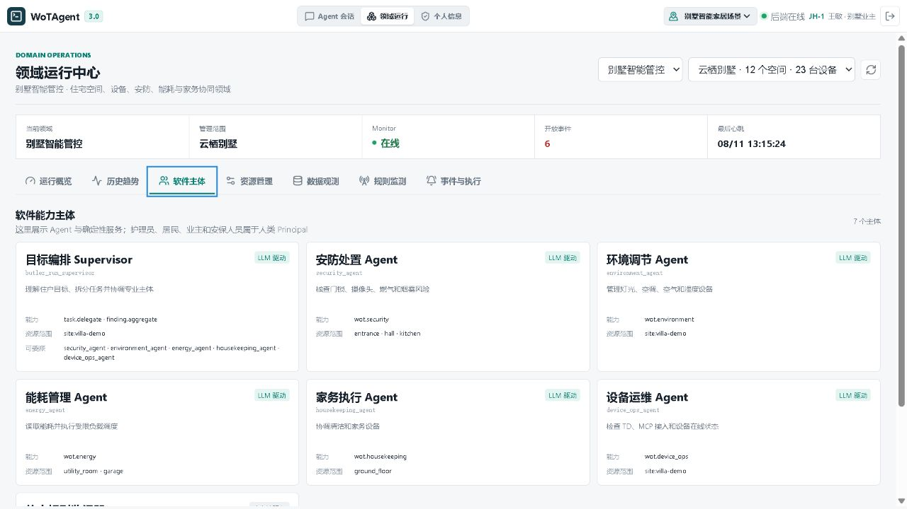

# WoTAgent

当前发布基线：`v2.8.0`；当前实现目标：`v3.0.0`。

WoTAgent 是一个面向实验验证的 LLM + WoT 多领域物联网智能体平台。LLM
负责理解目标、生成结构化 Task、选择专业 Agent，并根据新证据二次决策；
Principal 授权、DAG 调度、确认、TD 校验、MCP 执行、状态验证与有限恢复由
确定性代码负责。

## 界面预览

### Agent 任务工作台

登录后根据当前 Principal、领域角色与资源关系展示可执行任务，支持文本、语音、
电话模式和深度思考。


### 多 Agent 任务 DAG 与运行 Trace

一次用户请求可以形成多个并行或串行 Task。时间线展示 Supervisor 决策、执行波次、
专业 Agent、依赖关系、Token、工具调用、总耗时与费用。


<details>
<summary>查看静态 Trace 截图</summary>


</details>

### Villa 领域的软件能力主体

Deployment Profile 决定当前场景启用的专业 Agent 与资源范围；人类 Principal、
软件 Agent 和确定性 Monitor 在界面中明确区分。




### Principal 与角色入口

演示账号展示护理员、观察者、居民、管理员等身份，以及与居民或场景资源的关系。


## 核心链路

```text
Vue 3 Console
  -> FastAPI Run API
  -> RunService
  -> Python RunCoordinator
  -> Butler create_agent SupervisorDecision
  -> deterministic TaskScheduler
  -> Health/Care create_agent | Device specialist LangGraph
  -> Principal scope -> AgentSpec/MCP scope -> TD/Policy
  -> MCP execution -> post-action verification
  -> wot-device-simulator / SimuHome gateway / ESP32 adapter
```

关键原则：

- LLM 是语义决策核心，但不直接驱动硬件。
- 普通聊天和 Monitor 事件都进入 Run，并由 Butler 负责目标解析与专业 Agent
  委派。
- 一个 Run 可包含多个有依赖关系的 Task；同一 Agent 可执行多个独立 AgentRun。
- Health/Care 使用受限 ReAct，设备专业 Agent 使用 LangGraph 子图。
- Supervisor、Finding 和设备 Planner 输出均受 Pydantic Schema 约束。
- Executor 是确定性编排器，只执行计划中且 TD 已声明的动作。
- PolicyEngine 在模型之外执行 RBAC 和高风险确认。
- 每个 Run 生成可重放事件和按需 TraceArtifact，记录节点、工具输入输出、循环、
  Token、总耗时与可配置费用；非流式 `ainvoke` 没有真实 TTFT 时标记为不可用。
- SQLite 分别保存会话、Run/Task 运行记录和 LangGraph checkpoint，支持上下文延续与服务重启后的确认恢复。

## 仓库结构

```text
WoTAgent/
├── wotagent-prototype/              # Agent 后端与评测
│   ├── src/wotagent/agents/         # AgentSpec、Supervisor、Health/Care
│   ├── src/wotagent/agent_graph/    # 设备专业 Agent LangGraph
│   ├── src/wotagent/orchestration/  # Run/Task 模型、Coordinator、Scheduler
│   ├── src/wotagent/domains/        # eldercare / smart_home 领域适配
│   ├── src/wotagent/policy/         # RBAC 与确认策略
│   ├── src/wotagent/gateway/        # MCP 与 SimuHome 网关
│   └── src/wotagent/evaluation/     # HomeBench/SimuHome 对齐评测
├── frontend/wotagent-v2-console/    # 独立 Vue 3 运行监控台
└── wot-device-simulator/            # TD、MCP、REST 与设备状态仿真
```

1.0 已由 Git tag `v1.0.0` 和 `main` 历史保存；当前分支不再保留旧 ReAct、EventBus、轮询感知、旧 Session Memory 与旧 Vue 前端。

## 本地启动

Windows 下推荐直接双击仓库根目录中的统一入口：

```text
start-wotagent.bat         启动完整本地服务栈
start-wotagent-safe.bat    安全模式，不把 Monitor 事件提交给大模型
start-wotagent-remote.bat  启动服务栈并创建临时 Cloudflare 公网隧道
status-wotagent.bat        查看进程和健康状态
stop-wotagent.bat          停止服务栈并关闭 Tailscale Serve
```

统一脚本依次启动仿真端（`18080`）、Agent API（`8000`）、独立 Monitor
进程和 Vue 前端（`5174`）。PID 与日志保存在
`%LOCALAPPDATA%\WoTAgent\stack`，不会写入项目仓库。

手机访问时双击 `start-wotagent-remote.bat`，窗口会输出临时
`trycloudflare.com` 地址。当前实验 API 没有真实鉴权，因此该地址仅用于短时
测试；测试完成后应立即双击 `stop-wotagent.bat`。如需 Tailscale 私网方式，
可在 PowerShell 中执行 `scripts\wotagent-stack.ps1 private`。

### 1. 仿真端

```powershell
cd D:\Users\gyq16\Desktop\PRJ\WoTAgent\wot-device-simulator
.\.venv\Scripts\python.exe -m wot_device_simulator.service
```

控制面板：`http://127.0.0.1:18080/dashboard`，MCP：`http://127.0.0.1:18080/mcp`。

默认 stdio 模式下，Agent 也可以自动启动 MCP 子进程，此时不必先启动 HTTP 仿真端。若使用 HTTP：

```env
MCP_TRANSPORT_MODE=http
MCP_SERVER_URL=http://127.0.0.1:18080/mcp
```

### 2. Agent 后端

在 `wotagent-prototype/.env` 配置：

```env
LLM_MODEL=deepseek-chat
OPENAI_BASE_URL=https://api.deepseek.com
OPENAI_API_KEY=your-key
ENABLE_THINKING=true
ENABLE_STREAMING=true
```

启动：

```powershell
cd D:\Users\gyq16\Desktop\PRJ\WoTAgent\wotagent-prototype
.\.venv\Scripts\python.exe -m wotagent.cli api --host 127.0.0.1 --port 8000
```

API 文档：`http://127.0.0.1:8000/docs`。

### 3. Vue 前端

```powershell
cd D:\Users\gyq16\Desktop\PRJ\WoTAgent\frontend\wotagent-v2-console
npm install
npm run dev
```

访问 Vite 输出的地址，默认配置为 `http://localhost:5174`。

## 验证

```powershell
cd wotagent-prototype
.\.venv\Scripts\python.exe -m pytest -q

cd ..\frontend\wotagent-v2-console
npm test
npm run build

cd ..\..\wot-device-simulator
.\.venv\Scripts\python.exe -m pytest -q
```

推荐阅读：

- [文档索引与版本状态](doc/README.md)
- [面试表达与多主体抽象](doc/WOTAGENT_INTERVIEW_AND_AGENT_ABSTRACTION_GUIDE.md)
- [当前真实技术地图](doc/TECHNICAL_GUIDE.md)
- [Run / Task DAG 设计](doc/WOTAGENT_RUN_TASK_DAG_DESIGN.md)
- [TD / MCP 契约](doc/WOTAGENT_2.0_TD_MCP_CONTRACT.md)
- [API 指南](doc/API_GUIDE.md)

旧的完整技术指南保留为历史设计材料；当前架构事实以
[TECHNICAL_GUIDE.md](doc/TECHNICAL_GUIDE.md) 和实际代码为准。
