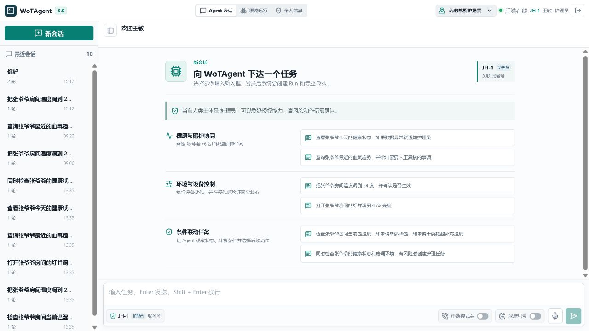
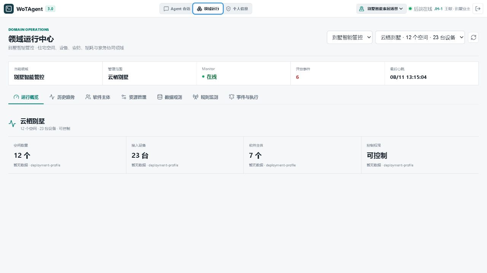
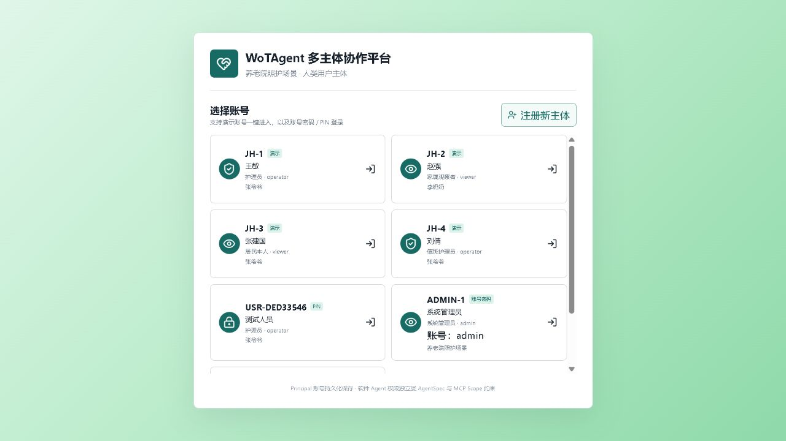
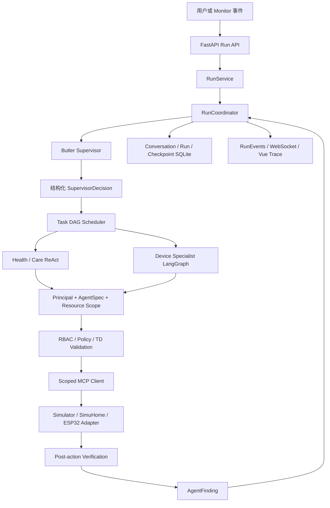
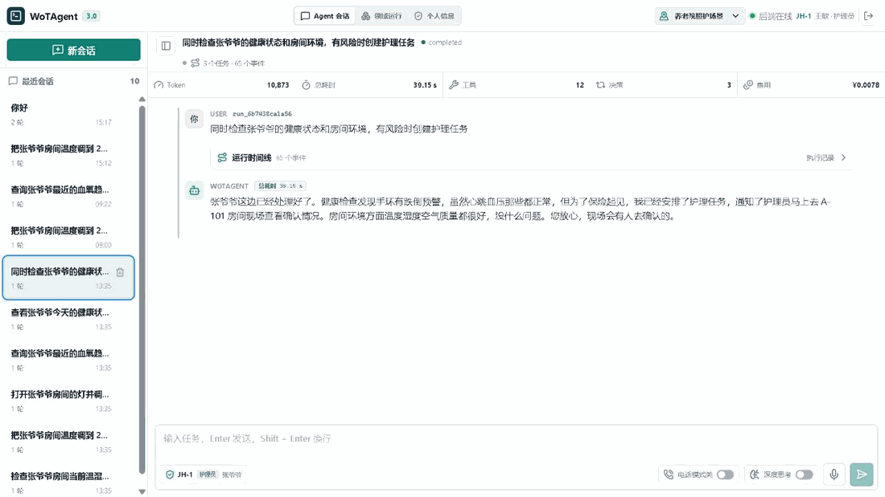
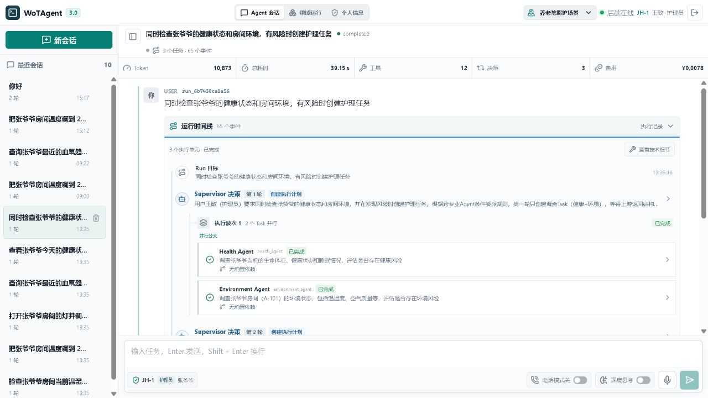

<div align="center">
  <h1>WoTAgent</h1>

  <p><strong>面向真实物联网任务的多 Agent 管控与可观测执行平台</strong></p>
  <p>让 LLM 负责理解目标、拆分任务和动态委派，让确定性系统负责权限、设备约束、执行与验证。</p>

  <p>
    
    
    
    
    
    
  </p>
</div>

> WoTAgent 是一个实验型 AI + IoT 工程项目。当前稳定实验基线为 `v3.0.1`。
> 项目重点不是让大模型绕过规则直接控制设备，而是在可审计、可授权、
> 可验证的边界内，将设备操作升级为目标驱动的多 Agent 协作。

## 为什么做这个项目

传统智能家居通常要求用户精确选择设备并执行固定动作；通用 LLM 虽然能理解自然语言，
却不能天然保证权限正确、参数合法、动作真正生效，也不适合直接接收高频传感器数据。

WoTAgent 尝试解决三个问题：

- **统一设备能力**：使用 WoT Thing Description 描述属性、动作、事件和参数约束，
  再编译为 MCP Resource / Tool。
- **组织复杂任务**：一次请求可以形成多个有依赖关系的 Task，由 Supervisor 选择专业
  Agent，并由调度器决定串行、并行或等待。
- **约束模型行为**：LLM 决定“做什么和下一步是什么”，RBAC、Resource Scope、TD、
  Policy、确认与执行后验证决定“能不能做、怎么安全地做”。

## 产品体验

### Agent 任务工作台

对话不是一个黑盒请求。每轮消息会形成独立 Run，前端同时展示最终回答、任务状态、
Token、耗时、工具调用以及可展开的运行 Trace。当前 Principal、领域角色和资源关系会
随会话一起显示。

<p align="center">
  
</p>

### 领域运行中心

平台能力与具体领域分层。Deployment Profile 决定当前运行在 Villa 还是养老照护场景，
并限定可见空间、设备、软件 Agent、Monitor 规则与提示词上下文。

<p align="center">
  
</p>

### Principal 与资源关系

用户身份与软件 Agent 是两类主体。前端展示人类 Principal 的角色、岗位或照护关系；
后端将这些关系转换为任务可用的 Capability 与 Resource Scope，而不是只依赖一个
`viewer/operator/admin` 标签。

<p align="center">
  
</p>

## 核心能力

| 能力 | 当前实现 |
|---|---|
| 目标驱动 Supervisor | LangChain `create_agent` 输出结构化决策，创建、补充或结束 Task |
| Run / Task DAG | `Conversation → Turn → Run → Task → AgentRun → Loop / ToolCall` |
| 有限并行 | 根据依赖、资源读写声明、冲突和并发上限选择执行波次 |
| 专业 Agent | Health、Care 使用受限 ReAct；Environment、Security、Energy、Housekeeping、DeviceOps 使用设备 LangGraph |
| WoT / MCP | TD 编译 MCP 能力，Scoped MCP Client 限制 Agent 可见资源和工具 |
| 执行安全 | Principal、RBAC、Resource Scope、Policy、TD 参数校验和高风险确认 |
| 结果验证 | 写操作后读取设备状态，区分调用成功与目标真正完成 |
| Monitor | 独立确定性服务持续接收或轮询数据，按规则产生领域事件并提交 Run |
| 持久化 | SQLite 保存会话、Run、Task、事件和 LangGraph checkpoint |
| 可观测性 | Run 事件流、嵌套 Trace、模型使用量、工具输入输出、耗时和可配置费用 |
| 多领域 | `smart_home` 与 `eldercare` 复用平台能力，通过 Deployment Profile 装配 |
| 仿真与评测 | 统一设备 Simulator，并保留 HomeBench / SimuHome 对齐评测入口 |

## 系统架构



当前外层 Run 生命周期由 Python `RunCoordinator` 驱动，并不是一个完全统一的
LangGraph 主图；专业设备 Agent 使用 LangGraph 子图，高风险操作通过原生
`interrupt()` 与 `Command(resume=...)` 恢复。这一边界在 README 中明确保留，避免把
“使用了 LangGraph”描述成“所有调度都由 LangGraph 完成”。

## 一次请求如何执行

例如：

> 同时检查张爷爷的健康状态和房间环境，有风险时创建护理任务。

Supervisor 第一轮创建 Health 与 Environment 两个无冲突 Task，调度器并行执行；
新证据表明需要人工处置后，Supervisor 第二轮再创建依赖前述结果的 Care Task，最终
汇总成功条件并结束 Run。

<p align="center">
  
</p>

<details>
<summary>查看完整静态 Trace</summary>

<p align="center">
  
</p>

</details>

这段执行体现了三个不同层次：

```text
Run                 一次用户目标或领域事件
├── Task Wave 1     Health Agent 与 Environment Agent 并行调查
├── Supervisor      根据 AgentFinding 再次判断
├── Task Wave 2     Care Agent 串行执行后续处置
└── Finish          检查成功条件并生成最终答复
```

## WoT 设备链路

```text
Device / Simulator
  → Device Registry
  → WoT Thing Description
  → TD Parser & Tool Compiler
  → MCP Resource / Tool Schema
  → AgentSpec-scoped MCP Client
  → Policy / RBAC / Parameter Validation
  → Execute
  → Read-after-write Verification
```

TD 是设备能力契约，不是给模型阅读的一段说明文字。它限定属性是否可读写、动作名称、
参数类型与范围；Agent 只能调用当前 AgentSpec 和 Principal Scope 共同允许的 MCP 能力。

## 领域与主体模型

平台把“谁在使用系统”和“哪个软件 Agent 执行任务”分开建模：

| 概念 | 示例 | 作用 |
|---|---|---|
| Principal | 业主、护理员、观察员、管理员 | 请求发起者与授权主体 |
| Role / Relationship | `operator`、照护关系、区域责任 | 产生基础能力与资源关系 |
| Deployment Profile | Villa、养老照护 | 选择领域、空间、设备、Agent 与上下文 |
| Specialist Agent | Health、Care、Environment、Security | 在有限能力范围内完成专业任务 |
| Monitor | 健康阈值、跌倒、环境规则 | 无需 LLM 的持续监测和事件触发 |
| Resource | 居民、房间、灯、空调、传感器 | 被读取或控制的受保护对象 |

Villa 与养老照护不是两套独立平台：它们复用 Run、Task、Agent、Policy、TD、MCP、
Monitor 和 Trace 基础设施，只在领域实体、规则、设备集合、专业能力与提示词上下文上装配
不同实现。

## 快速开始

### 环境要求

- Windows 10 / 11
- Python 3.11+
- Node.js 20+
- 一个 OpenAI-compatible LLM Provider

在 `wotagent-prototype/.env` 中至少配置：

```env
LLM_MODEL=deepseek-chat
OPENAI_BASE_URL=https://api.deepseek.com
OPENAI_API_KEY=your-key
AGENT_DECISION_MODE=hybrid
```

首次安装：

```powershell
git clone https://github.com/GoldenGYQ/WoTAgent.git
cd WoTAgent

# Agent API 与 Monitor
cd wotagent-prototype
python -m venv .venv
.\.venv\Scripts\python.exe -m pip install -e .
Copy-Item .env.example .env

# Device Simulator
cd ..\wot-device-simulator
python -m venv .venv
.\.venv\Scripts\python.exe -m pip install -e .

# Vue Console
cd ..\frontend\wotagent-v2-console
npm install
cd ..\..
```

编辑 `wotagent-prototype/.env` 后，在仓库根目录运行：

```powershell
.\start-wotagent.bat
```

统一入口会启动：

| 服务 | 默认地址 | 职责 |
|---|---|---|
| Device Simulator | `http://127.0.0.1:18080` | TD、MCP、REST 与模拟设备状态 |
| Agent API | `http://127.0.0.1:8000` | Run、Task、Agent、领域与事件 API |
| Monitor | 独立后台进程 | 采集数据、执行规则、产生领域事件 |
| Vue Console | `http://127.0.0.1:5174` | 对话、领域中心与运行 Trace |

常用入口：

```text
start-wotagent.bat         启动完整本地服务栈
start-wotagent-safe.bat    启动但不把 Monitor 事件提交给 LLM
status-wotagent.bat        查看进程、端口和健康状态
stop-wotagent.bat          停止全部服务和临时隧道
```

<details>
<summary>查看各服务的手动启动方式</summary>

```powershell
# Device Simulator
cd wot-device-simulator
.\.venv\Scripts\python.exe -m wot_device_simulator.service

# Agent API
cd ..\wotagent-prototype
.\.venv\Scripts\python.exe -m wotagent.cli api --host 127.0.0.1 --port 8000

# Vue Console
cd ..\frontend\wotagent-v2-console
npm install
npm run dev
```

</details>

> 当前实验 API 没有生产级登录鉴权。不要把 Vite 代理或 Agent API 裸露到公网；临时测试
> 完成后应立即执行 `stop-wotagent.bat`。

## 如何体验

### Villa 场景

```text
打开客厅灯并调到 45%，然后确认是否生效
检查所有灯，若开灯数量为奇数则打开空调，否则打开加湿器
同时检查房间环境和安防状态，只处理真正异常的项目
```

### 养老照护场景

```text
查看张爷爷今天的健康状态，并说明证据是否足够新鲜
同时检查张爷爷的健康状态和房间环境，有风险时创建护理任务
查询李奶奶最近的血氧趋势，不要做疾病诊断
```

还可以在领域运行中心主动触发血氧过低、疑似跌倒、温度异常等模拟事件，观察 Monitor
如何生成 Run，以及 Health、Environment、Care Agent 如何接力处置。

## 仓库结构

```text
WoTAgent/
├── wotagent-prototype/
│   ├── src/wotagent/agents/          # Supervisor、AgentSpec 与专业 Agent
│   ├── src/wotagent/orchestration/   # Run/Task 模型、Coordinator、Scheduler
│   ├── src/wotagent/agent_graph/     # 设备专业 Agent LangGraph
│   ├── src/wotagent/domains/         # eldercare / smart_home 领域插件
│   ├── src/wotagent/identity/        # Principal、角色与关系目录
│   ├── src/wotagent/policy/          # RBAC、Scope 与确认策略
│   ├── src/wotagent/gateway/         # MCP 与外部仿真网关
│   ├── src/wotagent/wot/             # TD 模型与 Tool Compiler
│   └── tests/                        # 单元、集成与可选真实模型测试
├── frontend/wotagent-v2-console/     # Vue 3 Agent 运行控制台
├── wot-device-simulator/             # 统一设备仿真服务
├── scripts/                          # 服务栈启动、状态与停止脚本
└── doc/                              # 架构、API、评测、实验与面试文档
```

## 测试

```powershell
# Backend
cd wotagent-prototype
.\.venv\Scripts\python.exe -m pytest -q

# Frontend
cd ..\frontend\wotagent-v2-console
npm test
npm run build

# Simulator
cd ..\..\wot-device-simulator
.\.venv\Scripts\python.exe -m pytest -q
```

默认测试主要验证确定性组件和 Fake / Scripted LLM 契约。真实模型测试必须显式启用，
并设置调用轮次、Token 与超时预算；Fake LLM 通过不等于真实中文请求链路已经通过。

## 当前边界与路线图

### 已实现

- Run / Task / AgentRun 分层、Task DAG、有限并行与资源冲突检测
- Supervisor 结构化决策与专业 Agent 委派
- TD → MCP 能力链、Policy/RBAC、执行后验证与有限恢复
- Conversation、Run、Event 与 LangGraph checkpoint 持久化
- Villa / 养老照护 Deployment Profile 与独立 Monitor
- Vue 对话工作台、领域运行中心和嵌套 Trace

### 仍在演进

- 外层 `RunCoordinator` 与 LangGraph 主图的职责边界
- Care 与其他专业 Agent 的统一 ReAct / Finding 契约
- 真实模型中文实体解析、失败分类与低成本冒烟测试
- 更完整的 Principal 认证、关系授权与跨居民/跨空间负向测试
- ESP32 等真实设备适配和 Simulator-backed 端到端评测
- RunEvents 对模型 TTFT、专业 Agent Loop 和 ToolCall 的完整投影

## 文档

- [文档索引与版本状态](doc/README.md)
- [当前技术手册](doc/TECHNICAL_GUIDE.md)
- [Run / Task DAG 设计](doc/WOTAGENT_RUN_TASK_DAG_DESIGN.md)
- [TD / MCP 契约](doc/WOTAGENT_2.0_TD_MCP_CONTRACT.md)
- [API 指南](doc/API_GUIDE.md)
- [面试表达与多主体抽象](doc/WOTAGENT_INTERVIEW_AND_AGENT_ABSTRACTION_GUIDE.md)

架构事实以当前代码、自动化测试和 [技术手册](doc/TECHNICAL_GUIDE.md) 为准；历史文档中的
设计目标不自动代表当前版本已经实现。
