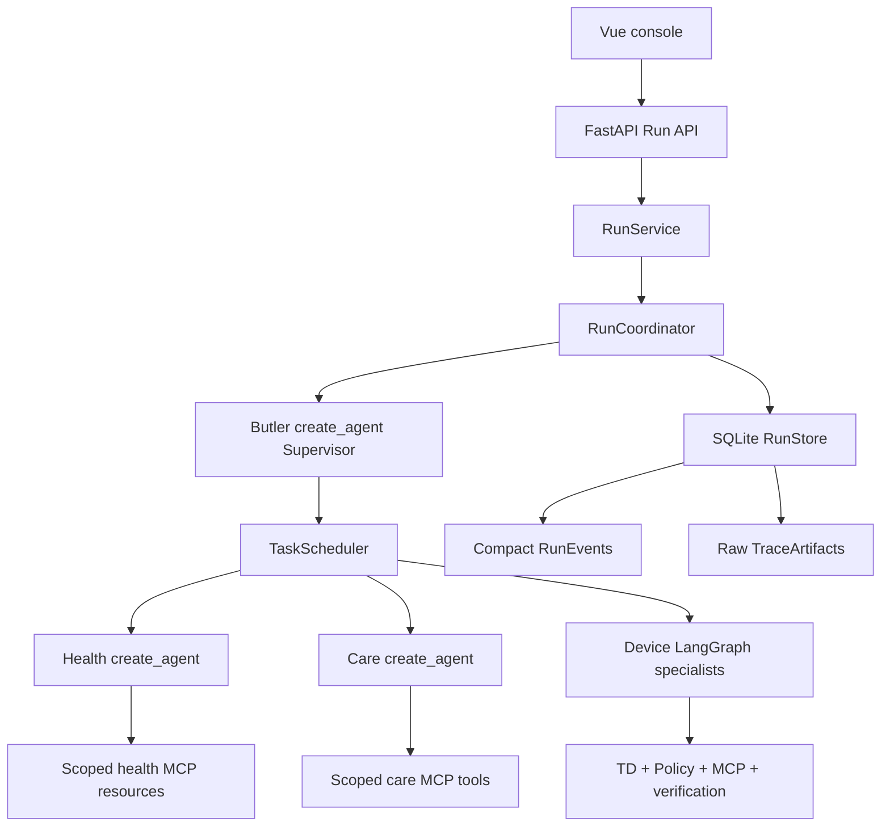

# WoTAgent Current Technical Map

This map describes the active runtime after the 2026-07-21 cleanup. It is a
source guide, not a historical design proposal.

## Runtime hierarchy

```text
Conversation -> Turn -> Run -> Task DAG -> AgentRun -> Loop -> ToolCall
```



## Source map

| Boundary | Source | Responsibility |
|---|---|---|
| HTTP assembly | `wotagent-prototype/src/wotagent/api/app.py` | Compose routers and runtime dependencies |
| Run API | `wotagent-prototype/src/wotagent/api/routers/runs.py` | Run, Task, AgentRun, event and TraceArtifact endpoints |
| Application | `wotagent-prototype/src/wotagent/application/run_service.py` | Conversation/Turn/Run lifecycle |
| Run coordination | `wotagent-prototype/src/wotagent/orchestration/run_coordinator.py` | Supervisor loop, Task execution and completion |
| Scheduling | `wotagent-prototype/src/wotagent/orchestration/scheduler.py` | DAG dependencies, conflicts and bounded parallelism |
| Contracts | `wotagent-prototype/src/wotagent/orchestration/run_models.py` | Run, Task, failure, scope, event and artifact models |
| Persistence | `wotagent-prototype/src/wotagent/orchestration/run_store.py` | SQLite Runs, Tasks, AgentRuns, events and raw artifacts |
| Model assembly | `wotagent-prototype/src/wotagent/core/model_runtime.py` | Planner/response model clients only; no orchestration |
| Supervisor | `wotagent-prototype/src/wotagent/agents/supervisor_agent.py` | Structured Task DAG decisions |
| Agent registry | `wotagent-prototype/src/wotagent/agents/specs.py` | Stable Agent IDs, responsibilities and capability scopes |
| Health specialist | `wotagent-prototype/src/wotagent/agents/health.py` | Bounded ReAct over scoped health resources |
| Care specialist | `wotagent-prototype/src/wotagent/agents/care.py` | Bounded ReAct over scoped care tools |
| Device graph | `wotagent-prototype/src/wotagent/agent_graph/graph.py` | Plan, policy, execute, verify, recover and respond |
| Device Planner | `wotagent-prototype/src/wotagent/agent_graph/planner.py` | LLM TaskPlan generation plus TD/schema validation |
| Device boundary | `wotagent-prototype/src/wotagent/gateway/mcp.py` | TD capability discovery and MCP invocation |
| Resource scope | `wotagent-prototype/src/wotagent/domain/resources.py` | Principal/resource/location to deployment device scope |
| Conversation memory | `wotagent-prototype/src/wotagent/conversation_state.py` | Active goal, entities, verified facts and last outcome |
| Domain contract | `wotagent-prototype/src/wotagent/domain/operations.py` | DomainPlugin interface and registry |
| Eldercare plugin | `wotagent-prototype/src/wotagent/domains/eldercare/operations.py` | Eldercare operational projection |
| Smart-home plugin | `wotagent-prototype/src/wotagent/domains/smart_home/operations.py` | Villa/smart-home operational projection |
| Frontend | `frontend/wotagent-v2-console` | Conversation, focused trace and domain console |
| Simulator | `wot-device-simulator` | TD registry, MCP tools and simulated device state |

## Important boundaries

- `smart_home` and `eldercare` are domains. `villa` and the nursing-home demo
  are deployment profiles of those domains.
- Human Principals are not software Agents. Authorization is computed before a
  Task runs and is checked again at MCP/resource boundaries.
- The Supervisor may propose concrete resource claims. Claims can narrow an
  authorized scope but can never add a device to it.
- Hybrid Planner semantics are LLM-driven. The deterministic layer validates
  Agent scope, TD device/action/parameter contracts, Policy and verification.
- A graph reaching its response node is not proof that a delegated Task
  completed. Device action/query Tasks require execution evidence.
- RunEvents remain compact for WebSocket/UI use. Raw prompts, responses and
  tool payloads are stored separately as TraceArtifacts and fetched only on
  demand.

## Removed legacy entry points

- `core/pipeline.py` was replaced by `core/model_runtime.py` because it only
  assembled model clients.
- `orchestration/task_runner.py` and the old top-level `supervisor.py` were
  removed after confirming they had no production callers.
- The production Care Task path no longer uses `EldercareChatAgent`; it now
  uses the same scoped specialist contract as Health.

The active HTTP surface is `/api/v2/*` plus `/api/health`; the active event
socket is `/ws/v2`.
