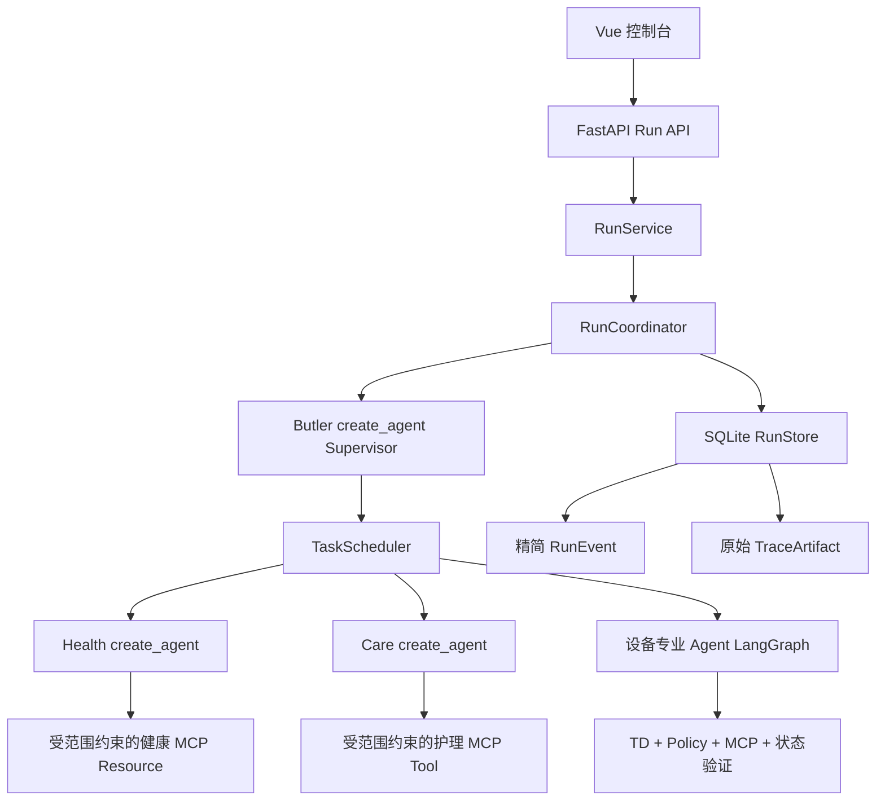

# WoTAgent 当前技术地图

状态：当前实现说明

最后核对：2026-11-09

发布基线：`v3.0.1`；下一阶段目标：真实模型链路复验、P1 资源级授权完善与运行稳定性提升

本文描述 2026-07-21 运行时整理及 2026-07-23 风险分类、调度更新后的真实
代码结构，不是历史设计方案。文档状态和阅读顺序见
[`README.md`](README.md)。

## 运行层级

```text
Conversation -> Turn -> Run -> Task DAG -> AgentRun -> Loop -> ToolCall
```



## 源码地图

| 边界 | 源码 | 职责 |
|---|---|---|
| HTTP 装配 | `wotagent-prototype/src/wotagent/api/app.py` | 组合路由与运行时依赖 |
| Run API | `wotagent-prototype/src/wotagent/api/routers/runs.py` | Run、Task、AgentRun、事件和 TraceArtifact 接口 |
| 应用层 | `wotagent-prototype/src/wotagent/application/run_service.py` | Conversation、Turn、Run 生命周期 |
| Run 编排 | `wotagent-prototype/src/wotagent/orchestration/run_coordinator.py` | Supervisor 循环、Task 执行和结束判定 |
| 调度 | `wotagent-prototype/src/wotagent/orchestration/scheduler.py` | DAG 依赖、资源冲突和有限并行 |
| 数据契约 | `wotagent-prototype/src/wotagent/orchestration/run_models.py` | Run、Task、失败、Scope、事件和 Artifact 模型 |
| 持久化 | `wotagent-prototype/src/wotagent/orchestration/run_store.py` | SQLite Run、Task、AgentRun、事件和 Artifact |
| 模型装配 | `wotagent-prototype/src/wotagent/core/model_runtime.py` | Planner/Response 模型客户端，不承担编排 |
| Supervisor | `wotagent-prototype/src/wotagent/agents/supervisor_agent.py` | 生成结构化 Task DAG 决策 |
| Agent 注册表 | `wotagent-prototype/src/wotagent/agents/specs.py` | 稳定 Agent ID、职责和能力范围 |
| Health | `wotagent-prototype/src/wotagent/agents/health.py` | 在健康 Resource 范围内执行有限 ReAct |
| Care | `wotagent-prototype/src/wotagent/agents/care.py` | 在护理 Tool 范围内执行有限 ReAct |
| 设备图 | `wotagent-prototype/src/wotagent/agent_graph/graph.py` | 规划、策略、执行、验证、恢复和回复 |
| 设备 Planner | `wotagent-prototype/src/wotagent/agent_graph/planner.py` | 生成 TaskPlan，并执行 TD/Schema 校验 |
| 设备边界 | `wotagent-prototype/src/wotagent/gateway/mcp.py` | 发现 TD 能力并调用 MCP |
| 资源范围 | `wotagent-prototype/src/wotagent/domain/resources.py` | 从 Principal、资源、位置计算设备范围 |
| 对话记忆 | `wotagent-prototype/src/wotagent/conversation_state.py` | 活跃目标、实体、已验证事实和最近结果 |
| 领域契约 | `wotagent-prototype/src/wotagent/domain/operations.py` | DomainPlugin 接口和注册表 |
| 养老领域 | `wotagent-prototype/src/wotagent/domains/eldercare/operations.py` | 养老领域运行投影 |
| 智能家居领域 | `wotagent-prototype/src/wotagent/domains/smart_home/operations.py` | 别墅/智能家居运行投影 |
| 前端 | `frontend/wotagent-v2-console` | 对话、聚焦 Trace 和领域运行中心 |
| 仿真端 | `wot-device-simulator` | TD 注册、MCP Tool 和模拟设备状态 |

## 关键边界

- `smart_home` 和 `eldercare` 是 Domain；`villa` 和养老院演示是 Deployment
  Profile。
- Human Principal 不是 Software Agent。Task 执行前计算授权，MCP/Resource
  边界再次校验。
- Supervisor 可以提出具体 Resource Claim，但只能收窄后端授权范围，不能增加
  新资源。
- Hybrid 模式下的语义规划由 LLM 负责；Agent Scope、TD、参数、Policy 和验证由
  确定性程序负责。
- 图到达 Response 节点不等于 Task 完成。设备控制和查询必须有真实执行证据。
- 同一个 AgentSpec 可以执行多个 Task。每个 Task 产生独立 AgentRun；安全的
  只读 Task 可以并行，依赖和资源写冲突由 Scheduler 串行化。
- 风险分类和状态迁移属于确定性领域逻辑。养老事件支持：

```text
open -> acknowledged -> in_progress -> resolved | false_positive
```

- RunEvent 用于 WebSocket 和界面展示，保持精简；大模型输入输出和工具大载荷
  单独保存为 TraceArtifact，按需读取。

## 当前验证

2026-07-24 最新完整回归：

```text
后端：273 passed, 3 skipped
仿真端：64 passed
前端：45 passed，typecheck/build 通过
```

当前目录存在一个明确缺口：养老 Profile 配置了 16 个设备 ID，但只有 15 个
设备存在 TD，`purifier-102` 暂缺 TD；别墅 Profile 配置的 23 个设备均有 TD。

### 4.3 Villa 场景执行边界

Villa 领域场景分为 `agent_run` 与 `direct_simulation`：

- `agent_run` 只声明目标和场景上下文，经 `RunService` 进入统一 Run/Task 生命周期；
- `direct_simulation` 只向仿真设备写入确定性数据，用于触发 Monitor 规则。

安防巡检、离家、回家、全屋体检和节能评估属于 `agent_run`。烟雾告警与能耗峰值
属于 `direct_simulation`。专业 Agent 的实际数量、依赖和并行关系由 Supervisor
与 Scheduler 决定，领域插件不得直接替代 Agent 调用设备。

## 已删除的旧入口

- `core/pipeline.py` 已由 `core/model_runtime.py` 替代。旧文件实际只负责模型
  客户端装配，不应被称为 Pipeline。
- `orchestration/task_runner.py` 和旧顶层 `supervisor.py` 在确认无生产调用后
  删除。
- Care 生产路径不再使用 `EldercareChatAgent`，而是与 Health 一样使用受限
  Specialist 契约和 Scoped MCP。

当前 HTTP 主接口为 `/api/v2/*` 和 `/api/health`，事件 WebSocket 为 `/ws/v2`。

## 领域抽象与统一运行链

养老和 Villa 不是两套智能体平台，而是同一平台上的两个 Deployment Profile。
二者复用以下平台能力：

```text
Principal / Authorization
AgentRegistry / AgentSpec
Supervisor / TaskScheduler
Run / Task / AgentRun
DomainEventEnvelope / Outbox
MCP Scope / TD / Policy / Verification
Trace / Checkpoint / Persistence
```

领域包只负责提供本领域内容：

```text
领域实体与名称解析
确定性监测规则
事件上下文
场景入口
资源映射
Profile 启用的专业 Agent 集合
```

因此，切换到 Villa 不会创建一套新的 Supervisor、Scheduler 或 Trace；切换到养老
也不会让平台核心理解“老人”这一专用概念。养老通过
`EldercareDomainEventSource` 把既有 RiskEvent 转换为平台事件，Villa 原生发布
`DomainEventEnvelope`，二者最终进入同一个消费者：

```text
Monitor 或确定性场景
→ DomainEventStore 持久化事件与 Outbox
→ DomainEventConsumer 领取事件
→ RunService.create_event_run()
→ RunCoordinator
→ Supervisor 决策
→ Task DAG
→ 专业 Agent
→ MCP / TD / Policy / Verification
```

`DomainEventConsumer` 不再包含 resident、risk 或 villa 等领域判断。新增领域只需实现
`DomainEventSource`，无需复制消费者或 Run 创建逻辑。

## Agent Registry 与 Profile 装配

`AgentRegistry` 是专业 Agent 的单一注册入口。每个 `AgentSpec` 声明稳定 ID、运行时
类型、委派能力和 MCP 范围。Deployment Profile 只选择允许启用的 Agent ID：

```text
AgentRegistry
→ Profile 选择 enabled_agents
→ 启动时校验未知 Agent ID
→ 为当前 Profile 构建 Supervisor Agent Catalog
→ Scheduler 只接受已启用 Agent
→ Specialist 只获得 AgentSpec 允许的能力
```

这解决了两个旧问题：

1. `DOMAIN_GRAPH_AGENTS`、Supervisor Catalog 和 API 列表各自维护，容易发生漂移。
2. Villa 请求可能看到养老 Agent，或养老 Profile 引用不存在的 Agent。

Agent Registry 负责“系统有哪些软件能力”，Profile 负责“当前部署启用哪些能力”；
Human Principal、Role 和资源关系仍由身份与授权模块负责，两者不能混为一谈。

## 当前验证基线

2026-07-24 验证结果：

```text
后端：273 passed, 3 skipped
仿真端：64 passed
前端：45 passed
前端 typecheck/build：通过
```

本轮后端和仿真端测试分别使用项目内
`wotagent-prototype/.venv/Scripts/python.exe` 与
`wot-device-simulator/.venv/Scripts/python.exe`。原虚拟环境曾指向已经删除的 UV
基础解释器，现已重新绑定到仓库内 Python 运行时并完成核心依赖导入与全量测试。
