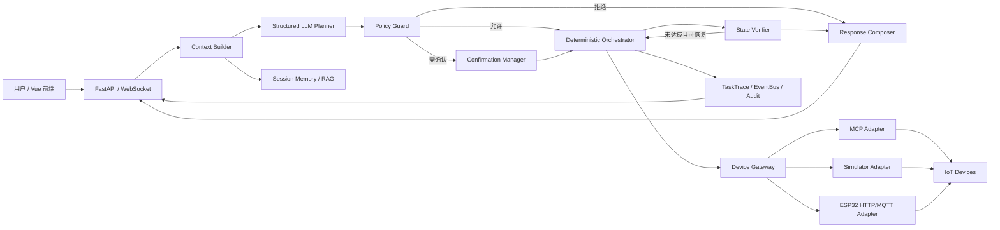
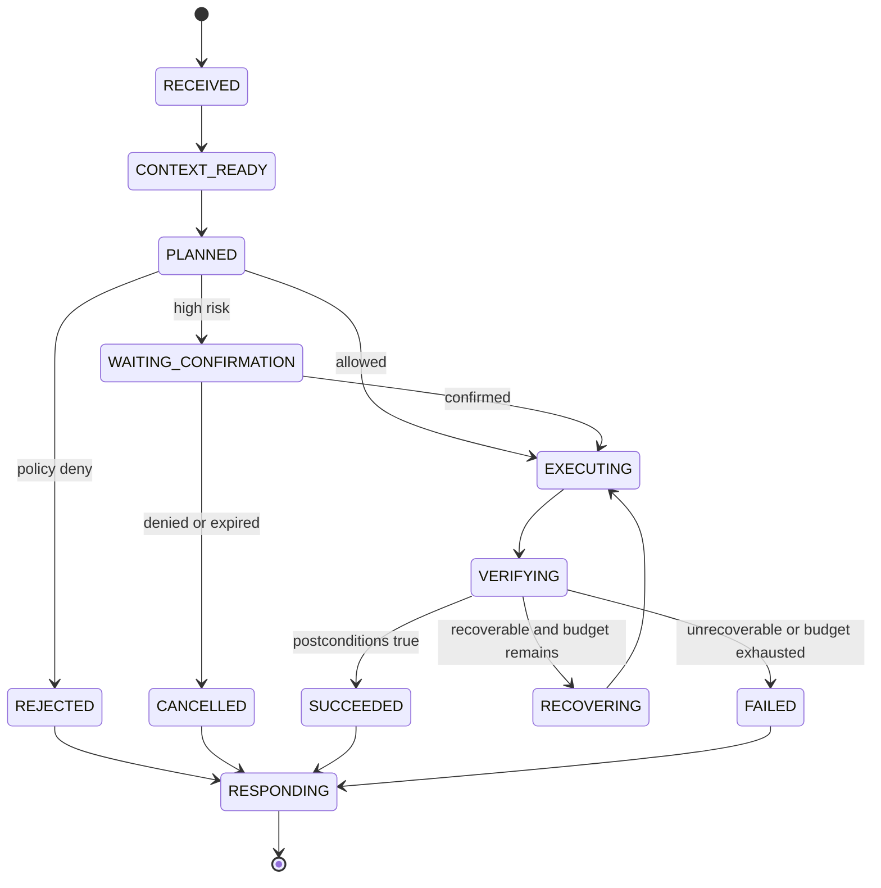

# WoTAgent 2.0 完成态技术文档与面试手册

> 文档性质：目标完成态设计文档。本文假设 WoTAgent 2.0 已按文中方案完成，用于指导重构、验收、演示和面试准备。
>
> 诚信边界：当前 `main` 已具备 WoT TD、角色化智能体流水线、MCP 设备调用、RBAC、RAG、设备模拟器、FastAPI/WebSocket/Vue 等基础能力；本文中的结构化任务协议、确定性编排器、执行后验证、有限恢复、统一 TaskTrace、真实 ESP32 适配器等属于 2.0 完成态目标。面试时只有在对应代码、测试和实验真正完成后，才能将其表述为已实现。

## 目录

1. 项目概述与面试表述
2. 背景、问题与目标
3. 核心设计原则
4. 总体架构
5. 仓库与模块划分
6. 智能体循环设计
7. 核心领域模型
8. 上下文构建与任务规划
9. 策略、安全与 RBAC
10. 确定性任务编排
11. WoT、TD 与设备网关
12. MCP 与设备模拟器
13. ESP32 真实设备接入
14. RAG、记忆与会话
15. 事件、可观测性与前端
16. API 设计
17. 可靠性与安全设计
18. 测试与验收体系
19. 部署与运维
20. 性能与实验评估
21. 技术难点、取舍与创新点
22. 演示脚本
23. 面试问题与参考回答
24. 简历表述建议
25. 局限性与演进路线
26. 术语表

---

## 1. 项目概述与面试表述

### 1.1 一句话介绍

WoTAgent 是一个面向智能家居与物联网场景的、基于大语言模型的安全任务编排平台：它用 WoT Thing Description 统一描述异构设备，以结构化规划将自然语言转换为可审计任务，再通过 RBAC、确定性编排、MCP 设备网关和执行后状态验证完成可靠控制。

### 1.2 30 秒面试版本

项目解决的是“用户说一句自然语言，系统如何安全、可控地操作多种 IoT 设备”。我们没有让 LLM 直接调用设备，而是让它只负责理解意图和生成结构化计划；授权、风险确认、步骤排序、重试和结果判定全部由确定性代码负责。设备侧通过 WoT TD 统一语义，通过 MCP 网关接入模拟器或 ESP32。系统还提供 WebSocket 实时事件、RBAC 权限、RAG 文档检索、会话审计和 Vue 演示平台。

### 1.3 1 分钟面试版本

传统智能家居常依赖固定 App、厂商私有协议或预配置自动化，跨设备协作成本高；直接让 LLM 操作设备又存在幻觉、越权和结果不可验证的问题。WoTAgent 采用分层架构：Context Builder 汇总用户身份、会话、TD 和设备状态；Planner 通过 Function Calling 生成强类型任务计划；Policy Guard 做 RBAC、动作白名单和风险确认；Orchestrator 按依赖图执行；Device Gateway 将统一动作映射到 MCP、模拟器或 ESP32；Verifier 查询设备真实状态判断目标是否达成，并在有限次数内恢复。这样保留了 LLM 的自然语言泛化能力，同时把安全性与可靠性放回传统软件控制面。

### 1.4 3 分钟展开框架

面试介绍建议按以下顺序展开：

1. 业务问题：异构设备、自然语言歧义、权限隔离、执行真实性。
2. 核心观点：LLM 负责语义，确定性系统负责权限与执行真相。
3. 技术链路：自然语言 -> 结构化计划 -> 策略判定 -> 编排执行 -> 状态验证 -> 审计响应。
4. 设备抽象：WoT TD 定义属性、动作和语义，MCP 统一工具调用。
5. 工程保障：类型校验、幂等键、超时重试、有限恢复、事件追踪、测试矩阵。
6. 项目价值：可扩展、可审计、可替换模型、可从模拟器平滑迁移到 ESP32。

### 1.5 我的主要工作

- 参与系统技术方案设计，将 LLM 能力限制在意图理解、任务规划和自然语言响应层。
- 设计多角色协作流程及结构化任务协议，完成上下文、规划、策略、执行、验证与响应的职责拆分。
- 设计自然语言任务拆解逻辑，包括设备解析、动作参数校验、步骤依赖和失败处理。
- 设计 WoT TD 与统一 Device Gateway，使模拟设备和 ESP32 复用相同控制契约。
- 融合 RBAC、MCP、RAG 和 Function Calling，建立控制前授权与控制后验证机制。
- 搭建 FastAPI、WebSocket、Vue 演示平台及任务追踪、日志审计和实验评估流程。

> 不应夸大为“多个完全自治 Agent 自发协商”。本项目更准确的定义是：多个职责角色组成的受控智能体工作流，由确定性状态机统一编排。

---

## 2. 背景、问题与目标

### 2.1 需要解决的问题

物联网自然语言控制并不只是把一句话映射成一个 API。完整系统至少需要处理：

- 同义表达：“打开客厅灯”“把客厅照明开一下”。
- 指代与上下文：“调亮一点”“刚才那个空调关掉”。
- 组合任务：“打开灯并调到 60%，再把空调设为 25 度”。
- 异构协议：HTTP、MQTT、串口、厂商云接口。
- 权限边界：访客只能查询，操作员可以控制，管理员可以配置。
- 高风险动作：门锁、燃气阀、报警器等需要二次确认。
- 设备失败：离线、超时、返回成功但状态未改变。
- 审计要求：谁在何时要求了什么，系统为何执行，最终是否成功。

### 2.2 项目目标

1. 让用户用自然语言查询和控制多类 IoT 设备。
2. 用 TD 消除设备接入层的语义差异。
3. 用结构化任务协议阻断自由文本直接驱动工具。
4. 用 RBAC 与风险策略防止越权和危险误操作。
5. 用执行后状态验证避免“工具返回成功即认为任务成功”。
6. 用统一网关支持模拟器与真实 ESP32 平滑切换。
7. 提供可复现实验、实时演示和完整审计链路。

### 2.3 非目标

- 不让 LLM 直接生成或执行任意代码。
- 不让 LLM 决定用户权限或覆盖策略结果。
- 不把 RAG 检索内容视为可信控制指令。
- 不追求无边界自治和无限循环自我修正。
- 不替代硬件侧必要的电气安全、急停和本地保护机制。

### 2.4 功能需求

| 编号 | 能力 | 示例 |
|---|---|---|
| F-01 | 自然语言聊天 | “你好，你能做什么？” |
| F-02 | 设备发现 | “家里有哪些设备？” |
| F-03 | 状态查询 | “客厅现在多少度？” |
| F-04 | 单设备控制 | “打开客厅灯” |
| F-05 | 复合任务 | “开灯并调到 60%” |
| F-06 | 上下文连续 | “把刚才那个关掉” |
| F-07 | 权限拒绝 | viewer 尝试执行控制 |
| F-08 | 风险确认 | 高风险设备动作二次确认 |
| F-09 | 执行验证 | 查询实际状态确认目标达成 |
| F-10 | 审计回放 | 查看计划、策略、工具和状态变化 |

### 2.5 非功能需求

- 安全：默认拒绝、最小权限、参数白名单、密钥隔离。
- 可靠：超时、重试、幂等、部分失败处理和有限恢复。
- 可解释：每一步都有原因、输入、输出和关联 ID。
- 可扩展：模型、设备协议和存储实现均可替换。
- 可测试：LLM 与设备侧均有可替代假实现。
- 可观测：日志、事件、指标和任务追踪统一关联。

---

## 3. 核心设计原则

### 3.1 LLM 不是控制面

LLM 可以提出“做什么”，但不能决定“是否允许”“是否真的成功”。系统将职责明确分为：

| LLM 负责 | 确定性代码负责 |
|---|---|
| 理解自然语言 | 身份与权限校验 |
| 消解普通歧义 | 风险分级与二次确认 |
| 生成结构化计划 | Schema 校验与动作白名单 |
| 生成易读回复 | 步骤依赖、超时与重试 |
| 结合文档解释设备 | 查询真实状态并判定成功 |

### 3.2 计划与执行分离

Planner 不持有真实设备工具，只输出 `TaskPlan`。Orchestrator 只接受通过 Pydantic 校验和 Policy Guard 审批的计划。由此可以独立测试计划质量和执行正确性。

### 3.3 默认拒绝

设备、动作、参数、用户角色或风险级别无法确认时，系统拒绝执行并返回可操作的澄清信息，而不是猜测。

### 3.4 状态是真相

控制接口返回 `accepted=true` 只表示设备接收请求。任务是否成功必须由 Verifier 查询目标属性并进行断言。

### 3.5 循环有界

恢复循环最多执行固定次数，仅允许使用预定义恢复策略。禁止 LLM 在失败后无限生成新动作。

### 3.6 端到端契约稳定

上层只依赖 Device Gateway，不感知设备是 SQLite 模拟器、MCP 服务、HTTP ESP32 还是 MQTT ESP32。

---

## 4. 总体架构



### 4.1 控制链路

```text
Request
  -> authenticate
  -> build context
  -> classify and plan
  -> validate schema
  -> authorize and assess risk
  -> request confirmation when needed
  -> schedule executable steps
  -> invoke device gateway
  -> verify postconditions
  -> bounded recovery or finish
  -> compose response
  -> persist trace and transcript
```

### 4.2 三个平面

- 交互平面：REST、WebSocket、Vue、会话管理。
- 智能编排平面：上下文、规划、策略、编排、验证、响应。
- 设备平面：TD Registry、Device Gateway、MCP、模拟器、ESP32。

---

## 5. 仓库与模块划分

建议的 2.0 完成态结构：

```text
WoTAgent/
├── wotagent-prototype/
│   ├── src/wotagent/
│   │   ├── api/                 # REST、WebSocket、依赖注入
│   │   ├── application/         # 用例服务与任务入口
│   │   ├── domain/              # TaskPlan、Policy、Execution 等领域模型
│   │   ├── agent/               # Context Builder、Planner、Composer
│   │   ├── orchestration/       # 状态机、调度、恢复、验证
│   │   ├── policy/              # RBAC、风险与确认
│   │   ├── gateway/             # 统一 Device Gateway 与各适配器
│   │   ├── wot/                 # TD 解析、注册、能力索引
│   │   ├── rag/                 # 文档入库与检索
│   │   ├── memory/              # 会话记忆与 transcript
│   │   ├── events/              # EventBus 与 TaskTrace
│   │   └── infrastructure/      # 配置、数据库、日志、模型客户端
│   ├── frontend/wot-vue/
│   └── tests/
├── wot-device-simulator/
│   ├── src/wot_device_simulator/
│   ├── td/
│   └── tests/
├── firmware/esp32/              # ESP32 示例固件
├── contracts/                   # JSON Schema、OpenAPI、MCP 契约
├── scripts/                     # 启动、验收、实验脚本
└── doc/
```

分层约束：domain 不依赖 FastAPI、LangChain 或具体设备协议；application 组织用例；infrastructure 实现外部依赖。这样模型框架或 MCP SDK 变化不会污染核心执行逻辑。

---

## 6. 智能体循环设计

### 6.1 状态机



### 6.2 为什么这比传统 ReAct 循环更合理

纯 ReAct 通常是“思考 -> 工具 -> 观察 -> 再思考”，控制权长期留在模型中。IoT 场景中它有四个问题：工具调用次数不可预测、权限判定易被提示注入影响、成功标准模糊、失败后可能产生危险补偿动作。

2.0 使用“单次结构化规划 + 确定性执行 + 有界恢复”。模型没有任意循环权，执行轨迹可以复现，策略和验证可以单测。

### 6.3 示例：打开客厅灯并调到 60%

用户输入：`把客厅灯打开并调到 60%`

Planner 输出：

```json
{
  "intent": "control",
  "summary": "打开客厅灯并设置亮度为 60%",
  "steps": [
    {
      "id": "s1",
      "device_id": "light-001",
      "action": "turnOn",
      "input": {},
      "depends_on": [],
      "postconditions": [{"property": "on", "operator": "eq", "value": true}]
    },
    {
      "id": "s2",
      "device_id": "light-001",
      "action": "setBrightness",
      "input": {"brightness": 60},
      "depends_on": ["s1"],
      "postconditions": [{"property": "brightness", "operator": "eq", "value": 60}]
    }
  ]
}
```

执行过程：operator 权限通过；两个动作均为低风险；编排器先执行 `s1`，再执行 `s2`；Verifier 查询 `on=true` 且 `brightness=60`；最后回复“客厅灯已打开，亮度为 60%”。

### 6.4 三种不进入执行的情况

- 信息不足：存在两个“客厅灯”，要求用户澄清。
- 权限不足：viewer 控制设备，直接拒绝，不调用工具。
- 高风险未确认：控制燃气阀，生成一次性确认令牌并暂停任务。

---

## 7. 核心领域模型

### 7.1 TaskRequest

```python
class TaskRequest(BaseModel):
    request_id: str
    session_id: str
    user_id: str
    role: Literal["viewer", "operator", "admin"]
    message: str
    locale: str = "zh-CN"
    idempotency_key: str | None = None
```

### 7.2 TaskPlan

```python
class TaskPlan(BaseModel):
    plan_id: str
    intent: Literal["chat", "query", "control", "clarify"]
    summary: str
    assumptions: list[str]
    steps: list[PlanStep]
    response_hint: str | None
```

### 7.3 PlanStep

```python
class PlanStep(BaseModel):
    id: str
    kind: Literal["query", "action"]
    device_id: str
    action: str
    input: dict[str, Any]
    depends_on: list[str]
    timeout_ms: int = 5000
    retry_policy: RetryPolicy
    postconditions: list[Condition]
```

### 7.4 策略与执行结果

```python
class PolicyDecision(BaseModel):
    effect: Literal["allow", "deny", "confirm"]
    reason_code: str
    reason: str
    risk_level: Literal["low", "medium", "high", "critical"]

class ExecutionResult(BaseModel):
    step_id: str
    status: Literal["accepted", "failed", "timeout", "skipped"]
    adapter: str
    raw_result: dict[str, Any]
    started_at: datetime
    finished_at: datetime

class VerificationResult(BaseModel):
    step_id: str
    passed: bool
    observed_state: dict[str, Any]
    failed_conditions: list[str]
```

### 7.5 TaskTrace

TaskTrace 是一次任务的统一事实记录，至少包含：请求、上下文摘要、模型版本、Prompt 版本、计划、策略判定、确认记录、每次工具调用、状态快照、恢复动作、最终状态和耗时。敏感信息在持久化前脱敏。

---

## 8. 上下文构建与任务规划

### 8.1 Context Builder 输入

- 用户身份、角色与租户。
- 最近 N 轮对话及上一个活动设备。
- 可访问设备列表和对应 TD 能力摘要。
- 必要的实时状态，不把全部状态无差别塞入 Prompt。
- RAG 检索到的使用说明或故障文档。
- 当前时间、地点和环境事件。

### 8.2 能力压缩

设备较多时不向模型发送完整 TD。系统先建立 capability index，再按房间、设备类型和用户文本召回相关设备，只注入动作名、参数 Schema、关键属性和权限标签。

### 8.3 Planner 输出约束

- 只能引用上下文中存在的 `device_id`。
- 只能选择 TD 声明的 action/property。
- 参数必须通过 JSON Schema。
- 不允许输出 shell、URL 或任意函数名。
- 有歧义时输出 `clarify`，不能自行挑选高风险设备。
- Planner 输出解析失败时最多修复一次，仍失败则安全终止。

### 8.4 Prompt 设计

Prompt 分为固定系统规则、动态设备能力和会话上下文。固定规则做版本控制；设备返回值被标为不可信数据，防止设备名称或 RAG 文档中的提示注入改变系统规则。

### 8.5 意图连续性

ConversationState 保存 `last_device_ids`、`last_intent`、`pending_confirmation` 和 `active_task_id`。例如用户先问“客厅灯亮度是多少”，再说“调高一点”，系统可引用上一设备；若上下文超过有效期则重新澄清。

---

## 9. 策略、安全与 RBAC

### 9.1 默认角色

| 角色 | 查询设备 | 控制普通设备 | 配置规则 | 管理用户 | 高风险控制 |
|---|---:|---:|---:|---:|---:|
| viewer | 是 | 否 | 否 | 否 | 否 |
| operator | 是 | 是 | 否 | 否 | 需确认/按策略 |
| admin | 是 | 是 | 是 | 是 | 需确认 |

### 9.2 策略判定顺序

1. 用户和会话是否有效。
2. 用户是否拥有设备所在资源域权限。
3. 动作是否存在于 TD 和工具白名单。
4. 参数是否满足类型、范围和业务约束。
5. 设备是否在线、是否处于可操作状态。
6. 动作风险是否需要确认或禁止远程执行。
7. 时间、地点、频率等上下文策略是否通过。

### 9.3 Viewer 拒绝示例

viewer 请求“把卧室空调打开”。Policy Guard 返回：

```json
{
  "effect": "deny",
  "reason_code": "RBAC_ACTION_DENIED",
  "reason": "viewer 仅具有设备读取权限",
  "risk_level": "low"
}
```

系统不调用任何设备工具，并将拒绝事件写入审计日志。

### 9.4 高风险确认

以燃气阀关闭为例：系统先验证用户权限，再返回确认摘要、影响设备、动作、有效期和一次性 token。确认必须绑定原计划哈希，避免确认后计划被替换。critical 动作可以配置为永不允许远程执行。

---

## 10. 确定性任务编排

### 10.1 依赖图

Orchestrator 将 `depends_on` 构造成 DAG，拒绝环依赖。无依赖且设备互不冲突的查询可以并行；同一设备上的状态修改默认串行。

### 10.2 执行规则

- 每个步骤均有超时、幂等键和取消信号。
- 重试仅用于明确的瞬时错误，如连接超时和 503。
- 参数错误、权限拒绝、设备不支持不重试。
- 前置步骤失败时，依赖步骤标记为 `skipped`。
- 用户取消后不启动新步骤，但保留已执行事实。

### 10.3 幂等性

任务级 `idempotency_key` 防止前端重复提交；步骤级键由 `task_id + step_id + plan_hash` 生成。适配器保存短期执行记录，同一个键重复到达时返回原结果。

### 10.4 执行后验证

Verifier 对 TD 属性做类型化断言，例如：

- `on == true`
- `brightness == 60`
- `targetTemp` 在 `24.5~25.5` 之间
- 设备状态在 5 秒内达到目标

### 10.5 有限恢复

恢复策略由代码预先定义：重新查询、等待后复查、对幂等动作重发一次、刷新设备连接。恢复预算耗尽后任务失败，并明确区分“请求未送达”“设备拒绝”“设备接受但状态未达成”。

### 10.6 部分失败

“打开灯并打开空调”中灯成功、空调离线时，系统返回 `PARTIAL_SUCCESS`，列出已完成和失败步骤。只有声明了安全补偿且用户允许时才执行补偿，不默认回滚现实世界动作。

---

## 11. WoT、TD 与设备网关

### 11.1 为什么使用 WoT TD

TD 类似 IoT 设备的机器可读接口说明，统一描述身份、属性、动作、事件、输入输出 Schema 和协议绑定。它解决“模型和上层业务如何知道设备能做什么”的问题，而不是替代底层 HTTP/MQTT。

### 11.2 示例 TD

```json
{
  "id": "urn:wotagent:device:light-001",
  "title": "LivingRoomLight",
  "@type": ["Light"],
  "properties": {
    "on": {"type": "boolean", "readOnly": true},
    "brightness": {"type": "integer", "minimum": 0, "maximum": 100}
  },
  "actions": {
    "turnOn": {},
    "turnOff": {},
    "setBrightness": {
      "input": {
        "type": "object",
        "properties": {"brightness": {"type": "integer", "minimum": 0, "maximum": 100}},
        "required": ["brightness"]
      }
    }
  }
}
```

### 11.3 Device Gateway 契约

```text
list_devices(filter?)
get_td(device_id)
download_all_td()
query_state(device_id)
query_all_states(filter?)
control_device(device_id, action, input, idempotency_key)
```

模拟器扩展管理能力包括 `drift`、`poll_once`、`patch_state`、`set_environment` 和 `inject_event`，这些仅用于实验与管理面，不暴露给普通控制 Planner。

### 11.4 设备清单

完成态演示环境覆盖灯、空调、风扇、加湿器、净化器、排风扇、电视和燃气传感器等类型，按客厅、厨房、书房、卧室、卫生间组织。设备实例、动作和属性始终以真实 TD Registry 为准。

---

## 12. MCP 与设备模拟器

### 12.1 MCP 的位置

MCP 是智能体侧的工具交互协议。WoT TD 描述设备语义，MCP 暴露可调用工具，Device Gateway 则隔离 MCP SDK 与业务层。三者不是替代关系。

### 12.2 模拟器组成

- SQLite `DeviceStateStore`：保存设备当前状态和版本。
- TD Registry：加载设备能力定义。
- MCP Server：提供统一工具。
- REST Service：提供 HTTP 回退和调试接口。
- Drift/Rule Engine：模拟温湿度变化、阈值规则和环境事件。
- State CLI：直接构造测试状态和故障。

### 12.3 并发控制

状态记录包含 `version`。更新时使用乐观锁：只有请求携带的版本与当前版本一致才提交，避免感知循环和用户控制相互覆盖。

### 12.4 故障注入

模拟器支持离线、固定延迟、随机超时、动作接受但状态不变、非法状态和事件风暴，用于验证超时、重试、状态验证和背压机制。

---

## 13. ESP32 真实设备接入

### 13.1 最小实验场景

建议至少使用 3 块 ESP32：

| 节点 | 元件 | TD 能力 | 目的 |
|---|---|---|---|
| 客厅灯 | LED/继电器 | on、brightness | 验证控制与 PWM |
| 环境节点 | DHT22 | temperature、humidity | 验证只读属性和感知 |
| 风扇节点 | 小风扇/MOSFET | on、speed | 验证多参数动作与反馈 |

### 13.2 HTTP 固件契约

```http
GET /health
GET /state
POST /actions/turnOn
POST /actions/setBrightness
Content-Type: application/json

{"brightness": 60, "idempotencyKey": "task_x:s2:hash"}
```

统一响应：

```json
{
  "accepted": true,
  "deviceId": "light-001",
  "stateVersion": 18,
  "timestamp": "2026-07-11T15:00:00+08:00"
}
```

### 13.3 MQTT 契约

```text
wot/{deviceId}/command/{action}
wot/{deviceId}/state
wot/{deviceId}/event/{eventName}
wot/{deviceId}/availability
```

命令消息必须携带 `requestId`、`idempotencyKey`、参数和过期时间；状态消息携带版本和时间戳。网关负责把异步回执关联到任务步骤。

### 13.4 硬件安全

- 高压继电器必须隔离，开发演示优先低压负载。
- 设备断网时保留本地安全策略。
- 对阀门、门锁等设备设置物理急停或本地确认。
- 固件校验参数范围，不信任服务器输入。
- 生产场景使用 TLS、设备证书、固件签名和密钥轮换。

### 13.5 对齐原则

ESP32 不需要理解 LLM、RBAC 或 MCP，只实现稳定的设备动作与状态接口。TD 和 Gateway 负责把真实设备映射到现有上层契约，因此替换模拟器不改变 Planner 和 Orchestrator。

---

## 14. RAG、记忆与会话

### 14.1 RAG 的正确用途

RAG 用于检索设备说明书、TD 文档、错误码说明、房间命名和运维知识。例如用户问“净化器 E3 是什么意思”，系统检索说明并回答。

RAG 不决定控制权限，也不能从文档文本中创建未注册工具。检索结果属于不可信参考信息。

### 14.2 会话记忆

- 短期消息窗口：支持连续对话。
- 结构化状态：最近设备、最近意图、待确认任务。
- SessionTranscript：分别保存完整事件流和用户可见聊天流。
- 长期偏好：必须显式授权，且不能绕过策略。

### 14.3 记忆污染防护

只有经过类型校验的结构化事实进入 ConversationState；工具返回和用户文本不直接写入系统规则；待确认计划存储哈希和过期时间。

---

## 15. 事件、可观测性与前端

### 15.1 事件类型

- `session.started`、`session.ended`
- `agent.phase`、`agent.plan`、`agent.response`、`agent.error`
- `policy.allowed`、`policy.denied`、`policy.confirmation_required`
- `task.started`、`task.completed`、`task.failed`
- `step.started`、`step.completed`、`step.failed`
- `device.state_changed`、`device.discovered`
- `perception.state`、`perception.rule_triggered`
- `system.log`

所有事件使用 `task_id`、`session_id`、`request_id` 和 `trace_id` 关联，外部格式遵循 CloudEvents 风格。

### 15.2 前端主要视图

- 对话区：消息、澄清、确认和最终结果。
- 实时任务时间线：规划、授权、执行、验证。
- 设备面板：在线状态、属性和最近更新时间。
- TD 查看器：展示设备属性、动作和事件。
- 审计页：按用户、时间和结果检索 TaskTrace。
- 管理页：RBAC、规则和模拟器故障注入，仅 admin 可见。

前端不伪造“正在分析并执行”。只有收到后端事件后才展示对应状态；请求失败必须显示真实状态码、错误码和重试入口。

### 15.3 指标

- `task_total{intent,status}`
- `task_duration_seconds`
- `planner_duration_seconds`
- `device_call_total{adapter,result}`
- `verification_failure_total`
- `policy_denied_total{reason}`
- `recovery_attempt_total{strategy}`
- `websocket_connections`

---

## 16. API 设计

### 16.1 创建任务

```http
POST /api/v2/tasks
Authorization: Bearer <token>
Idempotency-Key: <uuid>

{
  "sessionId": "sess_123",
  "message": "把客厅灯打开并调到60%"
}
```

返回 `202 Accepted`：

```json
{
  "taskId": "task_123",
  "status": "RECEIVED",
  "streamUrl": "/ws?sessionId=sess_123"
}
```

### 16.2 查询与取消

```text
GET    /api/v2/tasks/{taskId}
GET    /api/v2/tasks/{taskId}/trace
POST   /api/v2/tasks/{taskId}/cancel
POST   /api/v2/tasks/{taskId}/confirm
```

确认请求包含 confirmation token 和布尔决策。过期、已使用或计划哈希不一致均返回 `409`。

### 16.3 设备与 TD

```text
GET /api/v2/devices
GET /api/v2/devices/{deviceId}
GET /api/v2/devices/{deviceId}/td
GET /api/v2/devices/{deviceId}/state
```

### 16.4 状态码

| 状态码 | 含义 |
|---|---|
| 200 | 查询或同步操作成功 |
| 202 | 异步任务已接收 |
| 400 | 请求或参数非法 |
| 401 | 未认证 |
| 403 | RBAC/策略拒绝 |
| 404 | 任务或设备不存在 |
| 409 | 幂等冲突、状态冲突或确认失效 |
| 422 | 计划/TD Schema 校验失败 |
| 429 | 频率限制 |
| 502 | 上游模型或设备网关失败 |
| 503 | 服务或设备暂不可用 |
| 504 | 模型或设备超时 |

### 16.5 健康检查

`/health/live` 仅检查进程；`/health/ready` 检查数据库、模型配置、TD Registry 和至少一个设备适配器。不能把“进程活着”误报为“系统可执行任务”。

---

## 17. 可靠性与安全设计

### 17.1 威胁模型

- 用户提示注入诱导越权工具调用。
- RAG 文档或设备名称携带恶意指令。
- 重放控制请求。
- WebSocket 越权订阅其他会话。
- 设备伪造状态或回执。
- API Key、Wi-Fi 密钥和设备凭证泄漏。

### 17.2 防护措施

- 工具和动作双白名单；Planner 无法创建新工具。
- 服务端 RBAC，不接受模型输出的角色结论。
- TD 输入 Schema + 业务范围双重校验。
- 确认 token 绑定用户、计划哈希和有效期。
- 幂等键、nonce 和时间戳防重放。
- WebSocket 建连和每条订阅都校验资源归属。
- 日志脱敏，密钥只从环境或 Secret Manager 读取。
- 网关到设备使用 TLS/设备身份；关键设备使用签名消息。

### 17.3 熔断与背压

设备或模型连续失败达到阈值后打开熔断器，快速失败并告知用户。任务队列设置租户配额和最大并发；WebSocket 慢消费者丢弃低优先级 token 事件，但不丢任务终态。

---

## 18. 测试与验收体系

### 18.1 测试金字塔

1. 单元测试：领域模型、RBAC、风险规则、DAG、条件判定、重试策略。
2. 契约测试：TD、Device Gateway、MCP、HTTP/MQTT 消息 Schema。
3. 组件测试：使用 Fake Planner 和 Fake Gateway 测完整状态机。
4. 集成测试：真实模拟器、SQLite、FastAPI、WebSocket。
5. 模型评估：固定数据集测试意图、设备解析、参数和任务拆解。
6. 端到端测试：Vue -> API -> Planner -> Gateway -> Simulator -> UI。
7. 硬件测试：ESP32 在线、断网、重连、重复消息和状态验证。
8. 故障注入：超时、502、状态不变、部分失败、事件洪峰。

### 18.2 关键用例矩阵

| 场景 | 预期 |
|---|---|
| viewer 查询灯状态 | 成功 |
| viewer 打开灯 | 403，零设备调用 |
| operator 打开灯 | 执行并验证 |
| 参数亮度 120 | 计划校验失败 |
| 两个同名设备 | 进入澄清 |
| 高风险动作 | 等待确认 |
| 确认 token 过期 | 409，不执行 |
| 设备接口返回成功但状态未变 | 验证失败并有限恢复 |
| 重复 Idempotency-Key | 返回原任务，不重复控制 |
| 两步骤第二步失败 | PARTIAL_SUCCESS，事实完整 |
| 模型输出非法 JSON | 修复一次后安全失败 |
| MCP 不可用 | 熔断并返回可解释错误 |

### 18.3 验收门槛

- 所有控制动作都必须经过 Policy Guard。
- 所有可验证控制动作都必须产生 VerificationResult。
- 权限拒绝场景设备调用次数必须为 0。
- 重复请求不能产生重复物理动作。
- 任务终态与 TaskTrace 必须一致。
- 前端展示状态必须来源于后端事件。
- 默认测试不能依赖真实 LLM 或外网。
- 真实模型测试通过显式环境变量启用，并保存模型与 Prompt 版本。

### 18.4 测试命令示例

```powershell
# Backend
cd wotagent-prototype
.\.venv\Scripts\python.exe -X utf8 -m pytest tests -v

# Simulator
cd ..\wot-device-simulator
.\.venv\Scripts\python.exe -X utf8 -m pytest tests -v

# Frontend
cd ..\wotagent-prototype\frontend\wot-vue
npm run test
npm run build

# Opt-in real model E2E
$env:RUN_LIVE_LLM_TESTS="1"
.\.venv\Scripts\python.exe -X utf8 -m pytest tests/e2e/test_live_llm.py -v
```

---

## 19. 部署与运维

### 19.1 环境变量

| 变量 | 作用 |
|---|---|
| `OPENAI_API_KEY` | OpenAI-compatible 模型密钥 |
| `OPENAI_BASE_URL` | 模型服务地址 |
| `LLM_MODEL` | 规划与回复模型 |
| `ENABLE_THINKING` | 是否启用模型思考模式 |
| `MCP_TRANSPORT_MODE` | `stdio` 或 `http` |
| `MCP_SERVER_URL` | MCP HTTP 服务地址 |
| `DATABASE_URL` | 任务与审计数据库 |
| `JWT_SECRET` | API 认证密钥 |
| `EMBEDDING_PROVIDER` | RAG embedding 提供方 |
| `EMBEDDING_MODEL` | embedding 模型 |
| `DEVICE_ADAPTER` | `simulator`、`http`、`mqtt` |
| `LOG_LEVEL` | 日志级别 |

`.env` 不进入 Git；启动时校验关键变量，缺少密钥时 readiness 失败而不是运行到首个请求才报错。

### 19.2 本地启动顺序

```powershell
# 1. Simulator
cd D:\Users\gyq16\Desktop\PRJ\WoTAgent\wot-device-simulator
.\.venv\Scripts\wot-sim-api.exe

# 2. Backend
cd D:\Users\gyq16\Desktop\PRJ\WoTAgent\wotagent-prototype
.\.venv\Scripts\wotagent.exe api --host 127.0.0.1 --port 8000

# 3. Frontend dev server
cd D:\Users\gyq16\Desktop\PRJ\WoTAgent\wotagent-prototype\frontend\wot-vue
npm run dev -- --host 127.0.0.1
```

后端不应隐式启动第二个开发前端。生产模式只负责托管已构建静态文件；开发模式由 Vite 独立启动，二者通过明确配置区分。

### 19.3 生产部署

- Nginx/Caddy：TLS 和反向代理。
- FastAPI：多 worker，但任务状态需进入共享数据库/队列。
- Worker：执行任务和设备调用。
- PostgreSQL：任务、策略和审计。
- Redis：幂等、短期确认、队列和分布式锁。
- MQTT Broker：真实设备消息。
- Chroma/向量库：设备文档检索。
- Prometheus/Grafana：指标与告警。

---

## 20. 性能与实验评估

### 20.1 评估维度

| 指标 | 定义 | 当前值 |
|---|---|---|
| 意图准确率 | chat/query/control/clarify 分类正确率 | 需由真实实验填写 |
| 设备解析准确率 | device_id 解析正确比例 | 需由真实实验填写 |
| 参数正确率 | 动作参数完全正确比例 | 需由真实实验填写 |
| 计划可执行率 | 首次通过 Schema 与策略前置校验比例 | 需由真实实验填写 |
| 任务成功率 | 最终状态满足全部目标比例 | 需由真实实验填写 |
| 越权阻断率 | 非法请求被阻断比例 | 需由真实实验填写 |
| 验证覆盖率 | 控制步骤产生验证结果比例 | 需由真实实验填写 |
| P50/P95 延迟 | 从请求到终态的延迟 | 需由真实实验填写 |
| 平均 Token 成本 | 每任务输入与输出 Token | 需由真实实验填写 |

禁止在面试中编造数值。完成实验后应同时说明数据集规模、设备数量、模型版本、温度、重复次数和置信区间。

### 20.2 基线与消融

- Baseline A：单 Agent ReAct 直接调用工具。
- Baseline B：Planner + Executor，无 Policy 和 Verifier。
- WoTAgent 2.0：结构化 Planner + Policy + Orchestrator + Verifier。

消融项：移除 TD 能力约束、移除上下文状态、移除 RAG、移除执行后验证、取消重试。重点观察任务成功率、非法工具率、越权调用率和平均延迟。

### 20.3 延迟拆分

总延迟 = 上下文构建 + 模型规划 + 策略校验 + 设备执行 + 状态等待 + 响应生成。优化应先根据 trace 找瓶颈；简单确认回复可模板化，避免第二次模型调用。

---

## 21. 技术难点、取舍与创新点

### 21.1 技术难点

1. 自然语言歧义与真实设备标识之间的映射。
2. LLM 输出不稳定与物理控制确定性之间的矛盾。
3. 工具返回成功和物理状态真实改变之间的差异。
4. 模拟器与真实硬件协议不同但上层契约要稳定。
5. 多步骤任务中的依赖、部分失败和安全补偿。

### 21.2 关键取舍

- 选择受控多角色工作流，不追求完全自治多 Agent。
- 选择强类型结构化计划，牺牲部分自由度换取可验证性。
- 选择状态验证作为成功标准，接受额外查询延迟。
- 选择网关抽象，增加一层代码但降低硬件迁移成本。
- RAG 仅增强知识，不参与权限和动作真相判断。

### 21.3 可总结的创新点

- 将 WoT TD 的设备语义约束直接用于 LLM 规划候选空间。
- 把 RBAC 与动作风险策略插入“计划后、执行前”的统一策略门。
- 将智能体循环改造成“结构化规划、确定性执行、状态验证、有界恢复”。
- 使用同一 Device Gateway 契约连接模拟器、MCP 和 ESP32。
- 以 TaskTrace 统一研究实验、工程排障和安全审计。

这些属于系统方法创新与工程组合创新，不应轻易表述为提出了新的基础模型算法。

---

## 22. 演示脚本

### 22.1 5 分钟演示

1. 展示设备列表和客厅灯 TD，说明属性与动作由设备声明。
2. 用 viewer 查询灯状态，展示成功。
3. viewer 请求开灯，展示策略拒绝且设备状态未变。
4. 切换 operator，输入“把客厅灯打开并调到 60%”。
5. 展示计划、策略通过、两个步骤执行和状态验证。
6. 展示最终 TaskTrace，解释每个结果都可审计。

### 22.2 10 分钟演示

在 5 分钟版本基础上增加：

- 同名设备澄清。
- 高风险动作确认与 token 过期。
- 模拟“接口成功但状态不变”，展示 Verifier 和有限恢复。
- 将 gateway 从 simulator 切换到 ESP32，重复同一句指令。
- 展示 RAG 查询设备错误码，但强调文档不会绕过控制策略。

### 22.3 演示前检查

- `/health/ready` 为 healthy。
- 模型和 Prompt 版本固定。
- 模拟器状态重置。
- viewer/operator/admin 测试账号可用。
- ESP32 供电、网络和急停检查完成。
- 准备离线录屏，但现场优先真实运行。

---

## 23. 面试问题与参考回答

### Q1：为什么需要 LLM，规则引擎不行吗？

规则引擎适合确定性自动化，但难覆盖自然语言中的同义表达、上下文指代和组合任务。LLM 用于语义理解和规划，规则引擎继续负责权限、安全和执行，这是一种互补关系。

### Q2：为什么不让 LLM 直接调用工具？

直接调用会把权限、顺序和失败恢复交给概率模型。项目要求可审计和可复现，所以先产生结构化计划，再由确定性系统校验并执行。

### Q3：这是真正的 Multi-Agent 吗？

准确地说是多角色智能体工作流。Planner、Policy、Executor、Verifier、Composer 职责分离，但由统一状态机编排，不是多个自治体自由协商。这种设计更适合设备控制。

### Q4：WoT 和 MCP 有什么区别？

WoT TD 描述设备是什么、有哪些属性和动作；MCP 定义智能体如何发现和调用工具。TD 是设备语义契约，MCP 是工具交互协议，Gateway 将二者连接。

### Q5：为什么还需要 Device Gateway？

业务层不应绑定 MCP SDK 或某种硬件协议。Gateway 提供稳定接口，使模拟器、HTTP ESP32 和 MQTT ESP32 可以替换，也便于契约测试。

### Q6：如何防止模型幻觉出不存在的设备？

Planner 只能从 Context Builder 提供的 device_id 和 TD action 枚举中选择；输出还要通过 Pydantic、TD Schema 和策略白名单三层校验。

### Q7：如何判断控制成功？

不以工具返回成功为终点。Verifier 再查询设备状态，对计划中的 postconditions 做类型化断言，只有目标状态真实满足才标记成功。

### Q8：为什么需要有限恢复？

IoT 常见最终一致、网络抖动和短暂离线。一次失败不应立即终止，但无限 ReAct 又不可控，所以使用固定恢复策略和次数预算。

### Q9：RBAC 在哪里生效？

在服务端 Policy Guard 中，对计划的每个步骤授权。前端隐藏按钮只是体验优化，不承担安全职责。

### Q10：如何做高风险动作？

策略返回 confirm，任务暂停；确认 token 绑定用户、计划哈希和有效期。critical 动作可配置为只允许本地物理操作。

### Q11：RAG 在项目中做什么？

检索 TD、设备手册、错误码和运维知识，帮助理解或解释。RAG 内容不能创建工具、赋权或直接证明设备状态。

### Q12：如何处理用户说“调高一点”？

从 ConversationState 获取最近设备和动作，再查询当前值，根据 TD 的范围和步长计算新值。上下文不唯一或过期时要求澄清。

### Q13：多步骤任务如何执行？

计划用 `depends_on` 表达 DAG。无冲突步骤可并行，同设备写操作串行；失败时依赖步骤跳过，并返回部分成功事实。

### Q14：如何避免重复控制？

API 使用 Idempotency-Key，步骤使用由任务和计划哈希生成的幂等键，网关对重复键返回原结果。

### Q15：设备离线怎么办？

预检查 availability；执行阶段设置超时和瞬时错误重试；连续失败触发熔断；最终明确告诉用户设备离线，而不是输出模糊成功文案。

### Q16：为什么用 WebSocket？

任务包含模型、策略、设备和验证多个阶段，耗时不固定。WebSocket 可以实时推送状态和设备事件，REST 仍用于创建任务和查询终态。

### Q17：如何测试 LLM 系统？

大多数测试使用 Fake Planner，验证确定性流程；另建固定评估集测试真实模型的意图、设备、参数和计划质量。真实模型测试是 opt-in，记录版本和 Prompt。

### Q18：模拟器有什么价值？

它提供可重复状态、故障注入和自动化实验，能在没有硬件时验证完整链路。真实 ESP32 用相同 Gateway 契约接入，避免模拟器成为另一套系统。

### Q19：项目最重要的工程决策是什么？

把 LLM 从控制真相层移开：模型负责语义和计划，策略与物理状态决定能否执行和是否成功。

### Q20：系统有什么局限？

规划仍受模型质量影响；设备状态可能延迟或不可信；复杂物理补偿很难通用；当前 TD 和权限模型主要面向家庭/实验场景，生产工业控制还需要更严格的实时性与安全认证。

### Q21：为什么选择 Function Calling？

它让模型输出落在固定 Schema 中，比解析自由文本稳定；但 Function Calling 不是安全边界，服务端仍要重新校验。

### Q22：如何应对 Prompt Injection？

用户、RAG 和设备文本全部视为数据；系统规则固定；模型只能输出有限 Schema；真正权限和工具白名单在模型外执行。

### Q23：如何做可观测性？

用统一 trace_id 串联 API、Planner、Policy、Gateway 和 Verifier；TaskTrace 保存领域事实，指标用于趋势告警，日志用于细节排障。

### Q24：如果模型服务不可用呢？

聊天和新规划降级失败，但已有确定性自动化和设备直接管理接口可以继续；系统快速熔断，不应伪造回复。常用命令还可使用显式模板作为受限降级方案。

### Q25：项目与智能家居厂商方案有什么区别？

厂商方案通常围绕自有生态、设备云和预定义技能优化。本项目更强调开放 TD、跨协议网关、研究可解释性和 LLM 规划安全边界，不声称在设备规模、商业稳定性上超过成熟厂商平台。

---

## 24. 简历表述建议

### 24.1 当前基线的稳妥表述

**基于 LLM 的 WoT 多角色 RBAC 设备管控平台**

- 参与 WoT/TD 设备语义建模与基于 LangChain 的 Planner、Executor、Responder 多角色流程设计。
- 通过 MCP 接入设备模拟服务，结合 RBAC 完成设备查询、控制和权限隔离。
- 融合 RAG、Function Calling、FastAPI、WebSocket 与 Vue，搭建设备管控演示平台。

### 24.2 2.0 全部验收后的表述

**基于 LLM 的 WoT 安全多主体任务编排与设备管控平台**

- 设计“结构化规划、策略校验、确定性执行、状态验证、有界恢复”的智能体闭环，将自然语言复合指令转换为可审计设备任务。
- 基于 WoT TD 建立设备能力索引与强类型动作约束，通过 Device Gateway 和 MCP 统一接入模拟器及 ESP32 HTTP/MQTT 设备。
- 实现 RBAC、风险分级、二次确认、幂等控制、执行后验证与 TaskTrace，防止越权、重复执行和虚假成功。
- 建设 FastAPI/WebSocket/Vue 演示平台及分层测试、故障注入和模型评估体系。

### 24.3 面试诚信边界

只有完成对应代码和验收后，才使用“实现”“完成”“支持真实 ESP32”等措辞。尚处于设计或实验阶段时使用“设计”“参与搭建”“规划接入”。论文是否发表、性能提升百分比、设备数量和成功率必须由真实材料支持。

---

## 25. 局限性与演进路线

### 25.1 当前局限

- TD 对复杂设备组合语义的表达仍需扩展。
- 家庭角色模型较简单，尚未覆盖 ABAC 和多租户策略继承。
- 状态验证依赖设备上报真实性，缺少独立传感交叉验证。
- 跨任务并发冲突和长期自动化仍需更完善的资源锁。
- RAG 文档质量与版本管理会影响回答准确性。

### 25.2 演进路线

1. 完成领域模型、Planner Schema、Policy Guard 和 TaskTrace。
2. 用现有模拟器打通单设备和复合任务闭环。
3. 增加状态验证、有限恢复、幂等和故障注入。
4. 重构前端，使所有状态严格来自真实后端事件。
5. 接入三节点 ESP32 最小实验场景并完成契约测试。
6. 建立固定评估集，进行 ReAct 基线和 2.0 消融实验。
7. 扩展 ABAC、自动化规则、数字孪生和多家庭租户。

---

## 26. 术语表

| 术语 | 含义 |
|---|---|
| WoT | W3C Web of Things，用 Web 技术统一描述和交互 IoT |
| TD | Thing Description，设备机器可读语义描述 |
| MCP | Model Context Protocol，模型/智能体调用外部工具的协议 |
| RBAC | Role-Based Access Control，基于角色的访问控制 |
| RAG | Retrieval-Augmented Generation，检索增强生成 |
| Planner | 将用户意图转换为结构化任务计划的组件 |
| Orchestrator | 按规则和依赖执行计划的确定性编排器 |
| Verifier | 读取真实状态并检查任务后置条件的组件 |
| TaskTrace | 记录一次任务完整事实链的审计对象 |
| Idempotency | 同一请求重复提交不会造成重复副作用 |
| Circuit Breaker | 连续故障后暂时阻断调用的熔断机制 |
| CloudEvents | 统一描述事件元数据的规范 |

---

## 结语

WoTAgent 2.0 的重点不是堆叠 Agent 数量，而是建立可信的责任边界：LLM 提供自然语言泛化能力，WoT TD 提供设备语义，MCP 和 Device Gateway 提供接入能力，RBAC 与策略引擎提供控制边界，Orchestrator 与 Verifier 提供执行确定性，TaskTrace 提供可解释和可审计性。

面试时最值得讲清楚的一句话是：**我们不是让大模型直接控制物理世界，而是让大模型生成受约束的计划，再由传统软件系统决定能不能做、怎么做，以及是否真的做成。**
