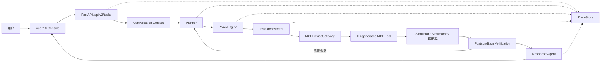

# WoTAgent 2.0 完整技术文档

> 本文只描述当前 2.0 分支已经存在并经过测试的能力。1.0 已由 Git tag `v1.0.0` 和 Git 历史保留，不再与 2.0 运行时混装。

## 1. 项目定位

WoTAgent 2.0 研究“如何把用户自然语言稳定地转化为受权限约束、可验证、可追踪的物联网操作”。它不是让大模型直接控制 GPIO，而是把系统拆成两个控制层：

1. **语义控制层**：LLM 理解指代、范围、目标状态和用户意图，生成结构化计划，并根据执行证据组织回复。
2. **确定性控制层**：普通程序执行 RBAC、设备能力校验、确认、调用、状态验证、有限恢复和 Trace 记录。

因此，LLM 是 Agent 的语义核心，但不是设备执行器或权限裁判。

## 2. 完整链路



### 2.1 为什么不是纯 ReAct

纯 ReAct 把“是否调用工具、调用几次、失败后怎么办”长期交给模型。IoT 场景中这会导致调用次数不稳定、权限边界模糊、设备不支持的动作被臆造，以及“模型说成功但设备没变化”。

2.0 让 Planner 只输出 `TaskPlan`，随后由确定性编排器执行。需要根据观察结果修正计划时，LangGraph 才进入下一轮，并且受循环预算限制。

## 3. 数据契约与 Trace

核心定义位于 `domain/task.py`。`TaskPlan` 包含 `chat/query/control` 意图、摘要和具体步骤；步骤携带设备 ID、动作、参数和前后置条件。Planner 使用 Function Calling 并绑定 Pydantic JSON Schema，PolicyEngine 再校验内容是否能由当前 TD 和角色执行。

每个任务有独立 `task_id`，Trace 记录节点事件、MCP 工具输入输出、策略决策、验证结果、循环与恢复次数、Token、缓存 Token、模型延迟、TTFT 和估算费用。私有思维链不通过 API 暴露，前端只展示可审计的分析摘要、计划和执行证据。

## 4. 上下文工程

`ConversationStore` 使用 SQLite 保存会话和轮次。每次请求建立三类上下文：

1. **有限对话窗口**：只选取最近已完成的可信轮次，并限制单条长度。
2. **结构化运行事实**：当前角色、上一任务结果、未完成目标和策略拒绝原因。
3. **动态设备能力**：通过 MCP 读取当前 TD 能力目录，只提供本次规划所需的设备事实。

失败任务的自然语言回答不会直接作为可信历史注入；被拒绝或部分失败的控制目标以 `pending_goal` 保存。这样“现在呢”“你再试试”等追问能够结合角色变化继续任务，而不必从长对话猜权限状态。

## 5. Agent Graph

### 5.1 Planner

Planner 输入用户消息、有限历史、运行事实和 TD 能力。普通模式用关闭 thinking 的模型强制生成 Tool Schema；深度思考模式先用 thinking 模型分析，再由普通 Planner 生成结构化计划。这规避了部分 OpenAI-compatible 服务在 thinking 模式下不支持强制 `tool_choice` 的 400 错误。

### 5.2 Policy

PolicyEngine 在模型外判断角色是否允许操作、TD 是否声明目标能力、参数是否合法，以及动作是否需要显式确认。实验角色为 `viewer`、`operator`、`admin`。登录鉴权未实现，角色由实验请求传入，因此只能表述为“RBAC 策略验证”。

### 5.3 Orchestrator 与 Agent 循环

Orchestrator 是确定性的：给定同一个已批准计划和设备状态，程序按固定规则调用固定 MCP 工具；它不会自行生成新动作，也不会自由聊天。

多设备任务被展开为多个步骤。每步执行后查询状态，与目标后置条件比较。失败可进入有限恢复；超过预算后返回失败或部分成功，不进行无限循环。需要根据新观察修正语义计划时，控制权才回到 Planner。

### 5.4 Response Agent

Response Agent 根据计划、策略决策和执行证据生成自然语言。它不能把未执行动作说成成功，也不能仅凭用户话术覆盖设备状态。

## 6. TD 到 MCP

TD 统一描述设备身份、位置、属性、动作、事件、输入参数与协议绑定。Agent 不硬编码“灯一定有 turnOn”，而是读取当前 TD。

```text
设备或适配器发布 TD
-> MCP server 读取 TD registry
-> Tool compiler 为 property/action 生成 JSON Schema
-> MCP server 注册工具
-> MCP client refresh_td_catalog()
-> MCPDeviceGateway 暴露 capabilities/query/control
-> Planner 和 Orchestrator 使用同一能力真相源
```

设备未声明 `turnOff` 时，Policy 会拒绝，而不是让模型尝试不存在的工具。

## 7. Matter、SimuHome 与 ESP32

SimuHome 提供 Matter 风格的家庭设备状态和任务样例。`gateway/simuhome.py` 将 endpoint、cluster、attribute/command 映射成 TD，再沿用同一 Tool Compiler 和 MCP 路径。SimuHome 不是另一个 Agent，而是外部环境、样例和评价基准。

适配后的评测比较输入命令、预期目标状态、Agent 计划、真实末态和工具轨迹。零 Token TD inspector 可先检查场景覆盖和能力转换，再运行真实 LLM 评测。

ESP32 实验应让每种固件或网关发布 TD；HTTP、MQTT 或 Matter 的协议差异留在设备适配器，Agent 侧保持 `TD -> MCP -> Gateway` 不变。

## 8. API、持久化与确认

`POST /api/v2/tasks` 返回 `202 Accepted + task_id`。客户端通过任务查询、事件增量重放、SSE 或 `/ws/v2` 观察运行。

`/api/v2/conversations` 提供会话持久化。前端保持同一 `conversation_id` 才能复用上下文；每个任务仍使用独立 LangGraph `thread_id`，避免 checkpoint 相互污染。

高风险动作触发 LangGraph interrupt 并进入 `waiting_confirmation`。`POST /confirm` 使用同一 `task_id` 恢复 SQLite checkpoint，不会重新规划一个新任务。

## 9. 前端与仿真端

`frontend/wotagent-v2-console` 是唯一 Agent 前端，负责会话、任务、深度思考开关、角色、Trace、循环、Token、TTFT、费用和确认操作。

`wot-device-simulator/dashboard` 是设备仿真控制台，用于观察和手动改变设备状态，不是第二个 Agent 前端。默认 stdio MCP 时 Agent 可自动拉起 MCP 子进程；HTTP MCP 模式则先启动仿真服务并配置 `MCP_SERVER_URL`。

## 10. 评测

当前评测分四层：

1. 单元测试：Schema、Policy、Orchestrator、Trace、TD compiler、MCP gateway。
2. 功能评价：计划合法率、越权拒绝率、后置条件验证率、恢复成功率。
3. 端到端评价：任务成功率、部分成功率、非法工具率、多轮完成率。
4. 效率评价：每轮 Token、总 Token、TTFT、模型耗时、工具耗时、循环和费用。

HomeBench/SimuHome 必须先做设备空间和能力对齐。设备空间不匹配通常不是“数量不够”，而是设备类型、房间、属性或动作在 TD 目录中没有语义对应。

## 11. 启动与回归

```powershell
# 仿真端
cd wot-device-simulator
.\.venv\Scripts\python.exe -m wot_device_simulator.service

# Agent API
cd ..\wotagent-prototype
.\.venv\Scripts\python.exe -m wotagent.cli api --host 127.0.0.1 --port 8000

# 2.0 前端
cd ..\frontend\wotagent-v2-console
npm run dev
```

```powershell
cd wotagent-prototype
.\.venv\Scripts\python.exe -m pytest -q

cd ..\frontend\wotagent-v2-console
npm test
npm run build

cd ..\..\wot-device-simulator
.\.venv\Scripts\python.exe -m pytest -q
```

## 12. 面试表述边界

可以准确表述：

- 使用 LangGraph 构建 Planner、Policy、确定性 Executor、Verifier/Recovery 和 Response Agent 的有界循环。
- 通过 WoT TD 统一设备能力，并动态生成 MCP Tool Schema。
- 使用 RBAC 和高风险确认约束控制，执行后读取状态验证结果。
- 建立会话持久化与 Trace，统计循环、Token、TTFT 和费用。
- 将 SimuHome/Matter 场景适配到 TD→MCP 链路进行实验评价。

当前不能表述为：

- 生产级登录、租户隔离或分布式部署。
- 已完成真实大规模 ESP32 集群验证。
- 2.0 仍使用 RAG 或后台 PerceptionEngine。它们属于 1.0 试验代码，已删除；未来如有明确知识问答或事件自动化需求，应作为独立服务重新设计。

## 13. 后续实验路线

1. 用 ESP32 发布真实设备 TD，接入现有 MCP server。
2. 固定 30 至 100 条任务，覆盖指代、多设备、权限、确认和恢复。
3. 对比单 Agent ReAct、无验证图和完整 2.0 图。
4. 报告成功率、越权率、非法动作率、验证率、Token、TTFT 与循环次数。
5. 将脱敏 Trace 沉淀为 Planner SFT、偏好学习或工具调用纠错数据。
