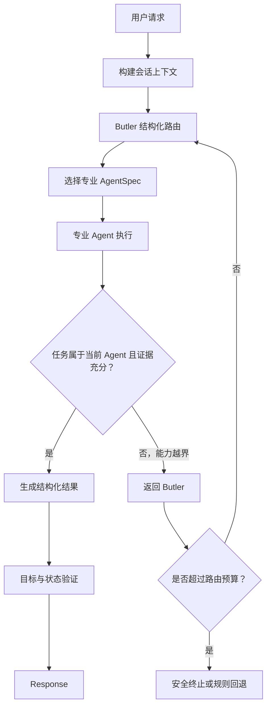
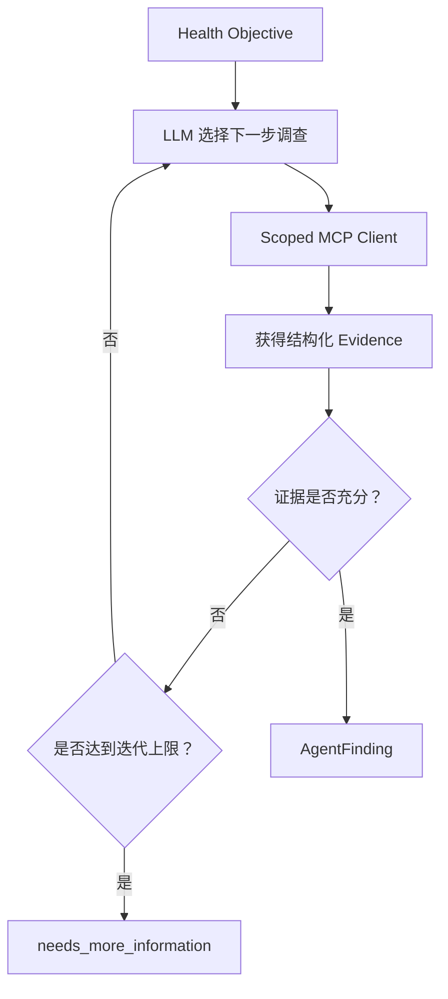
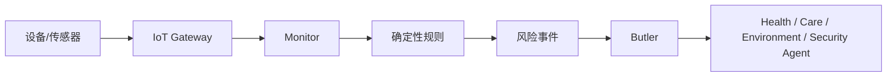

# WoTAgent 2.0 智能体路由与闭环重构经验总结

## 1. 文档目的

本文记录 WoTAgent 2.0 在多 Agent 路由、专业 Agent 执行闭环、上下文承接和运行可观测性方面的一次实际重构。

这次优化不是为了把所有确定性程序替换成大模型，也不是追求无限自主的 Agent。真正目标是：

- 让 LLM 负责需要语义理解和动态判断的任务层决策；
- 让 RBAC、TD、MCP Scope、安全规则和执行验证继续构成确定性底座；
- 让专业 Agent 在发现任务不属于自己时，可以退回 Butler 重新路由；
- 让 Health Agent 能根据工具观察结果动态决定下一步；
- 用结构化输出、迭代上限和完整 Trace 约束大模型行为；
- 保留规则策略作为快速通道、测试 Oracle 和故障回退。

本文按照“问题现象、根因、实现方案、踩坑、验证结果、后续原则”的顺序展开。

---

## 2. 重构前的核心问题

### 2.1 关键词匹配被误当成语义路由

重构前，普通对话的专业 Agent 选择主要依赖关键词函数。逻辑大致相当于：

```python
if is_eldercare_request(message):
    return health_agent

if is_security_request(message):
    return security_agent

return environment_agent
```

这里有两个严重问题。

第一，关键词只能识别字符串，无法理解对话语义。例如：

```text
用户：查看张爷爷今天的健康状态
用户：那最近的趋势呢
```

第二句话没有再次出现“张爷爷”“健康”“心率”等显式关键词，但在人类理解中，它显然承接上一轮健康话题。

第二，未命中关键词时默认进入 `environment_agent`，会把“无法判断”错误地转换为“确定属于环境领域”。这不是回退，而是无依据的决策。

### 2.2 错误路由会造成连锁浪费

一次错误路由不仅会选择错误 Agent，还会继续产生下列成本：

1. 加载错误专业 Agent 的能力范围；
2. 把无关 TD、设备和工具描述加入 Planner 上下文；
3. Planner 尝试在错误能力空间中规划；
4. Response Agent 再对失败结果做一次总结；
5. 最终没有调用任何有效工具，却消耗大量 Token。

实际错误案例中，“那最近的趋势呢”被送入环境领域：

- 上下文包含 12 条历史消息、421 个字符；
- Planner 收到约 20 个设备和 14,111 字符的能力描述；
- Planner 单次消耗约 5,562 Token；
- Response 又消耗约 420 Token；
- 总计约 5,982 Token；
- 工具调用数为 0；
- 最终仍未回答健康趋势问题。

这说明上下文工程不能只关注“提示词是否重复”，还必须关注“路由后给模型看了什么”。错误的能力空间本身就是最大的上下文污染源之一。

### 2.3 专业 Agent 缺少退回 Butler 的协议

过去一旦 Butler 或 Router 把任务分给某个专业 Agent，专业 Agent 通常只能：

- 尝试执行；
- 返回失败；
- 生成最终回复。

它不能明确表达：

```text
这个任务不属于我的能力边界，请 Butler 重新判断。
```

因此，一次路由错误很容易直接演变为最终失败。多 Agent 系统虽然有多个 Agent 名称，却缺少主体之间真正的协商和控制权回交。

### 2.4 专业 Agent 的“智能”无法弥补错误的能力边界

即使把专业 Agent 改成 ReAct，只要它收到的工具范围是错误的，它也无法完成任务。

例如，环境 Agent 只能看到：

- 温湿度；
- 空调；
- 窗帘；
- 灯光；
- 空气质量。

当用户询问健康趋势时，再聪明的环境 Agent 也不能合法调用健康数据工具。正确解决办法不是扩大所有 Agent 的工具权限，而是：

1. 专业 Agent承认任务越界；
2. 将控制权退回 Butler；
3. Butler 根据原始请求、会话上下文和退回原因重新路由；
4. 新 Agent 获得与其职责匹配的 MCP Scope。

---

## 3. 本次重构的职责边界

重构后仍坚持以下边界。

### 3.1 LLM 负责的内容

- 结合当前消息和会话上下文理解真实请求；
- 选择合适的专业 Agent；
- 补全省略的指代和上下文；
- 判断专业 Agent 是否提供了足够证据；
- 在 Health Agent 循环中决定下一项调查工具；
- 在专业 Agent 退回后重新路由；
- 生成面向用户的最终总结。

### 3.2 确定性程序负责的内容

- RBAC 权限判定；
- AgentSpec 与 MCP Scope；
- TD 能力和参数范围校验；
- 工具调用、超时和错误表示；
- 状态变更后的验证；
- 循环次数和总超时；
- 重复路由检测；
- 医疗硬阈值告警；
- 审计和 Trace；
- LLM 失败后的规则回退。

核心原则可以概括为：

> LLM 决定“下一步应该尝试什么”，程序决定“这一步是否允许、能否执行以及是否真正生效”。

---

## 4. 主要优化

### 4.1 使用结构化 Butler 路由

新增结构化路由结果，避免从自然语言回答中猜测控制指令。路由结果至少包含：

- 目标 Agent；
- 归一化后的用户请求；
- 路由原因；
- 置信度；
- 是否需要澄清；
- 当前涉及的住户或设备范围。

概念模型如下：

```python
class RouteDecision(BaseModel):
    agent: str
    resolved_request: str
    reason: str
    confidence: float
    needs_clarification: bool = False
    resident_id: str | None = None
```

其中 `resolved_request` 很重要。它用于把依赖历史的省略句恢复成专业 Agent 能独立理解的任务。

例如：

```text
原始输入：那最近的趋势呢
恢复后的请求：查询张爷爷最近的健康指标趋势
目标 Agent：health_agent
```

Butler 只能从当前已注册的 AgentSpec 中选择 Agent，不能自由编造 Agent 名称，也不能直接指定越权 MCP Tool。

### 4.2 关键词规则降级为快速通道和回退

本次没有完全删除关键词规则，而是重新限定其职责：

| 使用位置 | 是否保留 | 原因 |
| --- | --- | --- |
| 明确、简单、低歧义命令的快速通道 | 保留 | 降低延迟和模型调用 |
| `rule` 模式的基准策略 | 保留 | 用于回归和对照实验 |
| LLM 超时或结构化输出失败后的回退 | 保留 | 保证系统可用性 |
| 普通多轮语义路由的主判断 | 移除 | 关键词无法处理省略和指代 |
| 未匹配时默认环境 Agent | 移除 | 无法判断不等于环境任务 |
| TD 候选设备过滤 | 保留 | 属于能力检索，不等于最终决策 |
| 安全方向和参数硬校验 | 保留 | 不应交给 LLM |

关键词不是完全错误。问题在于把它放在了超出其能力的位置。

### 4.3 增加专业 Agent 退回 Butler 的机制

专业 Agent 出现以下情况时，不再直接生成最终失败回复：

- 任务不属于当前能力范围；
- 缺少完成任务所需的工具；
- 结构化计划明确要求澄清；
- 当前 Agent 规划失败且可能属于其他领域。

系统会产生结构化退回事件：

```text
agent.delegation.returned
```

Butler 随后重新评估，并产生：

```text
agent.reroute.selected
```

重新路由会携带：

- 原始用户请求；
- 会话上下文；
- 当前 Agent；
- 当前 Agent 的退回原因；
- 已尝试过的 Agent；
- 剩余路由次数。

为防止 Agent 之间来回踢任务，系统设置：

```text
SUPERVISOR_MAX_ROUTES=2
```

同时记录已尝试 Agent，禁止无意义地重复选择相同路径。

### 4.4 让 Health Agent 进入有限 ReAct 循环

健康领域优先实现了 Observe-Reason-Act 闭环：

```text
接收目标
  -> 查看健康工具范围
  -> LLM 选择下一项工具
  -> Scoped MCP Client 执行
  -> 获得结构化观察
  -> 判断证据是否充分
  -> 必要时继续调查
  -> 输出 AgentFinding
```

在“查询最近健康趋势”的真实验证中，Health Agent 按顺序执行了：

```text
read_health_summary
  -> read_vital_trend
  -> check_data_quality
```

这与一次性固定计划不同。后续工具选择基于前一轮观察结果，并受到最大循环次数、工具范围和终止条件约束。

### 4.5 删除模糊词自动恢复旧任务的硬编码

旧逻辑会尝试用“现在呢”“继续”“然后呢”等词自动恢复挂起目标。这个办法容易误判：

- “现在呢”可能询问权限状态；
- 也可能询问设备状态；
- 也可能要求重试上一操作；
- 还可能是对另一个话题的追问。

重构后，挂起目标作为会话上下文提供给 Butler，由结构化 LLM 决策是否承接，而不是由几个模糊关键词直接改变控制流。

### 4.6 Trace 记录决策理由，而非隐藏思维链

运行时间线中新增或强化了：

- 会话上下文构建；
- Butler 路由选择；
- 专业任务创建；
- Agent 退回；
- Butler 重新路由；
- Health Agent 每轮决策；
- MCP Resource/Tool 调用；
- 证据汇总；
- 回退原因；
- Token、TTFT、耗时和循环次数。

日志记录简短、结构化的决策理由，不记录大段隐式思维过程。这样既能解释系统行为，也避免把不可控的模型草稿当成审计事实。

### 4.7 压缩 Health Agent 证据上下文

早期实现会在每一轮把大量原始健康数据、历史观察和完整工具结果再次塞回模型，导致 Token 快速增长。

优化后：

- 只保留完成当前目标所需的关键字段；
- 对历史工具结果进行紧凑摘要；
- 避免重复附带相同住户资料；
- 限制最终 Finding 的长度和格式；
- 明确禁止诊断、药物建议和不必要的 Markdown 表格。

在同类健康趋势验证中，总 Token 从约 17,527 降至约 10,281，下降约 41%。该结果说明多轮 Agent 的成本关键不只是循环次数，还包括每轮观察如何压缩和继承。

### 4.8 为设备任务增加真正的 Observe-Act 循环

后续复杂测试进一步发现，最初的设备专业 Agent 仍然只是：

```text
Planner 一次规划
  -> Executor 批量执行
  -> Response
```

对于“先查询灯的数量，再根据奇偶控制设备”的任务，Planner 只能生成查询步骤。查询结果虽然进入 Trace，却不会返回 Planner，因此后续条件动作永远不会发生。

现在由 Butler 在结构化路由中增加：

```text
execution_mode = single_pass | observe_act_loop
```

涉及状态、数量、比较、条件分支或前一步结果的任务进入有限循环：

```text
Planner
  -> Policy
  -> Executor
  -> Verification
  -> Observation Pack
  -> Planner
```

循环状态记录：

- 原始目标；
- 当前轮次；
- 已执行计划；
- 工具结构化结果；
- 验证后状态；
- 累计工具调用数；
- 已出现的计划签名。

系统默认限制为 4 个设备执行轮次和 16 次工具调用，并检测重复计划。

### 4.9 增加条件计划语义审查

真实测试中曾出现以下危险情况：

```text
观察事实：4 盏灯开启，是偶数
候选动作：打开空调
```

该动作在 TD、RBAC 和 MCP Scope 层面完全合法，但不符合用户当前激活的条件分支。因此，仅有设备安全校验还不足以保证目标语义正确。

现在 Observe-Act 循环中的控制计划在进入 Policy 前，会经过独立的结构化 `Conditional Plan Reviewer`：

- 重新检查观察事实；
- 重新计算数量、奇偶、比较和余数；
- 判断当前激活分支；
- 拒绝非激活分支动作；
- 允许只执行当前阶段，并把下游条件延迟到动作验证之后；
- 审查失败时退回 Planner 修复一次；
- 修复后仍不一致则终止，不调用设备。

Reviewer 不负责权限和 TD 校验，它只补充“这个合法动作是否是当前条件下正确的动作”这一层语义约束。

---

## 5. 本次踩过的坑

### 5.1 坑一：把“默认 Agent”当成容错

### 现象

所有无法识别的请求都进入环境 Agent。

### 根因

代码把“没有证据”转换成了“确定属于某领域”。

### 修复

- 允许 Butler 返回澄清；
- 允许专业 Agent 返回越界；
- 允许重新路由；
- 达到上限后安全终止；
- 仅在规则回退中使用明确、可解释的默认策略。

### 经验

多 Agent 路由中，`unknown` 必须是一等状态。不能为了让图继续运行而伪造确定性。

---

### 5.2 坑二：误以为 ReAct 能解决所有错误

### 现象

希望把专业 Agent 改成 ReAct 后，它就能自行解决误路由问题。

### 根因

ReAct 只能在“它看得见的工具集合”内选择。AgentSpec 和 MCP Scope 如果错误，再多推理轮次也只会增加成本。

### 修复

增加 Agent 到 Butler 的控制权回交，并重新建立正确的能力范围。

### 经验

Agent 自主性必须建立在正确的能力边界上。路由、授权和执行是三个不同问题。

---

### 5.3 坑三：用自由文本判断是否越界

### 现象

尝试通过查找“无法处理”“不属于我的职责”等字符串判断 Agent 是否应退回。

### 根因

自由文本受模型、语言和措辞影响，无法稳定控制 LangGraph 跳转。

### 修复

优先依据结构化状态，例如：

```text
intent = clarify
planning_failed = true
status = out_of_scope
```

当前实现已经使用结构化计划和失败状态触发退回。下一步仍应把所有专业 Agent 的结果统一成显式 `AgentFinding.status`，彻底消除文本猜测。

### 经验

凡是会改变控制流的 LLM 输出，都必须经过结构化模型校验。

---

### 5.4 坑四：重新路由可能形成循环

### 现象

Agent A 退回 Butler，Butler 选择 Agent B，Agent B 又退回，甚至再次选择 Agent A。

### 根因

图中虽然存在循环边，却没有循环预算和重复计划检测。

### 修复

- 设置最大路由次数；
- 记录已尝试 Agent；
- 禁止重复选择同一失败路径；
- 相同失败连续出现时终止；
- 将终止原因写入 Trace。

### 经验

所有 Agent Loop 都必须同时拥有“继续条件”和“停止条件”。只有回边而没有预算，不是智能闭环，而是失控风险。

---

### 5.5 坑五：单元测试意外调用真实 LLM

### 现象

新增路由后，部分旧测试本来只验证图跳转，却因为默认进入 Hybrid Router 而调用了真实模型。

### 根因

测试没有显式注入 Fake Router，运行模式和外部依赖边界不够清晰。

### 修复

- 路由器支持依赖注入；
- 测试使用 Fake LLM 或 Fake Router；
- 对需要规则路径的测试显式设置 `rule` 模式；
- 集成测试通过可重复状态序列模拟多轮观察；
- 真实模型只用于单独的在线冒烟验证。

### 经验

测试 Agent 图时，应该测试“决策契约和状态转移”，而不是依赖真实模型恰好输出预期答案。

---

### 5.6 坑六：Windows 中文命令产生编码误导

### 现象

通过 PowerShell、Node 或临时管道发送中文测试请求时，服务端收到的内容可能变成问号或乱码，导致路由结果异常。

### 根因

终端代码页、PowerShell 管道编码、脚本文件编码和 HTTP JSON 编码并不总是一致。

### 修复

- 对复杂中文测试使用明确的 UTF-8 脚本文件；
- HTTP 请求显式设置 `Content-Type: application/json; charset=utf-8`；
- 必要时使用 Unicode 转义构造测试文本；
- 不把终端显示结果直接等同于服务端实际收到的字节；
- 通过 Trace 中保存的原始 `message` 再次确认。

### 经验

中文语义测试失败时，第一步应确认模型收到的真实字符串，而不是立即修改 Prompt 或路由算法。

---

### 5.7 坑七：前端响应式对象与原始对象混用

### 现象

Trace 事件已经从后端到达，但前端时间线偶尔不刷新，或任务状态显示滞后。

### 根因

对象加入 Vue 响应式数组后，后续代码仍修改插入前的原始对象，而不是数组中由 Vue 代理的对象。

### 修复

- 任务插入响应式集合后，从 Store 中重新取得代理对象；
- 后续事件合并统一操作响应式对象；
- 为事件增量、任务恢复和状态变化增加前端测试。

### 经验

实时 Trace 的正确性不仅是后端事件协议问题，也取决于前端是否始终修改同一份响应式状态。

---

### 5.8 坑八：任务恢复与实时流存在竞态

### 现象

页面恢复历史任务的同时，SSE 或轮询又收到同一任务，可能生成两个 RuntimeTask，造成重复时间线或状态互相覆盖。

### 根因

恢复流程和实时事件流程都能创建任务对象，但缺少按 `task_id` 的原子去重。

### 修复

- 创建任务前按 `task_id` 加锁或再次检查；
- 重复对象合并时保留事件更完整、更新时间更新的一份；
- 事件按照 `sequence` 去重和排序；
- 对恢复与实时到达并发场景增加测试。

### 经验

可观测前端本质上是一个事件溯源客户端。任务 ID、事件序号和幂等合并不是附加功能，而是数据正确性的基础。

---

### 5.9 坑九：后端重启后历史 Trace 丢失

### 现象

任务执行时前端可以查看完整 Trace，但后端重启后，旧 `task_id` 查询可能返回 404。

### 根因

当前 TraceStore 主要是进程内存存储，会话消息与完整运行事件的持久化程度不一致。

### 当前处理

本次没有为了路由重构顺带引入复杂数据库迁移，避免扩大修改范围。

### 后续建议

- 将 Task、Event、Usage 和 AgentFinding 持久化；
- 保留事件 sequence 和 trace_id；
- 支持按 conversation_id 重放；
- 为敏感健康数据增加脱敏和保留周期；
- 进程启动时恢复未完成任务为明确的 interrupted 状态。

### 经验

“实时可见”和“可审计”不是同一件事。真正的审计要求进程重启后仍能重放。

---

### 5.10 坑十：模型输出过度医疗化和过度格式化

### 现象

Health Agent 可能输出过长分析、Markdown 表格，甚至使用接近医疗诊断的措辞。

### 根因

提示词只告诉模型“分析健康数据”，没有明确限定系统的非诊断职责、证据格式和输出长度。

### 修复

- 明确系统只做风险感知、信息汇总和护理协同；
- 禁止疾病诊断和药物调整建议；
- 要求结论由 Evidence 支撑；
- 限制 Finding 长度；
- 要求优先输出护理人员可理解的简洁结论；
- 医疗硬阈值仍由 Monitor 规则触发，LLM 无权忽略。

### 经验

领域 Agent 的 Prompt 不只是角色描述，还必须明确责任边界、禁止事项、证据标准和输出契约。

### 5.11 坑十一：图中有循环事件，不等于真正重新决策

#### 现象

Trace 显示“循环完成”，但复杂设备任务只查询状态，不执行后续条件动作。

#### 根因

原来的 `agent.loop.completed` 只表示 Orchestrator 完成了一轮固定计划。执行后直接进入 Response，并没有把工具观察返回 Planner。

#### 修复

- 增加 `observe_act_loop` 执行模式；
- 将执行结果压缩成 Observation Pack；
- 执行成功后回到 Planner；
- Planner 只规划下一阶段；
- 终态由无工具的 `chat` 计划明确表示。

#### 经验

评价 Agent Loop 时必须检查控制流是否真的回到决策节点，而不能根据事件名称、循环计数或界面动画判断。

---

### 5.12 坑十二：Observation 写进图状态，但 Planner 实际没读到

#### 现象

第二轮 Planner 完整重复第一轮查询计划。

#### 根因

图把 Observation 写入 `context.agent_loop`，但 Planner 只序列化了 `context.runtime`。数据在内存中存在，却没有进入模型消息。

#### 修复

- 显式把 `agent_loop` 合并进 `runtime_context`；
- 单测检查实际发给模型的消息内容；
- Trace 记录运行上下文字符数和设备数量。

#### 经验

上下文工程不能只检查 State 中“有没有数据”，还要检查最终模型请求中“是否真的包含该数据”。

---

### 5.13 坑十三：能力候选上限截断了集合设备

#### 现象

用户要求检查 7 盏灯，但 Planner 只查询了 3 盏。

#### 根因

任务同时提到灯、空调、加湿器和风扇，候选设备上限为 8。空调等设备占据候选位置后，灯集合被截断。

#### 修复

Observe-Act 任务将相关设备候选上限提高到 24，确保集合查询能够看见完整设备空间；普通单轮任务仍保持较小上下文。

#### 经验

Top-K 能力检索必须考虑集合完整性。查询“所有灯”时，不能为了固定 Token 上限只返回部分灯。

---

### 5.14 坑十四：合法工具也可能属于错误条件分支

#### 现象

系统观察到 4 盏灯开启，却生成并执行了开空调动作，下一轮才自行纠正并打开加湿器。

#### 根因

RBAC 判断用户能否操作空调，TD 判断空调是否支持 `turnOn`，但二者都不判断“偶数条件下是否应该操作空调”。

#### 修复

在 Policy 前增加结构化条件计划审查，并在审查拒绝后要求 Planner 修复一次。

#### 经验

安全正确性至少有三层：

1. 是否有权限；
2. 设备是否支持；
3. 当前观察是否支持这个动作。

第三层不能被前两层替代。

---

### 5.15 坑十五：Reviewer 可能把分阶段计划误判为不完整

#### 现象

偶数分支中，Planner 正确计划“本轮只打开加湿器”，Reviewer 却因为没有同时计划风扇而拒绝。

#### 根因

Reviewer 按完整工作流审核候选计划，而系统实际采用逐阶段 Observe-Act：应先打开并验证加湿器，再决定风扇。

#### 修复

Reviewer 契约明确：

- 候选计划只是下一阶段；
- 不因下游条件被推迟而拒绝；
- 当前分支明确要求的父动作可以先执行；
- 下游动作必须等待父动作验证结果。

#### 经验

Planner 和 Reviewer 必须对“计划粒度”达成一致，否则审查器会把正确的增量决策当成遗漏。

---

### 5.16 坑十六：模型用空控制计划表达目标完成

#### 现象

模型返回：

```json
{
  "intent": "control",
  "steps": []
}
```

其自然语言摘要却表示“任务已经完成”。

#### 根因

模型理解了终态，但选错了结构化枚举。

#### 修复

- `query/control` 强制至少包含一个步骤；
- `chat/clarify` 强制不包含步骤；
- 首次非法输出触发一次结构修复；
- 已有成功执行历史且模型连续返回零步骤时，只允许规范化为无动作 `chat` 终态；
- 记录 `plan.normalized`；
- 首轮空控制计划仍直接拒绝。

#### 经验

不要因为模型“意思大概对”就放松结构校验。可做安全的无动作规范化，但不能替模型补造设备动作。

---

## 6. 重构后的实际链路

### 6.1 普通用户请求



### 6.2 Health Agent 子循环



### 6.3 Monitor 事件

Monitor 仍是独立于 LLM 的持续监测服务：



高频原始数据不会直接持续灌入大模型。Monitor 负责保存状态和产生事件，Agent 只在事件或用户任务需要时读取摘要、趋势和证据。

---

## 7. 验证方法与结果

### 7.1 单元与集成测试

重构后运行结果：

```text
后端：150 passed, 1 skipped
前端：17 passed
前端构建与类型检查：通过
```

测试覆盖重点包括：

- 结构化 Supervisor 路由；
- 会话省略句恢复；
- Agent 越界后退回 Butler；
- 最大重新路由次数；
- LLM 结构化输出失败后的规则回退；
- Health Agent 多轮工具选择；
- 最大循环次数终止；
- 设备任务查询后重新规划；
- 条件分支计划审查与修复；
- 非激活分支动作阻止；
- 空控制计划校验和终态规范化；
- Scoped MCP Client 越权阻止；
- RBAC 拒绝不可绕过；
- Trace 事件顺序；
- 前端任务恢复与响应式更新。

### 7.2 真实模型冒烟验证

在同一 conversation 中依次发送：

```text
查看张爷爷今天的健康状态
那最近的趋势呢
```

第二轮实际结果：

- 路由到 `health_agent`；
- 继承住户 `elderly-001`；
- 路由置信度为 0.95；
- 没有落入环境 Agent；
- Health Agent 连续读取健康摘要、生命体征趋势和数据质量；
- 共形成 4 次 Health 决策；
- 任务成功结束；
- Trace 能展示路由和每轮调查过程。

### 7.3 Token 对比

| 场景 | 路由 | 工具调用 | 总 Token | 结果 |
| --- | --- | ---: | ---: | --- |
| 重构前“那最近的趋势呢” | 错误进入环境 Agent | 0 | 约 5,982 | 无法回答 |
| Health 闭环早期版本 | 正确进入 Health Agent | 多次 | 约 17,527 | 能回答但上下文偏重 |
| 证据压缩后 | 正确进入 Health Agent | 多次 | 约 10,281 | 能回答且降低约 41% |

这些数据不是简单说明“Agentic 一定更省 Token”。恰恰相反：

- 正确的多轮调查通常比一次分类调用更贵；
- 但它能够真正获得证据并完成任务；
- 上下文压缩可以显著降低每轮增量成本；
- 错误路由即使 Token 较少，也属于无效消耗。

因此应该同时评价：

- 任务成功率；
- 工具有效调用率；
- 每个成功任务的 Token；
- 每轮 Token 增量；
- TTFT；
- 总延迟；
- 无效路由次数；
- 回退次数；
- 证据充分率。

### 7.4 复杂设备条件任务实测

测试指令：

```text
检查灯的状态。
如果开着的灯是奇数，就打开空调；
如果开着的灯是偶数，就打开加湿器。
打开加湿器以后，如果加湿器状态值加上关着的灯数量除以 3 的余数是 1，
就打开风扇。
```

奇数状态实测：

- 5 盏灯开、2 盏灯关；
- 查询全部 7 盏灯；
- Reviewer 选择 odd 分支；
- 只调用空调 `turnOn`；
- 不调用加湿器和风扇；
- 2 个执行轮次；
- 最终 `succeeded`。

偶数状态实测：

- 4 盏灯开、3 盏灯关；
- 查询全部 7 盏灯；
- Reviewer 选择 even 分支；
- 第 2 轮打开并验证加湿器；
- 第 3 轮根据 `(1 + 3) % 3 == 1` 打开并验证风扇；
- 不调用空调；
- 最终 `succeeded`。

该测试同时验证了路由、集合能力检索、多轮观察、算术条件、嵌套分支、执行验证和语义审查。

---

## 8. 可复现测试命令

以下命令均在项目根目录执行。

### 8.1 后端测试

```powershell
Set-Location D:\Users\gyq16\Desktop\PRJ\WoTAgent\wotagent-prototype
pytest
```

### 8.2 前端测试

```powershell
Set-Location D:\Users\gyq16\Desktop\PRJ\WoTAgent\frontend\wotagent-v2-console
npm test
```

### 8.3 前端构建

```powershell
Set-Location D:\Users\gyq16\Desktop\PRJ\WoTAgent\frontend\wotagent-v2-console
npm run build
```

### 8.4 推荐人工验证用例

用例一：上下文承接。

```text
查看张爷爷今天的健康状态
那最近的趋势呢
```

预期：

- 第二句仍路由到 Health Agent；
- resident_id 保持为张爷爷；
- 至少读取趋势数据；
- 不进入环境 Agent。

用例二：跨领域重新路由。

```text
查看张爷爷最近睡眠情况
如果房间太热，把空调调到舒适温度
```

预期：

- Butler 能识别健康调查和环境动作的不同职责；
- Health Agent 不直接控制空调；
- Environment Agent 的动作仍通过 RBAC、TD 和 MCP Scope；
- 状态改变后执行验证。

用例三：能力越界。

构造一个先被错误或低置信度送到 Environment Agent 的健康问题。

预期：

- 出现 `agent.delegation.returned`；
- 随后出现 `agent.reroute.selected`；
- 不超过最大路由次数；
- 不允许 Environment Agent 调用健康工具。

用例四：数据不足。

让健康数据时间戳过期或趋势数据缺失。

预期：

- Health Agent 先检查摘要更新时间；
- 继续查询最新数据或数据质量；
- 仍不足时返回 `needs_more_information`；
- 不编造健康结论。

---

## 9. 形成的工程原则

### 9.1 语义决策与安全约束必须分层

LLM 适合判断语义、目标和下一步，不适合决定自己是否有权限，也不适合绕过设备能力约束。

### 9.2 Agent 不是类名，而是独立能力边界

一个专业 Agent 至少需要：

- 明确职责；
- 独立 Prompt；
- 独立 AgentSpec；
- 独立 MCP Scope；
- 结构化输入和输出；
- 可观察的执行状态；
- 退回上级的协议。

如果多个所谓 Agent 共享全部工具、全部上下文和同一执行逻辑，它们更接近提示词角色，而不是真正的多主体系统。

### 9.3 无法判断必须被显式建模

`unknown`、`out_of_scope`、`needs_more_information` 和 `blocked` 都应该是结构化状态。不能用错误默认值掩盖不确定性。

### 9.4 自主循环必须有预算

每个循环都应限制：

- 最大迭代次数；
- 最大工具调用数；
- 总超时；
- 重复计划；
- 连续相同失败；
- 高风险动作确认。

### 9.5 工具成功不等于目标完成

设备动作必须尽量遵循：

```text
执行动作
  -> 读取执行后状态
  -> 与目标状态比较
  -> verified / unverified / failed
```

Butler 应根据验证后的状态判断成功，而不是仅看 HTTP 200。

### 9.6 上下文工程首先是范围工程

减少 Token 不只是缩短 System Prompt，还包括：

- 先正确路由，再加载专业能力；
- 不向模型暴露无关设备；
- 不重复传输完整观察；
- 使用结构化摘要；
- 对历史消息按目标相关性选择；
- 避免多个 Agent 重复总结同一份数据。

### 9.7 Trace 应记录决策证据，不记录表演式思考

用户真正需要知道的是：

- 系统选择了谁；
- 为什么选择；
- 调用了什么；
- 得到了什么；
- 权限如何判定；
- 目标是否验证；
- 为什么继续、退回或终止。

这比展示大段模型“内心独白”更稳定，也更适合作为科研实验数据。

---

## 10. 当前仍存在的限制

本次重构已经改善真实控制流，但并不代表所有 Agent 都已完全自主化。

当前限制包括：

1. Health Agent 已具备较完整的有限 ReAct 调查循环，Environment、Care、Security 等专业 Agent 仍以受约束单轮或确定性流程为主。
2. 普通设备任务已经支持专业 Agent 退回和重新路由，但统一的 `AgentFinding.status = out_of_scope` 仍应继续覆盖所有子图。
3. Butler 对普通设备任务的二次 GoalEvaluation 还可以进一步统一，目前健康闭环最完整。
4. LLM Router 本身会增加一次模型调用，后续可尝试小模型、语义缓存和高置信度快速通道。
5. Trace 的进程级持久化仍不完整，后端重启后历史审计能力有限。
6. 多 Agent Shadow Mode 和规则/Hybrid 自动差异报告仍可继续增强。
7. Care、Security、Environment Agent 需要更多独立 TD、MCP 权限范围和专用测试集，才能形成与 Health Agent 同等级别的专业能力边界。

这些限制应该如实描述。当前系统已经从“关键词选流程”向“受约束的目标驱动多 Agent”演进，但还不是所有领域都具备同等自主度的完全体。

---

## 11. 可用于项目汇报的专业表述

可以将这次工作概括为：

> 针对原有多 Agent 系统依赖关键词路由、专业 Agent 无法退回上级以及健康任务缺少观察闭环的问题，我将 Butler 重构为结构化 LLM Supervisor，使其结合会话上下文动态选择受 AgentSpec 约束的专业 Agent；同时增加专业 Agent 到 Butler 的有限退回与重新路由机制，并率先为 Health Agent 实现基于 Scoped MCP Client 的 Observe-Reason-Act 循环。系统保留 RBAC、TD、MCP Scope、确定性 Monitor、状态验证和规则回退作为安全底座，并通过 Trace 记录每轮路由、工具调用、证据与终止原因。重构后，多轮省略式健康查询能够正确承接上下文并动态查询摘要、趋势和数据质量；在压缩证据上下文后，同类任务 Token 消耗下降约 41%。

更简洁的面试版本：

> 我没有把所有逻辑都交给大模型，而是让 LLM 负责目标理解、动态路由和下一步调查，让 RBAC、TD、MCP Scope 和状态验证负责安全执行。重点解决了关键词误路由、Agent 不能退回 Butler 和多轮健康调查缺少闭环三个问题，并用结构化输出、循环预算、Fake LLM 测试和完整 Trace 保证系统可控、可测和可解释。

---

## 12. 总结

本次优化最重要的认识不是“关键词不好，LLM 好”，而是不同机制应承担不同职责：

- 关键词适合高确定性快速通道和规则回退；
- LLM 适合语义路由、上下文恢复和动态调查；
- AgentSpec 与 MCP Scope 负责主体能力边界；
- RBAC、TD 和 Policy 负责不可绕过的约束；
- Monitor 负责持续数据监测和硬规则告警；
- Verification 负责判断动作是否真正生效；
- Trace 负责把整个过程转化为可复盘、可评测的实验记录。

真正可靠的物联网 Agent 不是让大模型控制一切，而是在确定性安全底座之上，给予它有限、明确、可观察、可回退的决策权。

---

## 13. 2026-07-18 真实 Health 链路复验

### 13.1 测试前上下文审计

本轮没有直接放开真实模型测试，而是先检查 Supervisor 和 Health
`create_agent` 的实际模型边界。审计发现：

1. `HEALTH_AGENT_MAX_ITERATIONS` 和 `AGENT_MAX_TOOL_CALLS` 虽然存在于
   配置中，但此前没有接入 Health `create_agent` 的原生 Middleware。
2. Supervisor 每轮会收到完整历史和完整 `AgentFinding`，大型 Evidence
   与 Tool Result 会随二次决策累积。
3. 模型没有统一的单次输出 Token 硬上限。
4. Health 的原始用户请求没有作为不可变字段进入 Task，Supervisor 可以通过
   `objective` 和 `success_criteria` 擅自扩大调查范围。

本轮修复：

- Health Agent 使用 LangChain 原生 `ModelCallLimitMiddleware` 和
  `ToolCallLimitMiddleware`；
- Supervisor 每次调用最多一次模型；
- Health 最多执行配置的调查阶段，并为最终结构化 Finding 预留一次模型调用；
- 默认单次模型输出上限为 2048 Token，可通过
  `WOTAGENT_MAX_OUTPUT_TOKENS` 调整；
- Supervisor 历史压缩为最近 6 条、每条最多 400 字符；
- 最多向 Supervisor 提供 6 个压缩 Finding，每个 Finding 只保留关键
  Evidence、工具成功/验证状态和错误；
- `AgentTask.source_request` 由运行时写入，Specialist 不得把 Supervisor
  提案中超出原始请求的内容当成权威目标。

极端构造测试使用 20 条超长历史和 12 个大型 Finding。模型边界上的动态
上下文被压缩为：

```text
Conversation Context: 3,191 characters
Completed Findings: 15,301 characters
Total Dynamic Context: 18,492 characters
Conservative Token Estimate: 9,246
```

该数字是防爆上限测试，不是正常单轮消耗。真实空历史案例明显更小。

### 13.2 本轮真实测试踩坑记录

| 序号 | 现象 | 根因 | 修复 |
| --- | --- | --- | --- |
| 1 | 未显式设置 ACK 时真实测试仍发出请求 | 新增 `MeteredAgent` 后，`skipif` 装饰器误贴到了辅助类，而不是测试函数 | 恢复函数级 `skipif`，验证无 ACK 时 `1 skipped` |
| 2 | 张爷爷解析成功但没有 `effective_scope` | 模型自由生成了授权服务不认识的 capability | Health/Care capability 由运行时规范化，模型不能定义安全标识 |
| 3 | 某轮 Task 的 `target=None` | 模型生成了非规范 `target_type` | Health/Care 目标类型由运行时规范化为 `resident` |
| 4 | Health 触发 `TOOL_CALL_LIMIT_EXCEEDED (5/4)` | Supervisor 把一般健康状态扩展成生命体征、睡眠、趋势和数据质量，Health 尝试读取全部资源 | 保留 4 次工具硬上限；增加最小证据规则和不可变 `source_request` |
| 5 | Health Task 失败后 Run 仍显示 `completed` | Supervisor 返回 `clarify` 时 Coordinator 无条件把 Run 标记成功 | 有 Finding 时根据 Finding 计算 Run 状态 |
| 6 | Health 成功但 Run 为 `partial_success` | Health-only 测试向 Supervisor 暴露了全部 Agent，模型又委派未注册 Executor 的 DeviceOps | Health 合同测试只暴露 `health_agent`；多 Agent 联动另做 simulator-backed 测试 |
| 7 | 李奶奶工具调用成功但 `structured_response=None` | `deepseek-v4-flash` 偶发用自然语言结束 ReAct，没有生成结构化 Finding | 增加一次结构修复；修复失败不可重跑整条调查链 |
| 8 | `with_structured_output()` 修复仍返回 `None` | 当前 DeepSeek OpenAI-compatible 接口对此方式兼容不稳定 | 改用项目已验证的强制 Function Calling：`bind(tools=..., tool_choice=...)` |
| 9 | 正向案例受默认种子数据是否新鲜影响 | 测试没有固定生命体征输入 | 在隔离 SQLite 中写入固定、当前时间戳的心率、血氧和睡眠数据 |

特别需要记住：测试保护机制本身也必须测试。一个写错位置的 `skipif` 会使
“默认不消耗外部 Token”成为假设而不是事实。

### 13.3 最终真实模型结果

模型：`deepseek-v4-flash`

真实测试限制：

```text
temperature = 0
Supervisor iterations <= 2
Health investigation stages <= 4
Health tool calls <= 4
Health model calls <= 5
Structured repair calls <= 1
Output tokens per model call <= 900
Specialist total timeout = 20 seconds
LLM call timeout = 10 seconds
```

| 案例 | 结果 | Input | Output | Total | Cache Read |
| --- | --- | ---: | ---: | ---: | ---: |
| JH-1 查看张爷爷今天的健康状态 | Run/Task completed，目标 `elderly-001` | 8,207 | 1,716 | 9,923 | 4,352 |
| JH-2 查看李奶奶最近生命体征 | Run/Task completed，目标 `elderly-002`，使用一次结构修复 | 11,830 | 2,705 | 14,535 | 9,600 |
| JH-2 查看张爷爷健康状态 | Run failed，`RESOURCE_ACCESS_DENIED`，未进入 Health MCP | 2,452 | 664 | 3,116 | 2,176 |

失败尝试也真实消耗了模型 Token，但早期失败路径尚未正确导出 usage，因此本表
只报告最终可验证运行，不能把它当成本轮所有调试调用的总账。

### 13.4 最终自动化回归

```text
Backend: 176 passed, 2 skipped
Frontend: 15 passed
Frontend typecheck and production build: passed
```

默认执行 `pytest` 时真实模型测试仍然跳过。只有当前进程显式设置：

```powershell
$env:WOTAGENT_REAL_MODEL_SMOKE_ACK =
  "I_UNDERSTAND_THIS_USES_EXTERNAL_TOKENS"
```

才允许调用外部模型。可用 `WOTAGENT_REAL_MODEL_CASE` 单独执行一个案例，避免
为了复查单点问题重复消耗其他案例的 Token。

### 13.5 本轮结论

真实复验说明，Fake LLM 通过不能证明生产链路正确。真正的问题集中在主体身份、
实体类型、授权 capability、上游目标扩张、结构化输出兼容性和测试边界，而不是
Health Agent 是否“足够聪明”。

本轮没有把 LLM 改成规则输出。Supervisor 和 Health ReAct 仍由 LLM 驱动；
程序只接管不可由模型自证的系统事实、上下文预算、授权范围、修复次数和失败状态。

---

## 14. 2026-07-18 领域运行中心与 Monitor Run 对齐

### 14.1 审计结论

原 `EldercareDashboard.vue` 并非纯静态演示。健康摘要、风险、设备状态和动作
记录都来自真实 API。但是页面把不同成熟度的能力混在一起：

1. “Monitor 运行中”是写死的绿色状态，未调用已经存在的
   `/monitor/status`；
2. API 生命周期只启动 outbox 消费者，独立 Monitor 必须另行启动；
3. 手动数据输入先写入 WoT/MCP 仿真设备，返回 `monitor_pending`，并不直接
   产生风险；
4. Monitor outbox 此前进入旧 `EldercareRuntime.process_event()`，没有形成
   新版 Run/Task/AgentRun；
5. 前端测试只 Mock 了 API 成功响应，因此没有覆盖 Simulator、Monitor、
   Outbox 和 RunCoordinator 的完整链路；
6. 养老 REST 看板允许选择所有居民，没有使用 Agent 链路已经具备的居民关系
   Scope。

### 14.2 本轮改动

新增平台级 Domain Operations 契约：

```text
DomainManifest
→ Subject
→ Resource
→ Telemetry
→ Monitor Rule
→ Domain Event
→ Agent Run
→ Action / Verification
```

养老领域通过 `EldercareOperations` 将居民、健康指标、设备、风险和照护动作
投影到通用契约。Vue 顶层页面改为“领域运行中心”，不再把 WoTAgent 定义成
养老设备系统。当前注册领域仍只有 `eldercare`，但平台壳不包含心率、血氧或
居民等硬编码数据结构。

Monitor 事件生产链改为：

```text
EldercareMonitorService
→ durable outbox
→ DomainEventConsumer
→ RunService.create_event_run()
→ RunCoordinator
→ Supervisor / Task DAG
→ Specialist Agent
```

事件 Run 使用独立 Conversation，避免多个高频 Monitor 事件共享历史导致上下文
膨胀。Run 持久化 `source=monitor`、`domain_id`、`source_event_id` 和受信任
`source_context`。居民规范 ID 由 Monitor 事件上下文提供，模型不能重新猜测；
Task 创建时仍经过关系授权和 MCP Scope。

### 14.3 本轮踩坑

| 现象 | 根因 | 处理 |
| --- | --- | --- |
| 页面始终显示 Monitor 运行中 | 前端状态写死 | 改为读取持久化 heartbeat，离线时明确显示 |
| 提交读数后没有告警 | 数据只写入仿真设备，独立 Monitor 未启动 | 页面明确标注“仿真数据注入”和“等待 Monitor” |
| 有处置动作但无新版 Run | outbox 消费者调用旧养老图 | 新增应用层 `DomainEventConsumer` 创建正式 Run |
| JH-2 可在看板选择张爷爷 | 看板 API 没有关系 Scope | 通用领域 API 按 demo principal 过滤 Subject，并返回 403 |
| 通知和真实设备动作都显示成功 | 前端丢失执行模式 | 显示 `wot_mcp`、`simulated`、`recorded` 与 `verified` |
| 事件 Run 测试第一次返回空结果 | 测试 Supervisor 无 Finding 直接 finish，Coordinator 正确判定为 failed | 测试改为真实创建 Care Task 和 Finding，避免伪造成功 |
| 浏览器自动化无法初始化 | 当前桌面浏览器运行时无法写入 kernel assets | 保留 HTTP 200、前端测试、typecheck 和生产构建证据，未声称完成截图验收 |

### 14.4 验证结果

```text
Backend: 178 passed, 2 skipped
Frontend: 15 passed
Frontend typecheck: passed
Frontend production build: passed
Simulator/API/Frontend local HTTP: 200/200/200
```

本轮本地 API 验收显式设置
`ELDERCARE_EVENT_CONSUMER_ENABLED=false`，防止历史 outbox 在界面检查期间触发
真实模型调用。没有进行新的真实模型测试，也没有产生用于本轮验收的外部模型
Token。

## 15. 统一服务栈启动与临时手机访问

### 15.1 统一进程模型

项目实际需要同时运行四个进程：

```text
wot-device-simulator
Agent API
independent Monitor
Vue console
```

新增 `scripts/wotagent-stack.ps1`，统一负责启动顺序、PID、端口冲突、HTTP
健康检查、日志、状态查询和停止。运行状态保存在
`%LOCALAPPDATA%\WoTAgent\stack`，避免把 PID 和日志写入仓库。根目录提供
`start-wotagent.bat`、`start-wotagent-safe.bat`、
`start-wotagent-remote.bat`、`status-wotagent.bat` 和
`stop-wotagent.bat`。

### 15.2 本轮踩坑

| 现象 | 根因 | 处理 |
| --- | --- | --- |
| 仿真端启动时报 `ArgumentList` 为空 | Windows PowerShell 5 的 `Start-Process` 不接受空参数集合 | 仅在参数非空时传入 `ArgumentList` |
| 状态显示服务健康但不可停止 | 服务由旧脚本启动，没有统一 PID 记录 | 不盲目接管未知进程；确认命令行后重启为托管模式 |
| Quick Tunnel 已建立但脚本返回失败 | 日志文件已经创建但第一轮读取内容为空，正则收到 `null` | 空日志先跳过，并支持从运行中隧道日志恢复 URL |
| Tailscale 自动安装长时间等待 | Windows 系统级安装需要 UAC 与账号登录交互 | 保留为可选 `private` 模式；按用户选择默认使用 Quick Tunnel |

### 15.3 安全边界与验证

Cloudflare Quick Tunnel 是匿名公网入口。由于当前 Vite 同域代理 `/api` 和
`/ws/v2`，公开前端等价于同时公开未鉴权实验 API。因此只用于短时演示，完成后
必须执行 `stop-wotagent.bat`。脚本会先关闭 `cloudflared`，再按逆序停止四个
本地进程。

```text
PowerShell parser: passed
Frontend tests: 15 passed
Frontend typecheck/build: passed
Simulator/API/Frontend health: passed
Monitor heartbeat: online/running
Quick Tunnel frontend: HTTP 200
Quick Tunnel proxied /api/health: ok
```

## 16. Monitor Event Run 结构化尾包与事件幂等

### 16.1 真实故障

领域运行中心注入低血氧场景后，Monitor 正确生成风险事件和 Run，但
`run_ba6001910ffc` 最终失败：

```text
Health ReAct 已调用 MCP Resource
→ structured_response 缺失
→ Finding Repair LLM 返回普通文本而非 tool call
→ MODEL_OUTPUT_REPAIR_FAILED
→ Health Task failed
→ 依赖 Health 的 Care Task blocked
→ Supervisor 重建相同任务
→ REPEATED_FAILURE
→ Run failed
```

同时发现 outbox 将失败解释为“重新创建 Run”。同一个
`risk_51fa13bbdfaf` 被多次消费并创建多个 Run，既破坏
`Event → Run` 幂等关系，也造成额外模型调用和 Token 消耗。

### 16.2 修复

Health Agent 的可信结果优先级调整为：

```text
原生 AgentFindingPayload
→ 已验证 ToolMessage 的确定性 Finding Envelope
→ 最多一次 Repair LLM
→ 结构化失败
```

确定性封装只读取可校验的 `ToolExecutionResult` JSON。工具全部
`success=true` 且 `verified=true` 时，运行时可以证明调查执行成功；Assistant
文本仅作为 finding 摘要，不能决定状态，也不能伪造 Evidence。

DomainEventConsumer 在创建 Run 前检查风险事件已经绑定的 `run_id`：

- 已有运行中 Run：延后 outbox，不创建新 Run；
- 已有失败 Run：保留同一 Run 并进入有限 dead-letter 重试；
- 已有完成 Run：直接完成 outbox；
- 只有没有绑定 Run 时才创建新 Run。

同时修复 Supervisor 第一轮直接 `finish` 的零 Task 场景。没有 Task 和 Finding
不再天然等于失败；直接问答生成有效结构化 `final_response` 时记为
`run.completed`。执行型 Run 仍按 Finding 和验证证据判定，不能靠一段回答冒充
执行成功。

### 16.3 测试与真实复验

```text
Targeted backend tests: 14 passed
Full backend tests: 181 passed, 2 skipped

Real low-SpO2 event:
event_id: risk_ef1827670ca5
run_id: run_d522081907d3
Event-to-Run count: 1
Health Task: completed, 5 verified tool calls
Care Task: completed
Outbox: processed, attempts=1
Run: completed

Real direct finish:
run_id: run_0d64c3802791
Task count: 0
Run: completed
```

## 17. 页面刷新后的 RunEvent 回放恢复

### 17.1 现象与排查结论

手机页面刷新后，历史 Run 的状态和 Task 列表能够恢复，但内联时间线显示
“0 个事件”并持续等待第一个运行事件。数据库与 HTTP 接口中的事件没有丢失：

```text
run_b71ff2a4d2e2
SQLite RunEvent count: 12
GET /api/v2/runs/{run_id}/events?after=0: 12 events
```

因此故障位于前端恢复过程，而不是 Agent、RunStore 或 WebSocket。

### 17.2 根因与修复

旧实现把本地缓存恢复和会话 Turn 恢复都交给 `restoreRun()`，但其幂等检查发生在
异步请求之前，且本地缓存本身没有按 `run_id` 去重。重复恢复可能产生多个同 ID
的 `RuntimeRun`，或留下只恢复了 Task、尚未恢复 Events 的对象。

修复后：

- 本地 StoredRun 按 `run_id` 去重；
- `restorePromises` 合并同一 Run 的并发恢复；
- 异步获取 RunRecord 后再次执行 upsert，只允许一个 RuntimeRun；
- `refreshRun()` 发现 Events 为空时，主动从 cursor 0 回放持久化事件；
- 批量回放事件时不再为每个事件触发一次额外刷新。

### 17.3 回归验证

新增前端测试模拟“重复本地缓存 + 页面刷新 + 完成态历史 Run”，验证：

```text
RuntimeRun count: 1
Replayed event sequences: [1, 2]
Completed Run stream state: closed
Replay cursor: 0

Frontend tests: 16 passed
Frontend typecheck/build: passed
```

## 18. 平台级语音输入与授权上下文显示

### 18.1 界面问题

旧输入区显示 `viewer / operator / admin` 三个禁用按钮。它们不能切换权限，却仍以
可操作控件的外观出现；移动端还同时显示两个侧栏按钮。深度思考在后端不支持时也
会作为禁用控件占用空间。

本轮调整为：

- 删除伪角色切换按钮；
- 使用只读授权上下文展示 `Principal + Role + 关联资源`；
- 示例：`JH-1 · operator · 张爷爷`；
- 移动端只保留一个会话侧栏入口；
- 深度思考仅在后端声明支持时显示；
- 保留发送、录音和必要状态控件。

权限上下文不是单独的 RBAC。当前链路是：

```text
Principal
→ Role 提供基础 capability
→ Principal 与目标的 assignment 约束资源关系
→ AuthorizationService 签发 effective_scope
→ MCP 执行时再次检查 scope
```

### 18.2 语音链路

语音识别被实现为平台能力，而不是养老 Domain 或 Agent：

```text
Browser MediaRecorder
→ HTTPS multipart upload
→ POST /api/v2/speech/transcriptions
→ faster-whisper base multilingual
→ CPU int8
→ transcript
→ 用户输入框
→ 用户确认后提交现有 Run API
```

录音最长 30 秒，前端协商 `webm/opus`、`mp4` 或 `ogg/opus`。后端限制上传类型和
8 MB 大小，使用临时文件解码并在结束后删除。模型首次请求懒加载，避免增加普通
Agent 请求的启动时间。转写结果不会自动发送，防止误识别直接触发设备动作。

### 18.3 测试与踩坑

项目 `.venv` 没有内置 `pip`，依赖必须通过 `uv` 安装。服务运行时直接执行
`uv sync` 会因为 `wotagent.exe` 被占用而失败；开发期间可先用 `uv pip install`
安装新增库，最终应停止托管服务后再执行一次 `uv sync`。

Windows 自带英文 SAPI 语音不能用于验证真实中英混合准确率：中文片段会被合成
为无效音素。因此合成音频冒烟只能证明模型下载、加载和音频解码成功，不能代替
手机真人语音验收。

首次模型下载曾使并发的公网请求等待约 65 秒并被 Quick Tunnel 断开。修复方式是
模型加载时先使用 `local_files_only=True` 命中本机 Hugging Face 缓存，仅在缓存
不存在时访问模型仓库。修复后，服务重启后的第一次公网转写约 5.9 秒，其中模型
初始化与推理约 3.5 秒；后续请求更快。

```text
Speech API tests: 3 passed
Frontend tests: 18 passed
Full backend tests: 184 passed, 2 skipped
Frontend typecheck/build: passed
faster-whisper base CPU int8: model load and WAV decode passed
Quick Tunnel multipart transcription: passed
```

## 19. 条件任务边界与 Task DAG 数据流

### 19.1 真实问题

一个条件控制请求曾被 Supervisor 拆成两个 Task：

```text
Task A：查询全部灯并统计开灯数量
Task B：根据奇偶结果打开空调或加湿器
```

`depends_on` 当时只保证 Task B 在 Task A 之后运行，并不传递 Task A 的结构化
Finding。结果是 Task B 不知道灯的真实状态，只能重新规划或重复查询。这里的
问题不是 `resource_claims.mode=write`；资源声明只参与 Scheduler 的冲突裁决，
不会把查询变成写操作，也不会决定具体调用哪个工具。

### 19.2 修复原则

保留 Supervisor 的 LLM 决策权，包括 Task 拆解和 `resource_claims` 生成，不增加
关键词路由或确定性任务合并器。新增两层约束：

1. 当“观察 → 计算/判断 → 条件动作 → 验证”均属于同一专业 Agent 时，Supervisor
   应优先创建一个完整条件 Task，由专业 Agent 在有限循环中根据观察选择动作。
2. 确实需要拆分时，RunCoordinator 将上游 Finding 投影为结构化
   `DependencyFinding`，再传给下游专业 Agent。

依赖数据只包含：

```text
上游 task_id / agent_id / objective / status / finding
设备步骤的 kind / device_id / action / execution_status
有界的 result / verification / error
recommended_actions / unresolved_questions
```

完整 trace 不会重复进入模型。单个上游最多投影 16 个设备步骤，一个下游 Task
总共最多接收 32 个设备观察；字符串、列表、字典和嵌套深度也有边界。

### 19.3 实际数据路径

```text
上游 Task 完成
→ AgentFinding 持久化
→ RunCoordinator 读取直接依赖
→ 生成 DependencyFinding
→ 下游 AgentTask.dependency_findings
→ Device LangGraph agent_loop.observations
→ Planner 根据已有事实选择下一动作
```

Health 和 Care 执行器也会收到同一份结构化依赖摘要，且提示优先复用有效事实，
仅在数据不足、过期或需要验证时重新查询。

### 19.4 测试与结论

新增测试覆盖：

- Supervisor 提示明确要求同专业条件链优先使用单 Task；
- LLM 仍负责输出 `resource_claims`；
- Coordinator 把 7 盏灯的结构化状态传给依赖 Task；
- Task 事件记录依赖 Finding 数量和来源 Task ID；
- 设备 Agent 第 1 轮就能在 `observations` 中看到上游事实。

```text
Targeted tests: 28 passed
Full backend tests: 186 passed, 2 skipped
```

本轮没有调用真实模型，避免在结构契约尚未完成回归前消耗 Token。下一次真实链路
复验应重点观察 Supervisor 是否生成单个条件 Task，以及 Planner 是否直接基于
上游观察生成空调或加湿器动作。

## 20. RunEvent 细粒度 Trace 与三级时间线

### 20.1 数据为什么曾经不完整

设备 LangGraph 原本已经向旧 `InMemoryTraceStore` 写入以下事件：

```text
agent.node.started / completed / failed
model.request.started / completed
policy.evaluated
agent.tool.completed
verification.completed
agent.loop.completed
```

但前端 WebSocket 和历史回放读取的是持久化 `RunStore`。两套 Store 之间没有事件
桥，因此前端只能看到 RunCoordinator 写入的 Run、Task 和调度里程碑。前端无法
凭空展示工具输入输出，问题首先属于后端可观测性投影，而不是 CSS。

### 20.2 后端修复

`InMemoryTraceStore` 增加按 `task_id` 订阅的 listener。设备和 Care 专业 Agent
运行时临时订阅自己的 Trace，并把每个事件实时投影为持久化 RunEvent：

```text
LangGraph TraceEvent
→ task_id listener
→ RunStore.record_event()
→ SQLite RunEvent
→ WebSocket / 历史回放
```

投影保留：

- Task、Node、Iteration；
- Tool Call ID；
- 工具名称和 Step ID；
- 工具输入；
- 工具输出；
- Verification；
- duration 和结构化错误。

listener 的异常不会中断设备执行，Task 结束后立即注销，避免跨 Run 泄漏。

Supervisor 现在也会记录模型请求开始、结构化输入、模型响应、结构化输出、耗时和
Token 使用。Health `create_agent` 的消息转录会投影工具调用输入和
`ToolExecutionResult` 输出；由于当前没有使用流式 Agent callback，这部分工具
事件在 Health Agent 返回后按转录顺序补写，不是调用瞬间实时写入。

### 20.3 前端三级结构

时间线从平铺事件列表调整为：

```text
第一级：Run 调度 / 专业 Task
  第二级：模型、Planner、Policy、Tool、Verification、Loop 事件
    第三级：输入、输出、验证、错误、计划和执行元数据
```

Task 执行中显示稳定的 spinner、状态标签和“等待下一项执行事件”提示。新增事件、
分组展开和详情展开使用短时透明度与位移动画；`prefers-reduced-motion` 仍会关闭
动画。输入输出使用不同的左侧状态色，但保持控制台式紧凑布局，没有增加嵌套装饰
卡片。

### 20.4 测试与踩坑

新增后端测试实际执行：

```text
TraceStore agent.tool.completed
→ RunStore RunEvent
→ input/output/tool_call_id 保持一致
```

新增前端测试验证：

- Tool 事件位于对应 Task 下；
- 点击二级事件后显示输入和输出；
- 运行中 Task 显示 spinner；
- 历史 Run 仍可折叠并回放。

```text
Backend: 187 passed, 2 skipped
Frontend: 19 passed
Frontend typecheck/build: passed
```

本轮内置浏览器连接因本机 browser runtime 的 kernel asset 路径错误而失败，因此
没有声称完成截图视觉验收。已完成组件 DOM 测试、类型检查、生产构建和本地 HTTP
健康检查；后续浏览器运行环境恢复后仍应补一次 390px 手机宽度和桌面宽度截图检查。

### 20.5 “结构存在但看起来仍是平铺”的二次修正

第一版虽然在 DOM 中实现了 `Task → Event → Detail`，但 Task 内事件仍共用一根
连续时间轴，缩进差异很小。手机截图表明 Planner、模型、Policy 和 Tool 在视觉上
仍像同级日志。这说明数据结构分层不等于用户能够感知到层级。

二次修正将每个 Task 内连续事件按语义阶段组织为：

```text
Task 入口
规划与模型决策
权限与策略检查
工具执行与状态验证
恢复与替代方案
结果与收尾
```

每个阶段从 Task 主干上使用实线折角分叉；具体事件再通过虚线分支向右缩进；事件的
输入、输出和验证详情继续通过点线向右缩进。三种连接线和三档水平位置分别表达
Task、阶段、事件详情的从属关系。工具执行与状态验证被放在同一阶段，是因为一次
设备动作的验证属于该动作的闭环结果，不应在多个设备步骤中反复生成交替阶段标题。

新增组件断言确认运行中 Task、执行阶段、阶段内事件和 spinner 同时存在，针对测试
和生产构建均通过。

## 21. 最终回复的安全 Markdown 渲染

最终回复原先通过 Vue 文本插值显示，模型输出中的标题、列表、表格和代码标记会被
当作普通字符。修复只作用于 `turn.assistant_message`：

```text
Agent Markdown
→ markdown-it（关闭原始 HTML）
→ DOMPurify
→ MarkdownContent
```

Trace 继续由 `InlineTraceTimeline` 使用结构化 RunEvent 渲染，两条链路没有共享
解析器，因此 Markdown 不会改变 Trace 的层级、输入输出或动画。

外部链接统一添加 `target="_blank"` 和
`rel="noopener noreferrer nofollow"`；禁止 style、iframe、object、embed、form
和常见事件属性。新增样式覆盖标题、列表、引用、行内代码、代码块和可横向滚动的
移动端表格。

测试时发现项目默认的 Happy DOM 不属于 DOMPurify 推荐的安全 DOM 实现，会把
Markdown 生成的标签全部剥离。没有通过 mock 绕过，而是让安全清洗测试单独运行在
JSDOM 中。测试验证原始 script 不会成为 DOM、`javascript:` 链接不会保留、正常
链接包含安全属性。

```text
Frontend: 21 passed
Frontend typecheck/build: passed
```

## 22. 登录后默认进入角色化新会话

### 22.1 问题与边界

前端原先在身份切换或页面初始化时，会读取上次选中的会话；找不到时又自动选择
会话列表中的第一项。这个逻辑把“加载历史会话”和“选择当前会话”绑定在了一起，
导致用户登录后直接落入旧任务，看不到系统当前能做什么。

本次没有删除历史会话，也没有改变后端 Conversation、Turn、Run 和 Task 的关系。
初始化仍会加载会话列表和恢复 Run 缓存，但当前会话保持为 `null`。用户发送第一条
消息时，原有 `ensureConversation()` 再按需创建真实会话。

```text
登录或切换身份
→ 加载该身份的历史会话和 Run
→ 清除旧的 active conversation
→ 展示新会话操作指南
→ 用户发送消息
→ 按需创建 Conversation 和 Run
```

### 22.2 角色化提示

新会话根据当前账号的真实 `role` 和关联主体生成提示：

- `viewer`：健康读取、环境和设备查询、会话总结；
- `operator`：健康与照护协同、环境和设备控制、条件联动任务。

界面同时说明当前主体 ID、角色和关联服务对象。`viewer` 明确提示控制请求会被后端
策略拒绝；`operator` 明确提示高风险动作仍需确认。示例按钮只把文本填入输入框，
不会自动发送或创建 Run，用户仍可在提交前检查和修改任务。

### 22.3 测试

组件测试验证不同角色不会看到错误能力示例，并验证点击示例只触发输入填充。运行时
测试验证身份切换后历史 Run 仍可恢复，但不会自动选中旧会话，旧的本地 active
conversation 记录也会被清除。

```text
Frontend: 22 passed
Frontend typecheck/build: passed
Public frontend HTTP check: 200
```

## 23. 按住说话式语音输入

### 23.1 原交互的问题

原语音入口是一个状态切换按钮：点击麦克风开始，再点击方块停止。虽然可以完成
录音和转写，但没有建立清晰的输入模式，也没有取消手势、持续反馈或转写结果预期。
在手机上，用户容易误触后不知道录音是否已经开始。

### 23.2 新交互模型

输入区现在分为文字与语音两种模式，麦克风和键盘图标负责切换：

```text
文字模式
→ 输入多行任务
→ Enter 发送 / Shift + Enter 换行

语音模式
→ 按住开始录音
→ 上滑 56px 进入取消区域
→ 松开取消，或松开上传并转成文字
→ 自动回到文字模式
→ 用户检查或修改后再发送
```

录音中显示秒数、动态声波和当前手势状态；转写中显示中英混合语音识别状态。取消
操作会在前端丢弃音频，不调用转写 API。组件卸载时也按取消处理，避免页面切换
意外提交半段录音。

语音结果没有自动发送。这是有意保留的人机确认点：Agent 指令可能触发设备控制、
护理通知或其他受权限约束的动作，先把语音转为可编辑文字能降低误识别直接执行的
风险。

### 23.3 验证

新增测试覆盖正常录音转写和取消录音不上传。文字输入增加内容自适应高度，移动端
隐藏次要身份文字并保持主操作区稳定。

## 24. Trace 时间线随 Run 生命周期自动折叠

时间线原先同时根据 Run 状态和 `selected` 状态决定是否展开。当前 Run 在执行完成后
通常仍处于选中状态，因此 `completed` 会被 `selected` 再次强制展开，挡住紧随其后
的最终回复。

修复后，外层时间线只根据 Run 生命周期自动切换：

```text
accepted / received / running / waiting_confirmation
→ 自动展开，持续观察执行过程

completed / partial_success / failed / blocked / cancelled
→ 自动折叠，优先展示最终回复或错误结论
```

`selected` 只继续用于标记当前 Run 和内部 Task 展示，不再控制外层时间线。终态自动
折叠后，用户仍可点击时间线标题重新展开完整 Trace。

## 25. P0.5：持久化运行指标与仿真多 Agent 冒烟

### 25.1 为什么刷新后指标一直是零

旧前端创建 `RuntimeRun` 时直接填入空的 `UsageSummary`，随后只重放事件，
并没有从后端 Run 记录恢复统计值。更重要的是，后端虽然已经产生
`model.request.completed`、`agent.tool.completed` 等 RunEvent，却没有把它们
投影到持久化的 Run 摘要中。因此这不是简单的前端渲染错误，而是缺少可持久化
的指标读模型。

本轮在 `InMemoryRunStore` 和 `SQLiteRunStore` 的事件写入事务内完成指标投影，
RunRecord 新增：

```text
usage
supervisor_iterations
agent_loops
recoveries
duration_ms
finished_at
```

统计事实来自已经持久化的 RunEvent：

- `model.request.completed` 聚合模型调用、Token、价格和模型耗时；
- `agent.tool.completed`、`agent.resource.completed` 聚合工具调用；
- `supervisor.decision.completed` 记录 Supervisor 决策轮次；
- `agent.loop.completed` 和 `agent.recovery.completed` 分别记录专业 Agent 循环和恢复；
- 终态 `run.*` 计算从 Run 创建到最终完成的端到端耗时。

### 25.2 TTFT 不可用时不能显示 0

当前主要模型路径使用 `ainvoke`，没有稳定采集首个流式 Token 的时间。
`0 ms` 会被误解为性能极好，实际含义却是“没有测量”。因此 P0.5 不伪造 TTFT：
只有事件明确携带 `ttft_ms` 时才增加测量次数。前端顶栏将该位置改成真实的
Run 端到端总耗时，并在每条最终回复旁显示同一指标。

同时明确区分：

```text
Supervisor 决策轮次 != 专业 Agent 内部 Loop 次数
```

前端顶栏展示 Supervisor 决策轮次；`agent_loops` 仍保留在 API 中，供后续
专业 Agent 细粒度面板使用。

### 25.3 仿真多 Agent 冒烟测试的边界

新增 opt-in 测试：

```powershell
$env:RUN_SIMULATOR_AGENT_TESTS='1'
.\.venv\Scripts\python.exe -m pytest `
  tests/e2e/test_run_multi_agent_simulator.py -q -s
```

该测试创建同一 Run 下的两个独立 Task：

1. `health_agent` 通过带 `resident:elderly-001` Scope 的 MCP Resource
   读取健康摘要；
2. `environment_agent` 通过真实 `wot-device-simulator` 发布的 TD 派生
   MCP 工具读取 `environment-sensor-001` 状态。

测试验证两个 Task 被调度为同一个并行批次、两个 Finding 都包含工具证据，
Environment 结果携带真实 `__read_state` 工具名，并由 Supervisor 第二次决策
完成 Run。

该测试使用脚本化 Supervisor 和确定性 specialist adapter，不调用外部 LLM。
它证明 RunCoordinator、TaskScheduler、Health Resource、TD/MCP 和仿真端的组合
链路可运行，但不证明真实模型的中文理解或结构化输出稳定性。真实模型 Health/
Scope 冒烟仍是另一组独立测试，二者不能互相替代。

### 25.4 本轮踩坑与结论

- 前端类型夹具仍使用旧 `loopCount`，说明数据契约变更必须同步测试夹具；
- 单测只构造事件不等于验证刷新恢复，必须同时覆盖 SQLite RunRecord 再读取；
- 工具调用次数只能统计完成事件，避免 started/completed 各算一次；
- 仿真测试必须显式 opt-in，默认测试不应因本地服务未启动而失败；
- 仿真测试通过不能标注成真实模型测试通过。

验证结果：

```text
Backend: 190 passed, 3 skipped
Simulator multi-Agent smoke: 1 passed
Frontend: 24 passed
Frontend typecheck/build: passed
```
## 26. P1 第一阶段：Deployment Profile 场景隔离

### 26.1 问题现象

用户在养老对话后询问“我们有几个房间”，系统只回答 A-101 和 A-102，
但 Simulator 实际同时装载了别墅和养老院设备。Trace 显示 Planner 原本发现
31 个设备，最终只向模型提供了 4 个健康设备。

根因有两层：

1. 别墅和养老院只是界面概念，没有成为 Run、设备目录和 MCP 的执行边界；
2. 广义空间查询没有命中具体房间或设备词，能力选择器错误继承上一轮“健康”
   上下文，把健康设备当成当前世界。

### 26.2 架构修复

新增共享 `DeploymentProfile` 清单，明确区分：

- Profile/Scene：当前世界的领域、站点、空间、设备和领域提示词；
- AgentSpec/MCP Scope：专业 Agent 可使用的能力类别；
- RBAC/Relationship：当前 Principal 对具体资源可执行的操作。

同一个 Run 只能属于一个 Profile；同一 Conversation 不允许跨 Profile。
前端切换 Profile 时同步切换 Simulator 并创建空会话。Simulator 的 REST 和
MCP 接口都会拒绝当前 Profile 外的设备，不依赖模型自觉遵守。

### 26.3 本轮踩坑

- 为确认恢复函数增加场景上下文后，直接调用内部函数的旧测试缺少参数；
  最终把上下文设计为可选，并仅在生产 Run 提供时启用设备范围。
- 前端 `RunRecord` 增加字段后，旧本地记录和测试夹具不含新字段；
  TypeScript 契约将字段设为可选兼容读取，但新后端始终写入实际值。
- Conversation 的模型上下文只含 `role/content`，不能用于查找历史 Run；
  跨场景检查必须读取持久化 Turn 的 `run_id`，再从 RunStore 获取 Profile。

### 26.4 测试原则

场景切换不能只测试下拉框。必须分别验证：

- 两个 Profile 的设备集合互斥；
- Run 持久化 `profile_id/domain_id/site_id`；
- 同一 Conversation 跨 Profile 被后端拒绝；
- Gateway 在 MCP 调用前拒绝场景外设备；
- 广义房间/空间查询不继承上一轮设备领域词。

## 27. P1 第二阶段：每个场景都必须有领域运行投影

### 27.1 暴露出的建模缺口

引入 Deployment Profile 后，前端只在养老场景展示“领域运行中心”，切换到别墅
则隐藏入口。平台虽然已经具备通用 `DomainOperationsRegistry`，但注册表中实际
只有 `EldercareOperations`。因此问题不是平台概念不允许别墅领域，而是实现只完成
了一个领域适配器，前端又用隐藏按钮掩盖了缺口。

修复后的约束是：

```text
每个可选择 Deployment Profile
-> 必须有同 domain_id 的 DomainOperations
-> 必须声明领域主体、资源、观测、规则、场景、事件与执行记录
```

### 27.2 别墅领域主体

别墅不照搬“老人”作为 Subject，而以 `site:villa-demo` 作为当前管理范围，并声明：

- 智能管家/秘书：LLM Supervisor，建立任务和协调专业主体；
- 安防保安：LLM 专业 Agent，负责门锁、摄像头、燃气和烟雾；
- 环境、能耗、家务、设备运维 Agent：各自在 AgentSpec/MCP Scope 内运行；
- 住宅规则监视器：非 LLM 确定性服务，对注入数据执行阈值规则。

登录用户与上述软件主体属于不同维度。当前 JH-1 对别墅站点具备读取、控制、场景
执行和事件确认能力；JH-2 只有读取能力。访问决定由后端关系授权生成，不由模型
输出。

### 27.3 真实设备链与边界

领域中心的场景动作不直接修改前端状态，而是调用 Gateway：

```text
Domain scenario
-> TD 声明的动作和参数
-> MCP/Gateway
-> simulator 设备
-> 查询动作后状态
-> 写入 verified 执行记录
```

烟雾与能耗注入会先更新对应仿真设备，再由确定性规则生成领域事件。当前别墅事件
保存在进程内，尚未像养老 Monitor outbox 一样自动创建 Run；界面明确显示“等待
处置”，不能声称已经完成事件驱动 Agent 闭环。

### 27.4 本轮踩坑

- PowerShell 默认编码会把 UTF-8 中文显示成乱码，必须以 `-Encoding UTF8`
  复查后再判断文件是否损坏；
- 摄像头 TD 要求 `durationSeconds`，场景动作传空对象会在真实 Gateway 被拒绝；
- 通用领域执行记录不能只保留 `resident_id`，新增 `subject_id` 并暂时兼容旧字段；
- `auth/__init__.py` 先加载高层授权服务会经编排层回到 Policy，形成循环导入；
  先导出底层 RBAC 后再加载高层服务，避免运行时导入失败；
- 单元测试必须采用仓库已有的 `asyncio.run()` 模式，不能假定安装了
  `pytest-asyncio`。
- 真实切换到别墅后，独立养老 Monitor 仍会轮询手环；Profile 生命周期必须同时
  约束后台采集服务。当前 Monitor 在非养老 Profile 下保持心跳但进入 `paused`，
  不再访问场景外设备。

### 27.5 验证范围

测试覆盖领域主体声明、Profile 设备过滤、JH-1 执行、JH-2 只读、烟雾事件、
事件确认、摄像头 TD 必填参数、通用 HTTP API 和前端按 Profile 过滤领域。

完整回归结果：

```text
Backend: 202 passed, 3 skipped
Frontend: 25 passed, typecheck/build passed
Simulator: 63 passed
```

## 28. P1 第三阶段：人类 Principal 与软件 Agent 分离

### 28.1 为什么必须分离

此前界面和领域清单里同时出现“护理员”“保安”“健康监测专员”等名称，容易把登录用户、
岗位角色和软件 Agent 混成同一种主体。修复后的四层模型是：

```text
Principal
  -> 谁发起请求，例如护理员、居民、别墅业主、安保人员

Software Agent
  -> 哪一类软件能力执行任务，例如健康信息分析、安防处置、环境调节

Resource / Subject
  -> 操作或读取的对象，例如 resident:elderly-001、site:villa-demo、device:light-001

Policy / Relationship
  -> Principal 是否可以把某项能力委派给 Agent，并作用于该资源
```

因此，护士或保安不是 Agent；老人既可以是受保护的数据主体，也可以作为登录 Principal
查询自己的数据。软件 Agent 按抽象能力分类，不模拟一个具体人的职业身份。

### 28.2 当前可信身份链

新增 `PrincipalDirectory` 作为实验阶段的后端可信身份目录。前端登录卡片不再硬编码角色和
居民关系，而是读取：

```text
GET /api/v2/principals?domain_id=<domain_id>&login_only=true
GET /api/v2/principals/{principal_id}/context?domain_id=<domain_id>
```

同一个 Principal 在不同领域可以有不同绑定：

```text
JH-1 + eldercare  -> 护理员，caregiver_of elderly-001
JH-1 + smart_home -> 别墅业主，owner_of site:villa-demo
JH-2 + eldercare  -> 家属观察者，family_of elderly-002
JH-2 + smart_home -> 安保人员，assigned_to site:villa-demo
```

创建 Run 时，后端根据 `user_id + domain_id` 解析可信 `TaskPrincipal`，覆盖客户端自报的
粗粒度角色，并将 Principal 快照持久化到 Run。Supervisor 仍可提出目标、Agent 和业务
capability，但不能生成 `effective_scope`。

### 28.3 实际授权公式

设备任务的最终能力边界是：

```text
Principal capability and relationship scope
INTERSECT Deployment Profile device set
INTERSECT AgentSpec and MCP scope
INTERSECT TD capability and parameter constraints
INTERSECT Policy/RBAC decision
```

任务准备阶段会把交集签发为 `effective_scope`；设备 Graph 和恢复路径都使用该范围，而不是
直接使用整个 Profile。Health/Care 的可信 capability 由运行时固定注入，模型不能通过自报
更高权限扩大范围。

### 28.4 本轮踩坑

- 兼容主体 `local-user` 一度被目录绑定为 `admin`，导致客户端传入的 `operator` 被意外提权；
  修复为只保留 operator，并由回归测试锁定。
- Health Task 一度仍优先采用模型生成的 `requested_capability`；修复为健康和照护能力由
  后端规范化，模型只负责业务目标。
- 别墅领域曾维护独立的 `DomainAssignmentService`，与养老居民绑定形成两套身份真相；
  现已删除，统一使用 `PrincipalDirectory`。
- 前端切换 Profile 后不能沿用旧领域角色文本；现在会重新读取同一 Principal 在新领域的
  binding，并展示领域角色、平台角色和资源关系。

### 28.5 当前边界

这仍是实验级身份目录，不是真实登录鉴权。已知 Principal 的角色和关系由后端授信，但
`user_id` 仍由客户端提交。生产化仍需要认证网关、服务端会话、岗位/班次上下文和更细的
资源关系策略。

验证结果：

```text
Backend: 207 passed, 3 skipped
Frontend: 26 passed, typecheck/build passed
```
