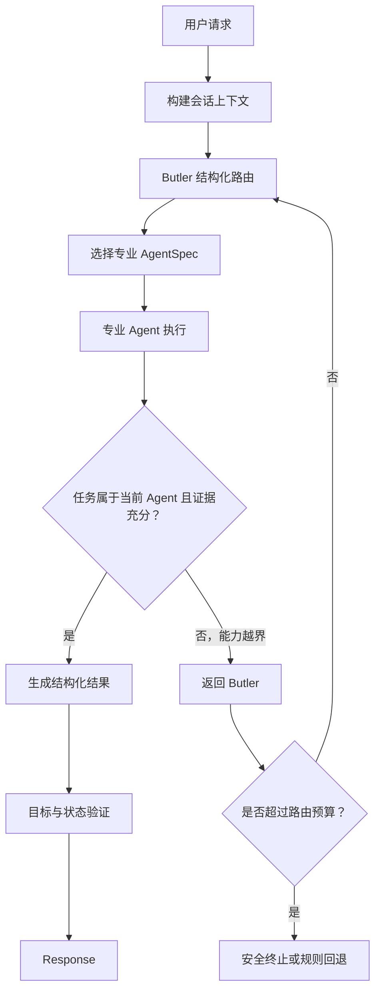
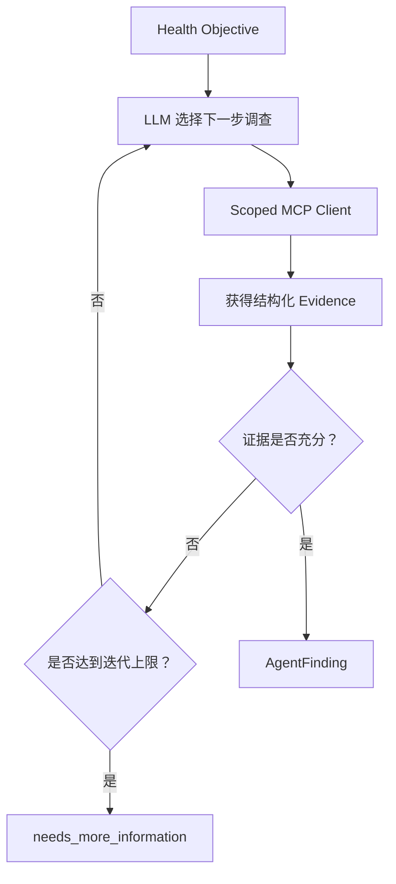
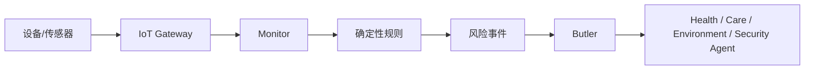

# WoTAgent 2.0 智能体路由与闭环重构经验总结

## 1. 文档目的

本文记录 WoTAgent 2.0 在多 Agent 路由、专业 Agent 执行闭环、上下文承接和运行可观测性方面的一次实际重构。

这次优化不是为了把所有确定性程序替换成大模型，也不是追求无限自主的 Agent。真正目标是：

- 让 LLM 负责需要语义理解和动态判断的任务层决策；
- 让 RBAC、TD、MCP Scope、安全规则和执行验证继续构成确定性底座；
- 让专业 Agent 在发现任务不属于自己时，可以退回 Butler 重新路由；
- 让 Health Agent 能根据工具观察结果动态决定下一步；
- 用结构化输出、迭代上限和完整 Trace 约束大模型行为；
- 保留规则策略作为快速通道、测试 Oracle 和故障回退。

本文按照“问题现象、根因、实现方案、踩坑、验证结果、后续原则”的顺序展开。

---

## 2. 重构前的核心问题

### 2.1 关键词匹配被误当成语义路由

重构前，普通对话的专业 Agent 选择主要依赖关键词函数。逻辑大致相当于：

```python
if is_eldercare_request(message):
    return health_agent

if is_security_request(message):
    return security_agent

return environment_agent
```

这里有两个严重问题。

第一，关键词只能识别字符串，无法理解对话语义。例如：

```text
用户：查看张爷爷今天的健康状态
用户：那最近的趋势呢
```

第二句话没有再次出现“张爷爷”“健康”“心率”等显式关键词，但在人类理解中，它显然承接上一轮健康话题。

第二，未命中关键词时默认进入 `environment_agent`，会把“无法判断”错误地转换为“确定属于环境领域”。这不是回退，而是无依据的决策。

### 2.2 错误路由会造成连锁浪费

一次错误路由不仅会选择错误 Agent，还会继续产生下列成本：

1. 加载错误专业 Agent 的能力范围；
2. 把无关 TD、设备和工具描述加入 Planner 上下文；
3. Planner 尝试在错误能力空间中规划；
4. Response Agent 再对失败结果做一次总结；
5. 最终没有调用任何有效工具，却消耗大量 Token。

实际错误案例中，“那最近的趋势呢”被送入环境领域：

- 上下文包含 12 条历史消息、421 个字符；
- Planner 收到约 20 个设备和 14,111 字符的能力描述；
- Planner 单次消耗约 5,562 Token；
- Response 又消耗约 420 Token；
- 总计约 5,982 Token；
- 工具调用数为 0；
- 最终仍未回答健康趋势问题。

这说明上下文工程不能只关注“提示词是否重复”，还必须关注“路由后给模型看了什么”。错误的能力空间本身就是最大的上下文污染源之一。

### 2.3 专业 Agent 缺少退回 Butler 的协议

过去一旦 Butler 或 Router 把任务分给某个专业 Agent，专业 Agent 通常只能：

- 尝试执行；
- 返回失败；
- 生成最终回复。

它不能明确表达：

```text
这个任务不属于我的能力边界，请 Butler 重新判断。
```

因此，一次路由错误很容易直接演变为最终失败。多 Agent 系统虽然有多个 Agent 名称，却缺少主体之间真正的协商和控制权回交。

### 2.4 专业 Agent 的“智能”无法弥补错误的能力边界

即使把专业 Agent 改成 ReAct，只要它收到的工具范围是错误的，它也无法完成任务。

例如，环境 Agent 只能看到：

- 温湿度；
- 空调；
- 窗帘；
- 灯光；
- 空气质量。

当用户询问健康趋势时，再聪明的环境 Agent 也不能合法调用健康数据工具。正确解决办法不是扩大所有 Agent 的工具权限，而是：

1. 专业 Agent承认任务越界；
2. 将控制权退回 Butler；
3. Butler 根据原始请求、会话上下文和退回原因重新路由；
4. 新 Agent 获得与其职责匹配的 MCP Scope。

---

## 3. 本次重构的职责边界

重构后仍坚持以下边界。

### 3.1 LLM 负责的内容

- 结合当前消息和会话上下文理解真实请求；
- 选择合适的专业 Agent；
- 补全省略的指代和上下文；
- 判断专业 Agent 是否提供了足够证据；
- 在 Health Agent 循环中决定下一项调查工具；
- 在专业 Agent 退回后重新路由；
- 生成面向用户的最终总结。

### 3.2 确定性程序负责的内容

- RBAC 权限判定；
- AgentSpec 与 MCP Scope；
- TD 能力和参数范围校验；
- 工具调用、超时和错误表示；
- 状态变更后的验证；
- 循环次数和总超时；
- 重复路由检测；
- 医疗硬阈值告警；
- 审计和 Trace；
- LLM 失败后的规则回退。

核心原则可以概括为：

> LLM 决定“下一步应该尝试什么”，程序决定“这一步是否允许、能否执行以及是否真正生效”。

---

## 4. 主要优化

### 4.1 使用结构化 Butler 路由

新增结构化路由结果，避免从自然语言回答中猜测控制指令。路由结果至少包含：

- 目标 Agent；
- 归一化后的用户请求；
- 路由原因；
- 置信度；
- 是否需要澄清；
- 当前涉及的住户或设备范围。

概念模型如下：

```python
class RouteDecision(BaseModel):
    agent: str
    resolved_request: str
    reason: str
    confidence: float
    needs_clarification: bool = False
    resident_id: str | None = None
```

其中 `resolved_request` 很重要。它用于把依赖历史的省略句恢复成专业 Agent 能独立理解的任务。

例如：

```text
原始输入：那最近的趋势呢
恢复后的请求：查询张爷爷最近的健康指标趋势
目标 Agent：health_agent
```

Butler 只能从当前已注册的 AgentSpec 中选择 Agent，不能自由编造 Agent 名称，也不能直接指定越权 MCP Tool。

### 4.2 关键词规则降级为快速通道和回退

本次没有完全删除关键词规则，而是重新限定其职责：

| 使用位置 | 是否保留 | 原因 |
| --- | --- | --- |
| 明确、简单、低歧义命令的快速通道 | 保留 | 降低延迟和模型调用 |
| `rule` 模式的基准策略 | 保留 | 用于回归和对照实验 |
| LLM 超时或结构化输出失败后的回退 | 保留 | 保证系统可用性 |
| 普通多轮语义路由的主判断 | 移除 | 关键词无法处理省略和指代 |
| 未匹配时默认环境 Agent | 移除 | 无法判断不等于环境任务 |
| TD 候选设备过滤 | 保留 | 属于能力检索，不等于最终决策 |
| 安全方向和参数硬校验 | 保留 | 不应交给 LLM |

关键词不是完全错误。问题在于把它放在了超出其能力的位置。

### 4.3 增加专业 Agent 退回 Butler 的机制

专业 Agent 出现以下情况时，不再直接生成最终失败回复：

- 任务不属于当前能力范围；
- 缺少完成任务所需的工具；
- 结构化计划明确要求澄清；
- 当前 Agent 规划失败且可能属于其他领域。

系统会产生结构化退回事件：

```text
agent.delegation.returned
```

Butler 随后重新评估，并产生：

```text
agent.reroute.selected
```

重新路由会携带：

- 原始用户请求；
- 会话上下文；
- 当前 Agent；
- 当前 Agent 的退回原因；
- 已尝试过的 Agent；
- 剩余路由次数。

为防止 Agent 之间来回踢任务，系统设置：

```text
SUPERVISOR_MAX_ROUTES=2
```

同时记录已尝试 Agent，禁止无意义地重复选择相同路径。

### 4.4 让 Health Agent 进入有限 ReAct 循环

健康领域优先实现了 Observe-Reason-Act 闭环：

```text
接收目标
  -> 查看健康工具范围
  -> LLM 选择下一项工具
  -> Scoped MCP Client 执行
  -> 获得结构化观察
  -> 判断证据是否充分
  -> 必要时继续调查
  -> 输出 AgentFinding
```

在“查询最近健康趋势”的真实验证中，Health Agent 按顺序执行了：

```text
read_health_summary
  -> read_vital_trend
  -> check_data_quality
```

这与一次性固定计划不同。后续工具选择基于前一轮观察结果，并受到最大循环次数、工具范围和终止条件约束。

### 4.5 删除模糊词自动恢复旧任务的硬编码

旧逻辑会尝试用“现在呢”“继续”“然后呢”等词自动恢复挂起目标。这个办法容易误判：

- “现在呢”可能询问权限状态；
- 也可能询问设备状态；
- 也可能要求重试上一操作；
- 还可能是对另一个话题的追问。

重构后，挂起目标作为会话上下文提供给 Butler，由结构化 LLM 决策是否承接，而不是由几个模糊关键词直接改变控制流。

### 4.6 Trace 记录决策理由，而非隐藏思维链

运行时间线中新增或强化了：

- 会话上下文构建；
- Butler 路由选择；
- 专业任务创建；
- Agent 退回；
- Butler 重新路由；
- Health Agent 每轮决策；
- MCP Resource/Tool 调用；
- 证据汇总；
- 回退原因；
- Token、TTFT、耗时和循环次数。

日志记录简短、结构化的决策理由，不记录大段隐式思维过程。这样既能解释系统行为，也避免把不可控的模型草稿当成审计事实。

### 4.7 压缩 Health Agent 证据上下文

早期实现会在每一轮把大量原始健康数据、历史观察和完整工具结果再次塞回模型，导致 Token 快速增长。

优化后：

- 只保留完成当前目标所需的关键字段；
- 对历史工具结果进行紧凑摘要；
- 避免重复附带相同住户资料；
- 限制最终 Finding 的长度和格式；
- 明确禁止诊断、药物建议和不必要的 Markdown 表格。

在同类健康趋势验证中，总 Token 从约 17,527 降至约 10,281，下降约 41%。该结果说明多轮 Agent 的成本关键不只是循环次数，还包括每轮观察如何压缩和继承。

### 4.8 为设备任务增加真正的 Observe-Act 循环

后续复杂测试进一步发现，最初的设备专业 Agent 仍然只是：

```text
Planner 一次规划
  -> Executor 批量执行
  -> Response
```

对于“先查询灯的数量，再根据奇偶控制设备”的任务，Planner 只能生成查询步骤。查询结果虽然进入 Trace，却不会返回 Planner，因此后续条件动作永远不会发生。

现在由 Butler 在结构化路由中增加：

```text
execution_mode = single_pass | observe_act_loop
```

涉及状态、数量、比较、条件分支或前一步结果的任务进入有限循环：

```text
Planner
  -> Policy
  -> Executor
  -> Verification
  -> Observation Pack
  -> Planner
```

循环状态记录：

- 原始目标；
- 当前轮次；
- 已执行计划；
- 工具结构化结果；
- 验证后状态；
- 累计工具调用数；
- 已出现的计划签名。

系统默认限制为 4 个设备执行轮次和 16 次工具调用，并检测重复计划。

### 4.9 增加条件计划语义审查

真实测试中曾出现以下危险情况：

```text
观察事实：4 盏灯开启，是偶数
候选动作：打开空调
```

该动作在 TD、RBAC 和 MCP Scope 层面完全合法，但不符合用户当前激活的条件分支。因此，仅有设备安全校验还不足以保证目标语义正确。

现在 Observe-Act 循环中的控制计划在进入 Policy 前，会经过独立的结构化 `Conditional Plan Reviewer`：

- 重新检查观察事实；
- 重新计算数量、奇偶、比较和余数；
- 判断当前激活分支；
- 拒绝非激活分支动作；
- 允许只执行当前阶段，并把下游条件延迟到动作验证之后；
- 审查失败时退回 Planner 修复一次；
- 修复后仍不一致则终止，不调用设备。

Reviewer 不负责权限和 TD 校验，它只补充“这个合法动作是否是当前条件下正确的动作”这一层语义约束。

---

## 5. 本次踩过的坑

### 5.1 坑一：把“默认 Agent”当成容错

### 现象

所有无法识别的请求都进入环境 Agent。

### 根因

代码把“没有证据”转换成了“确定属于某领域”。

### 修复

- 允许 Butler 返回澄清；
- 允许专业 Agent 返回越界；
- 允许重新路由；
- 达到上限后安全终止；
- 仅在规则回退中使用明确、可解释的默认策略。

### 经验

多 Agent 路由中，`unknown` 必须是一等状态。不能为了让图继续运行而伪造确定性。

---

### 5.2 坑二：误以为 ReAct 能解决所有错误

### 现象

希望把专业 Agent 改成 ReAct 后，它就能自行解决误路由问题。

### 根因

ReAct 只能在“它看得见的工具集合”内选择。AgentSpec 和 MCP Scope 如果错误，再多推理轮次也只会增加成本。

### 修复

增加 Agent 到 Butler 的控制权回交，并重新建立正确的能力范围。

### 经验

Agent 自主性必须建立在正确的能力边界上。路由、授权和执行是三个不同问题。

---

### 5.3 坑三：用自由文本判断是否越界

### 现象

尝试通过查找“无法处理”“不属于我的职责”等字符串判断 Agent 是否应退回。

### 根因

自由文本受模型、语言和措辞影响，无法稳定控制 LangGraph 跳转。

### 修复

优先依据结构化状态，例如：

```text
intent = clarify
planning_failed = true
status = out_of_scope
```

当前实现已经使用结构化计划和失败状态触发退回。下一步仍应把所有专业 Agent 的结果统一成显式 `AgentFinding.status`，彻底消除文本猜测。

### 经验

凡是会改变控制流的 LLM 输出，都必须经过结构化模型校验。

---

### 5.4 坑四：重新路由可能形成循环

### 现象

Agent A 退回 Butler，Butler 选择 Agent B，Agent B 又退回，甚至再次选择 Agent A。

### 根因

图中虽然存在循环边，却没有循环预算和重复计划检测。

### 修复

- 设置最大路由次数；
- 记录已尝试 Agent；
- 禁止重复选择同一失败路径；
- 相同失败连续出现时终止；
- 将终止原因写入 Trace。

### 经验

所有 Agent Loop 都必须同时拥有“继续条件”和“停止条件”。只有回边而没有预算，不是智能闭环，而是失控风险。

---

### 5.5 坑五：单元测试意外调用真实 LLM

### 现象

新增路由后，部分旧测试本来只验证图跳转，却因为默认进入 Hybrid Router 而调用了真实模型。

### 根因

测试没有显式注入 Fake Router，运行模式和外部依赖边界不够清晰。

### 修复

- 路由器支持依赖注入；
- 测试使用 Fake LLM 或 Fake Router；
- 对需要规则路径的测试显式设置 `rule` 模式；
- 集成测试通过可重复状态序列模拟多轮观察；
- 真实模型只用于单独的在线冒烟验证。

### 经验

测试 Agent 图时，应该测试“决策契约和状态转移”，而不是依赖真实模型恰好输出预期答案。

---

### 5.6 坑六：Windows 中文命令产生编码误导

### 现象

通过 PowerShell、Node 或临时管道发送中文测试请求时，服务端收到的内容可能变成问号或乱码，导致路由结果异常。

### 根因

终端代码页、PowerShell 管道编码、脚本文件编码和 HTTP JSON 编码并不总是一致。

### 修复

- 对复杂中文测试使用明确的 UTF-8 脚本文件；
- HTTP 请求显式设置 `Content-Type: application/json; charset=utf-8`；
- 必要时使用 Unicode 转义构造测试文本；
- 不把终端显示结果直接等同于服务端实际收到的字节；
- 通过 Trace 中保存的原始 `message` 再次确认。

### 经验

中文语义测试失败时，第一步应确认模型收到的真实字符串，而不是立即修改 Prompt 或路由算法。

---

### 5.7 坑七：前端响应式对象与原始对象混用

### 现象

Trace 事件已经从后端到达，但前端时间线偶尔不刷新，或任务状态显示滞后。

### 根因

对象加入 Vue 响应式数组后，后续代码仍修改插入前的原始对象，而不是数组中由 Vue 代理的对象。

### 修复

- 任务插入响应式集合后，从 Store 中重新取得代理对象；
- 后续事件合并统一操作响应式对象；
- 为事件增量、任务恢复和状态变化增加前端测试。

### 经验

实时 Trace 的正确性不仅是后端事件协议问题，也取决于前端是否始终修改同一份响应式状态。

---

### 5.8 坑八：任务恢复与实时流存在竞态

### 现象

页面恢复历史任务的同时，SSE 或轮询又收到同一任务，可能生成两个 RuntimeTask，造成重复时间线或状态互相覆盖。

### 根因

恢复流程和实时事件流程都能创建任务对象，但缺少按 `task_id` 的原子去重。

### 修复

- 创建任务前按 `task_id` 加锁或再次检查；
- 重复对象合并时保留事件更完整、更新时间更新的一份；
- 事件按照 `sequence` 去重和排序；
- 对恢复与实时到达并发场景增加测试。

### 经验

可观测前端本质上是一个事件溯源客户端。任务 ID、事件序号和幂等合并不是附加功能，而是数据正确性的基础。

---

### 5.9 坑九：后端重启后历史 Trace 丢失

### 现象

任务执行时前端可以查看完整 Trace，但后端重启后，旧 `task_id` 查询可能返回 404。

### 根因

当前 TraceStore 主要是进程内存存储，会话消息与完整运行事件的持久化程度不一致。

### 当前处理

本次没有为了路由重构顺带引入复杂数据库迁移，避免扩大修改范围。

### 后续建议

- 将 Task、Event、Usage 和 AgentFinding 持久化；
- 保留事件 sequence 和 trace_id；
- 支持按 conversation_id 重放；
- 为敏感健康数据增加脱敏和保留周期；
- 进程启动时恢复未完成任务为明确的 interrupted 状态。

### 经验

“实时可见”和“可审计”不是同一件事。真正的审计要求进程重启后仍能重放。

---

### 5.10 坑十：模型输出过度医疗化和过度格式化

### 现象

Health Agent 可能输出过长分析、Markdown 表格，甚至使用接近医疗诊断的措辞。

### 根因

提示词只告诉模型“分析健康数据”，没有明确限定系统的非诊断职责、证据格式和输出长度。

### 修复

- 明确系统只做风险感知、信息汇总和护理协同；
- 禁止疾病诊断和药物调整建议；
- 要求结论由 Evidence 支撑；
- 限制 Finding 长度；
- 要求优先输出护理人员可理解的简洁结论；
- 医疗硬阈值仍由 Monitor 规则触发，LLM 无权忽略。

### 经验

领域 Agent 的 Prompt 不只是角色描述，还必须明确责任边界、禁止事项、证据标准和输出契约。

### 5.11 坑十一：图中有循环事件，不等于真正重新决策

#### 现象

Trace 显示“循环完成”，但复杂设备任务只查询状态，不执行后续条件动作。

#### 根因

原来的 `agent.loop.completed` 只表示 Orchestrator 完成了一轮固定计划。执行后直接进入 Response，并没有把工具观察返回 Planner。

#### 修复

- 增加 `observe_act_loop` 执行模式；
- 将执行结果压缩成 Observation Pack；
- 执行成功后回到 Planner；
- Planner 只规划下一阶段；
- 终态由无工具的 `chat` 计划明确表示。

#### 经验

评价 Agent Loop 时必须检查控制流是否真的回到决策节点，而不能根据事件名称、循环计数或界面动画判断。

---

### 5.12 坑十二：Observation 写进图状态，但 Planner 实际没读到

#### 现象

第二轮 Planner 完整重复第一轮查询计划。

#### 根因

图把 Observation 写入 `context.agent_loop`，但 Planner 只序列化了 `context.runtime`。数据在内存中存在，却没有进入模型消息。

#### 修复

- 显式把 `agent_loop` 合并进 `runtime_context`；
- 单测检查实际发给模型的消息内容；
- Trace 记录运行上下文字符数和设备数量。

#### 经验

上下文工程不能只检查 State 中“有没有数据”，还要检查最终模型请求中“是否真的包含该数据”。

---

### 5.13 坑十三：能力候选上限截断了集合设备

#### 现象

用户要求检查 7 盏灯，但 Planner 只查询了 3 盏。

#### 根因

任务同时提到灯、空调、加湿器和风扇，候选设备上限为 8。空调等设备占据候选位置后，灯集合被截断。

#### 修复

Observe-Act 任务将相关设备候选上限提高到 24，确保集合查询能够看见完整设备空间；普通单轮任务仍保持较小上下文。

#### 经验

Top-K 能力检索必须考虑集合完整性。查询“所有灯”时，不能为了固定 Token 上限只返回部分灯。

---

### 5.14 坑十四：合法工具也可能属于错误条件分支

#### 现象

系统观察到 4 盏灯开启，却生成并执行了开空调动作，下一轮才自行纠正并打开加湿器。

#### 根因

RBAC 判断用户能否操作空调，TD 判断空调是否支持 `turnOn`，但二者都不判断“偶数条件下是否应该操作空调”。

#### 修复

在 Policy 前增加结构化条件计划审查，并在审查拒绝后要求 Planner 修复一次。

#### 经验

安全正确性至少有三层：

1. 是否有权限；
2. 设备是否支持；
3. 当前观察是否支持这个动作。

第三层不能被前两层替代。

---

### 5.15 坑十五：Reviewer 可能把分阶段计划误判为不完整

#### 现象

偶数分支中，Planner 正确计划“本轮只打开加湿器”，Reviewer 却因为没有同时计划风扇而拒绝。

#### 根因

Reviewer 按完整工作流审核候选计划，而系统实际采用逐阶段 Observe-Act：应先打开并验证加湿器，再决定风扇。

#### 修复

Reviewer 契约明确：

- 候选计划只是下一阶段；
- 不因下游条件被推迟而拒绝；
- 当前分支明确要求的父动作可以先执行；
- 下游动作必须等待父动作验证结果。

#### 经验

Planner 和 Reviewer 必须对“计划粒度”达成一致，否则审查器会把正确的增量决策当成遗漏。

---

### 5.16 坑十六：模型用空控制计划表达目标完成

#### 现象

模型返回：

```json
{
  "intent": "control",
  "steps": []
}
```

其自然语言摘要却表示“任务已经完成”。

#### 根因

模型理解了终态，但选错了结构化枚举。

#### 修复

- `query/control` 强制至少包含一个步骤；
- `chat/clarify` 强制不包含步骤；
- 首次非法输出触发一次结构修复；
- 已有成功执行历史且模型连续返回零步骤时，只允许规范化为无动作 `chat` 终态；
- 记录 `plan.normalized`；
- 首轮空控制计划仍直接拒绝。

#### 经验

不要因为模型“意思大概对”就放松结构校验。可做安全的无动作规范化，但不能替模型补造设备动作。

---

## 6. 重构后的实际链路

### 6.1 普通用户请求



### 6.2 Health Agent 子循环



### 6.3 Monitor 事件

Monitor 仍是独立于 LLM 的持续监测服务：



高频原始数据不会直接持续灌入大模型。Monitor 负责保存状态和产生事件，Agent 只在事件或用户任务需要时读取摘要、趋势和证据。

---

## 7. 验证方法与结果

### 7.1 单元与集成测试

重构后运行结果：

```text
后端：150 passed, 1 skipped
前端：17 passed
前端构建与类型检查：通过
```

测试覆盖重点包括：

- 结构化 Supervisor 路由；
- 会话省略句恢复；
- Agent 越界后退回 Butler；
- 最大重新路由次数；
- LLM 结构化输出失败后的规则回退；
- Health Agent 多轮工具选择；
- 最大循环次数终止；
- 设备任务查询后重新规划；
- 条件分支计划审查与修复；
- 非激活分支动作阻止；
- 空控制计划校验和终态规范化；
- Scoped MCP Client 越权阻止；
- RBAC 拒绝不可绕过；
- Trace 事件顺序；
- 前端任务恢复与响应式更新。

### 7.2 真实模型冒烟验证

在同一 conversation 中依次发送：

```text
查看张爷爷今天的健康状态
那最近的趋势呢
```

第二轮实际结果：

- 路由到 `health_agent`；
- 继承住户 `elderly-001`；
- 路由置信度为 0.95；
- 没有落入环境 Agent；
- Health Agent 连续读取健康摘要、生命体征趋势和数据质量；
- 共形成 4 次 Health 决策；
- 任务成功结束；
- Trace 能展示路由和每轮调查过程。

### 7.3 Token 对比

| 场景 | 路由 | 工具调用 | 总 Token | 结果 |
| --- | --- | ---: | ---: | --- |
| 重构前“那最近的趋势呢” | 错误进入环境 Agent | 0 | 约 5,982 | 无法回答 |
| Health 闭环早期版本 | 正确进入 Health Agent | 多次 | 约 17,527 | 能回答但上下文偏重 |
| 证据压缩后 | 正确进入 Health Agent | 多次 | 约 10,281 | 能回答且降低约 41% |

这些数据不是简单说明“Agentic 一定更省 Token”。恰恰相反：

- 正确的多轮调查通常比一次分类调用更贵；
- 但它能够真正获得证据并完成任务；
- 上下文压缩可以显著降低每轮增量成本；
- 错误路由即使 Token 较少，也属于无效消耗。

因此应该同时评价：

- 任务成功率；
- 工具有效调用率；
- 每个成功任务的 Token；
- 每轮 Token 增量；
- TTFT；
- 总延迟；
- 无效路由次数；
- 回退次数；
- 证据充分率。

### 7.4 复杂设备条件任务实测

测试指令：

```text
检查灯的状态。
如果开着的灯是奇数，就打开空调；
如果开着的灯是偶数，就打开加湿器。
打开加湿器以后，如果加湿器状态值加上关着的灯数量除以 3 的余数是 1，
就打开风扇。
```

奇数状态实测：

- 5 盏灯开、2 盏灯关；
- 查询全部 7 盏灯；
- Reviewer 选择 odd 分支；
- 只调用空调 `turnOn`；
- 不调用加湿器和风扇；
- 2 个执行轮次；
- 最终 `succeeded`。

偶数状态实测：

- 4 盏灯开、3 盏灯关；
- 查询全部 7 盏灯；
- Reviewer 选择 even 分支；
- 第 2 轮打开并验证加湿器；
- 第 3 轮根据 `(1 + 3) % 3 == 1` 打开并验证风扇；
- 不调用空调；
- 最终 `succeeded`。

该测试同时验证了路由、集合能力检索、多轮观察、算术条件、嵌套分支、执行验证和语义审查。

---

## 8. 可复现测试命令

以下命令均在项目根目录执行。

### 8.1 后端测试

```powershell
Set-Location D:\Users\gyq16\Desktop\PRJ\WoTAgent\wotagent-prototype
pytest
```

### 8.2 前端测试

```powershell
Set-Location D:\Users\gyq16\Desktop\PRJ\WoTAgent\frontend\wotagent-v2-console
npm test
```

### 8.3 前端构建

```powershell
Set-Location D:\Users\gyq16\Desktop\PRJ\WoTAgent\frontend\wotagent-v2-console
npm run build
```

### 8.4 推荐人工验证用例

用例一：上下文承接。

```text
查看张爷爷今天的健康状态
那最近的趋势呢
```

预期：

- 第二句仍路由到 Health Agent；
- resident_id 保持为张爷爷；
- 至少读取趋势数据；
- 不进入环境 Agent。

用例二：跨领域重新路由。

```text
查看张爷爷最近睡眠情况
如果房间太热，把空调调到舒适温度
```

预期：

- Butler 能识别健康调查和环境动作的不同职责；
- Health Agent 不直接控制空调；
- Environment Agent 的动作仍通过 RBAC、TD 和 MCP Scope；
- 状态改变后执行验证。

用例三：能力越界。

构造一个先被错误或低置信度送到 Environment Agent 的健康问题。

预期：

- 出现 `agent.delegation.returned`；
- 随后出现 `agent.reroute.selected`；
- 不超过最大路由次数；
- 不允许 Environment Agent 调用健康工具。

用例四：数据不足。

让健康数据时间戳过期或趋势数据缺失。

预期：

- Health Agent 先检查摘要更新时间；
- 继续查询最新数据或数据质量；
- 仍不足时返回 `needs_more_information`；
- 不编造健康结论。

---

## 9. 形成的工程原则

### 9.1 语义决策与安全约束必须分层

LLM 适合判断语义、目标和下一步，不适合决定自己是否有权限，也不适合绕过设备能力约束。

### 9.2 Agent 不是类名，而是独立能力边界

一个专业 Agent 至少需要：

- 明确职责；
- 独立 Prompt；
- 独立 AgentSpec；
- 独立 MCP Scope；
- 结构化输入和输出；
- 可观察的执行状态；
- 退回上级的协议。

如果多个所谓 Agent 共享全部工具、全部上下文和同一执行逻辑，它们更接近提示词角色，而不是真正的多主体系统。

### 9.3 无法判断必须被显式建模

`unknown`、`out_of_scope`、`needs_more_information` 和 `blocked` 都应该是结构化状态。不能用错误默认值掩盖不确定性。

### 9.4 自主循环必须有预算

每个循环都应限制：

- 最大迭代次数；
- 最大工具调用数；
- 总超时；
- 重复计划；
- 连续相同失败；
- 高风险动作确认。

### 9.5 工具成功不等于目标完成

设备动作必须尽量遵循：

```text
执行动作
  -> 读取执行后状态
  -> 与目标状态比较
  -> verified / unverified / failed
```

Butler 应根据验证后的状态判断成功，而不是仅看 HTTP 200。

### 9.6 上下文工程首先是范围工程

减少 Token 不只是缩短 System Prompt，还包括：

- 先正确路由，再加载专业能力；
- 不向模型暴露无关设备；
- 不重复传输完整观察；
- 使用结构化摘要；
- 对历史消息按目标相关性选择；
- 避免多个 Agent 重复总结同一份数据。

### 9.7 Trace 应记录决策证据，不记录表演式思考

用户真正需要知道的是：

- 系统选择了谁；
- 为什么选择；
- 调用了什么；
- 得到了什么；
- 权限如何判定；
- 目标是否验证；
- 为什么继续、退回或终止。

这比展示大段模型“内心独白”更稳定，也更适合作为科研实验数据。

---

## 10. 当前仍存在的限制

本次重构已经改善真实控制流，但并不代表所有 Agent 都已完全自主化。

当前限制包括：

1. Health Agent 已具备较完整的有限 ReAct 调查循环，Environment、Care、Security 等专业 Agent 仍以受约束单轮或确定性流程为主。
2. 普通设备任务已经支持专业 Agent 退回和重新路由，但统一的 `AgentFinding.status = out_of_scope` 仍应继续覆盖所有子图。
3. Butler 对普通设备任务的二次 GoalEvaluation 还可以进一步统一，目前健康闭环最完整。
4. LLM Router 本身会增加一次模型调用，后续可尝试小模型、语义缓存和高置信度快速通道。
5. Trace 的进程级持久化仍不完整，后端重启后历史审计能力有限。
6. 多 Agent Shadow Mode 和规则/Hybrid 自动差异报告仍可继续增强。
7. Care、Security、Environment Agent 需要更多独立 TD、MCP 权限范围和专用测试集，才能形成与 Health Agent 同等级别的专业能力边界。

这些限制应该如实描述。当前系统已经从“关键词选流程”向“受约束的目标驱动多 Agent”演进，但还不是所有领域都具备同等自主度的完全体。

---

## 11. 可用于项目汇报的专业表述

可以将这次工作概括为：

> 针对原有多 Agent 系统依赖关键词路由、专业 Agent 无法退回上级以及健康任务缺少观察闭环的问题，我将 Butler 重构为结构化 LLM Supervisor，使其结合会话上下文动态选择受 AgentSpec 约束的专业 Agent；同时增加专业 Agent 到 Butler 的有限退回与重新路由机制，并率先为 Health Agent 实现基于 Scoped MCP Client 的 Observe-Reason-Act 循环。系统保留 RBAC、TD、MCP Scope、确定性 Monitor、状态验证和规则回退作为安全底座，并通过 Trace 记录每轮路由、工具调用、证据与终止原因。重构后，多轮省略式健康查询能够正确承接上下文并动态查询摘要、趋势和数据质量；在压缩证据上下文后，同类任务 Token 消耗下降约 41%。

更简洁的面试版本：

> 我没有把所有逻辑都交给大模型，而是让 LLM 负责目标理解、动态路由和下一步调查，让 RBAC、TD、MCP Scope 和状态验证负责安全执行。重点解决了关键词误路由、Agent 不能退回 Butler 和多轮健康调查缺少闭环三个问题，并用结构化输出、循环预算、Fake LLM 测试和完整 Trace 保证系统可控、可测和可解释。

---

## 12. 总结

本次优化最重要的认识不是“关键词不好，LLM 好”，而是不同机制应承担不同职责：

- 关键词适合高确定性快速通道和规则回退；
- LLM 适合语义路由、上下文恢复和动态调查；
- AgentSpec 与 MCP Scope 负责主体能力边界；
- RBAC、TD 和 Policy 负责不可绕过的约束；
- Monitor 负责持续数据监测和硬规则告警；
- Verification 负责判断动作是否真正生效；
- Trace 负责把整个过程转化为可复盘、可评测的实验记录。

真正可靠的物联网 Agent 不是让大模型控制一切，而是在确定性安全底座之上，给予它有限、明确、可观察、可回退的决策权。
