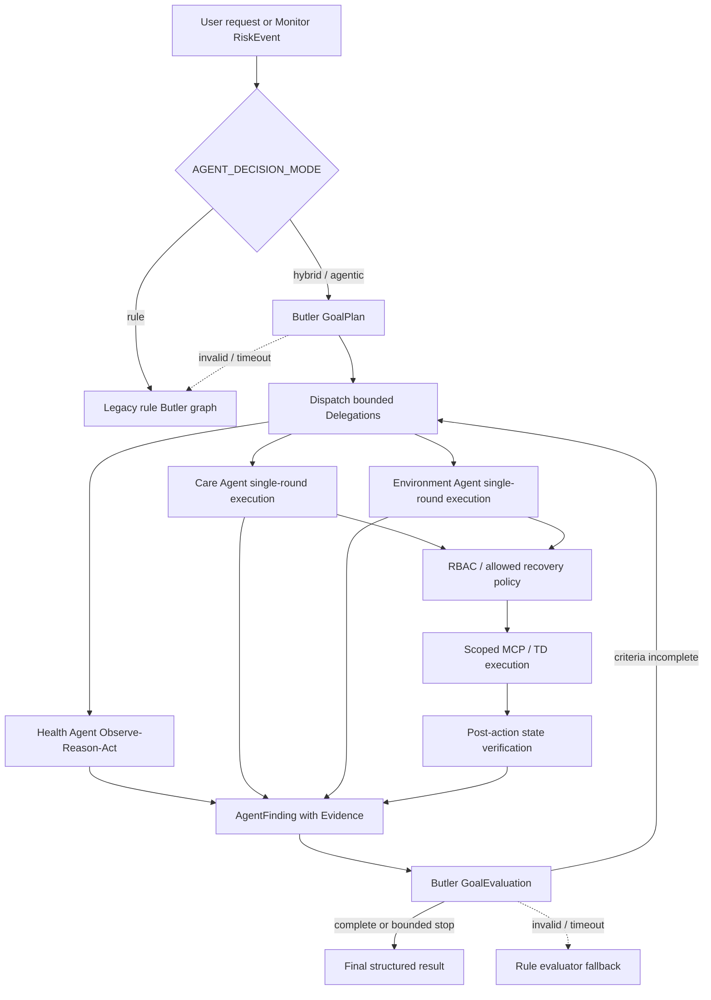

# WoTAgent Goal-Driven Agent Loop

## 1. Scope

This revision evolves WoTAgent from one-shot planning toward a bounded
Observe-Reason-Act loop without removing the deterministic safety base.

The LLM may decide goals, investigation steps, delegations, evidence
sufficiency, recovery suggestions, and goal completion. It may not bypass
RBAC, Policy, Agent MCP scope, TD schemas, confirmation, execution timeout,
verification, audit, or Monitor hard alerts.

## 2. Decision Modes

| Mode | Behavior |
| --- | --- |
| `rule` | Original deterministic Butler delegation and execution. Used as baseline, Oracle, and fallback. |
| `hybrid` | Default. LLM GoalPlan and GoalEvaluation, bounded Health Agent loop, deterministic Care/Environment execution, rule fallback. |
| `agentic` | Experimental extension point. Currently uses the same bounded safety envelope as hybrid; more professional loops can be added incrementally. |

`AGENT_SHADOW_MODE=true` executes only the rule path. The hybrid path performs
planning and dry-run comparison without Resource or Tool execution.

## 3. Structured Contracts

- `Delegation`: professional Agent objective, reason, expected evidence, priority.
- `GoalPlan`: goal, context, delegations, success criteria, constraints, iteration limit.
- `Evidence`: source, value, timestamp, reliability, description.
- `AgentFinding`: status, evidence, confidence, recommendations, unresolved questions, tool calls.
- `GoalEvaluation`: satisfied and unsatisfied criteria, next delegations, completion decision.
- `ToolExecutionResult`: success, verification, arguments, observed state, structured error, retryability.
- `HealthAgentDecision`: one authorized health Resource call or a structured finish decision.

## 4. Actual Runtime

### User chat routing

Ordinary chat and Monitor events now share the same Butler responsibility
boundary. In `hybrid` and `agentic` modes, chat routing is produced as a
validated `RouteDecision` by the LLM Butler. The decision resolves elliptical
references, selects one registered Agent, carries the resident scope, and
rewrites the request into a self-contained professional objective.

If a professional Agent returns a structured `clarify` or planning failure,
the outcome returns to the Butler. The Butler may select a different,
previously unattempted Agent. `SUPERVISOR_MAX_ROUTES` bounds this hand-back
loop and defaults to two routes.

The keyword router remains only as the `rule` mode Oracle and as an LLM
failure fallback. It is no longer the primary chat router in hybrid mode.

## 5. Health Agent Loop

Code path:

`eldercare/health_agent.py`
→ `ScopedHealthMCPClient`
→ MCP Resources in `eldercare/mcp_server.py`
→ `HealthAgentDecision`
→ Resource observation
→ `Evidence`
→ next decision or `AgentFinding`.

Authorized resources:

- `read_health_summary`
- `check_data_quality`
- `read_latest_vitals`
- `read_vital_trend`
- `read_resident_context`

The loop stops on completion, repeated Resource plans, maximum iterations, or
maximum Resource calls. It cannot diagnose disease, prescribe medication, or
control devices.

## 6. Butler Re-evaluation

The Butler does not treat a successful Tool response as goal completion.
`GoalEvaluation` compares each success criterion against AgentFinding evidence.
An unverified device action cannot satisfy a device-state criterion.

For high and critical health events, a deterministic hard guard forces human
notification even if an LLM evaluation attempts to mark the goal complete.

## 7. Recovery

Recovery is bounded:

1. A failed assigned-caregiver notification returns a failed AgentFinding.
2. Butler evaluates the failure and can delegate notification to the current
   duty caregiver.
3. Program limits this compensation to `AGENT_MAX_COMPENSATIONS`.
4. Continued failure terminates with unresolved criteria and an explicit
   manual-intervention recommendation.

No unbounded retries are allowed.

## 8. Safety Base Retained

- `PolicyEngine` and RBAC
- Agent-specific MCP scopes
- TD action and parameter schemas
- explicit confirmation for high-risk device actions
- idempotency keys
- per-call timeout and bounded retry
- post-action state verification
- Monitor deterministic medical thresholds
- Outbox delivery
- structured trace and audit events

## 9. Trace Events

New events include:

- `agent.goal.created`
- `agent.delegation.started`
- `agent.health.decision`
- `agent.resource.completed`
- `agent.finding.completed`
- `agent.goal.evaluated`
- `agent.fallback.activated`
- `agent.shadow.compared`
- `agent.delegation.returned`
- `agent.reroute.selected`

Only concise structured decision reasons are recorded. Hidden chain-of-thought
is not logged.

## 10. Current Limitations

- Only Health Agent has a complete autonomous investigation loop.
- Ordinary health chat now enters the bounded Health Agent loop instead of
  being limited to a fixed health-summary read.
- Care and Environment Agents remain bounded single-round executors.
- `agentic` mode is reserved and does not yet enable unrestricted additional
  loops.
- Care delivery and duty roster are simulated.
- Goal planning still depends on the configured LLM provider; rule fallback is
  used when unavailable.
