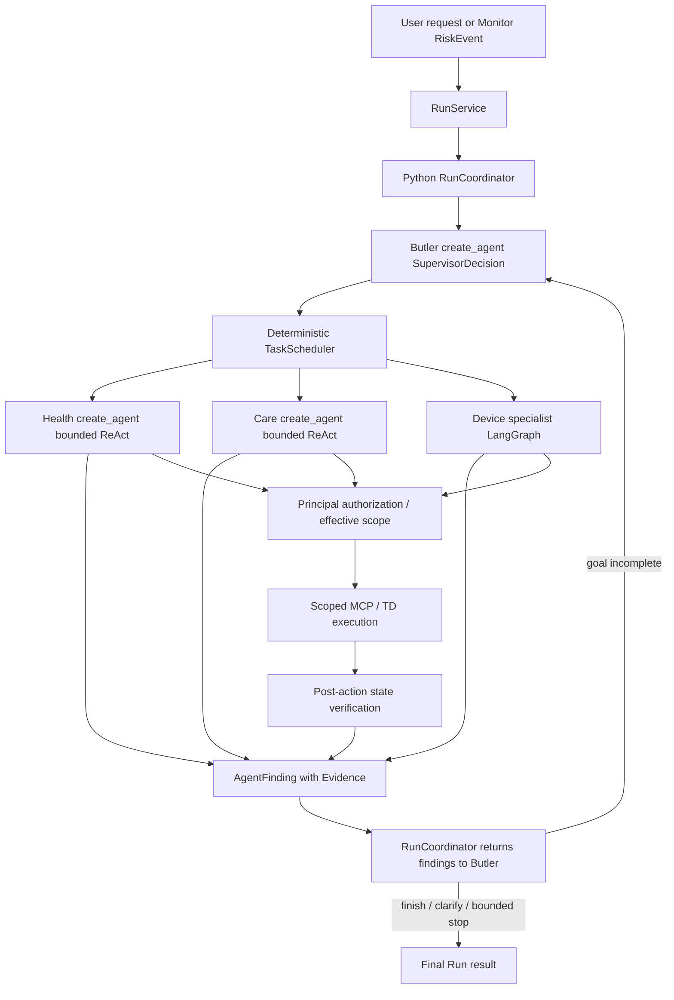

# WoTAgent Goal-Driven Agent Loop

Status: current agent-loop contract with explicit implementation caveats

Last verified: 2026-07-23

## 1. Scope

This revision evolves WoTAgent from one-shot planning toward a bounded
Observe-Reason-Act loop without removing the deterministic safety base.

The LLM may decide goals, investigation steps, delegations, evidence
sufficiency, recovery suggestions, and goal completion. It may not bypass
RBAC, Policy, Agent MCP scope, TD schemas, confirmation, execution timeout,
verification, audit, or Monitor hard alerts.

## 2. Decision Modes

Configuration still exposes `rule`, `hybrid` and `agentic`, but these values do
not currently select three equivalent end-to-end RunCoordinator
implementations.

| Mode | Current meaning |
| --- | --- |
| `rule` | Influences deterministic/legacy strategy paths and remains useful as an Oracle/fallback in covered components. It is not a complete replacement for the create_agent Run Supervisor. |
| `hybrid` | Default production experiment path: LLM Supervisor and specialist decisions inside deterministic authorization, scheduling, TD, MCP and verification boundaries. |
| `agentic` | Reserved bounded experiment mode. It does not remove safety boundaries or enable unlimited loops. |

`AGENT_SHADOW_MODE` exists as an experiment setting, but a complete top-level
rule-versus-hybrid shadow Run with equivalent semantics is not yet wired
through the current Coordinator. Do not present it as finished.

## 3. Structured Contracts

The active Run runtime uses:

- `SupervisorDecision`: `create_tasks`, `finish` or `clarify`.
- `SupervisorTaskPlan` / `ProposedTask`: specialist objectives, dependencies,
  claims, expected evidence and success criteria.
- `AgentTask`: runtime-attested Agent identity plus Principal, canonical target,
  requested capability and backend-issued effective scope.
- `Evidence`: source, value, timestamp, reliability and description.
- `AgentFindingPayload`: model-generated status, evidence, recommendations and
  continuation request.
- `AgentFinding`: runtime envelope that injects Agent, Task and AgentRun IDs.
- `TaskFailure`: category, code, retryability and stable fingerprint.
- `ToolExecutionResult`: success, verification, arguments, observed state and
  structured error.

The eldercare package still contains earlier `GoalPlan`, `GoalEvaluation` and
`HealthAgentDecision` contracts for its domain goal-graph/strategy path. They
are not the top-level Run Supervisor contract and should not be used to
describe the entire current runtime.

## 4. Actual Runtime

### User chat routing

Ordinary chat and Monitor events share the Run/Supervisor responsibility
boundary. The LLM returns a validated `SupervisorDecision` with
`create_tasks`, `finish` or `clarify`. A create decision may contain multiple
Tasks, dependencies, resource claims, evidence requirements and success
criteria.

Entity resolution, Principal authorization and effective-scope issuance happen
before specialist execution. The Supervisor may request a capability and
propose claims, but it cannot mint canonical identity, authorization or
additional resources.

After each Scheduler wave, structured Findings return to the Coordinator and
then to the Supervisor. The Supervisor may finish, clarify or create another
bounded wave. Repeated non-recoverable failure fingerprints stop equivalent
redispatch.

## 5. Health Agent Loop

Code path:

`agents/health.py`
→ `domains/eldercare/health_gateway.py`
→ scoped health MCP Resources
→ `HealthAgentDecision`
→ Resource observation
→ `Evidence`
→ next decision or `AgentFinding`.

Authorized resources:

- `read_health_summary`
- `check_data_quality`
- `read_latest_vitals`
- `read_vital_trend`
- `read_resident_context`

The loop stops on completion, repeated Resource plans, maximum iterations, or
maximum Resource calls. It cannot diagnose disease, prescribe medication, or
control devices.

## 6. Butler Re-evaluation

The Butler does not treat a successful Tool response as goal completion.
The Coordinator provides completed Task Findings and prior outcomes to the next
structured Supervisor decision. An unverified device action cannot satisfy a
device-state criterion, and a Finding can explicitly request another
delegation or clarification.

For high and critical health events, a deterministic hard guard forces human
notification even if an LLM evaluation attempts to mark the goal complete.

## 7. Recovery

Recovery is bounded at multiple levels:

1. Device LangGraph may apply bounded retry/recovery for allowed errors and
   verifies post-action state.
2. Care can notify the assigned caregiver, fall back to the duty caregiver and
   create a tracked care Task within its MCP scope.
3. Structured `TaskFailure` classifies retryable and permanent failures.
4. Failure fingerprints prevent the Supervisor from recreating an equivalent
   non-recoverable Task until the iteration budget is exhausted.

No unbounded retries are allowed.

## 8. Safety Base Retained

- `PolicyEngine` and RBAC
- Agent-specific MCP scopes
- TD action and parameter schemas
- explicit confirmation for high-risk device actions
- idempotency keys
- per-call timeout and bounded retry
- post-action state verification
- Monitor deterministic medical thresholds
- Outbox delivery
- structured trace and audit events

## 9. Trace Events

Current RunEvents include compact Run/Supervisor/Task/Agent lifecycle and
projected tool/model facts. Large prompts, responses and tool payloads are
stored as on-demand TraceArtifacts rather than repeated in every event.
Representative semantic events include:

- `agent.goal.created`
- `agent.delegation.started`
- `agent.health.decision`
- `agent.resource.completed`
- `agent.finding.completed`
- `agent.goal.evaluated`
- `agent.fallback.activated`
- `agent.shadow.compared`
- `agent.delegation.returned`
- `agent.reroute.selected`

Only concise structured decision reasons are recorded. Hidden chain-of-thought
is not logged.

## 10. Current Limitations

- Health and Care use bounded `create_agent` ReAct specialists.
- Environment, Security, Energy, Housekeeping and DeviceOps share bounded
  device LangGraph execution with different AgentSpec/MCP scopes.
- Not every enabled Agent has a complete domain-specific workflow in every
  Deployment Profile; several eldercare Agent entries are extension slots.
- The outer Supervisor/Scheduler lifecycle is still Python
  `RunCoordinator`, not one unified LangGraph main graph.
- Complete top-level rule/shadow parity is not implemented.
- Generic conditional Task guard/skip semantics are not implemented; conditional
  cross-Agent work should be delegated in a later Supervisor wave.
- Care delivery and duty roster are simulated.
- Goal planning still depends on the configured LLM provider; rule fallback is
  only available in the components where it is explicitly wired.
