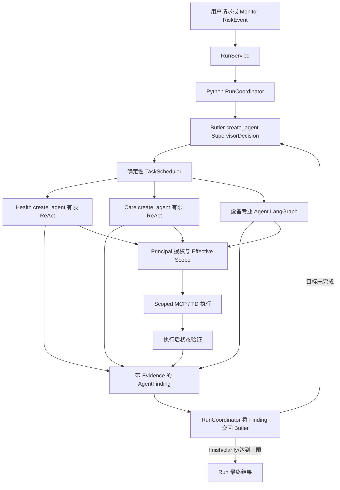

# WoTAgent 目标驱动智能体循环

状态：当前智能体循环契约，同时明确尚未完成的部分

最后核对：2026-07-23

## 1. 适用范围

当前版本把 WoTAgent 从“一次规划后固定执行”演进为受限的
Observe-Reason-Act 闭环，同时保留确定性安全底座。

LLM 可以决定目标、调查步骤、专业 Agent 委派、证据是否充分、恢复建议和目标是否
完成；它不能绕过 RBAC、Policy、Agent MCP Scope、TD Schema、人工确认、执行
超时、状态验证、审计和 Monitor 硬告警。

## 2. 决策模式

配置仍提供 `rule`、`hybrid` 和 `agentic`，但当前它们并不是三个语义等价的
端到端 RunCoordinator 实现。

| 模式 | 当前含义 |
|---|---|
| `rule` | 影响已接入的确定性/旧策略路径，可作为部分组件的 Oracle 或回退；不能完全替代当前 create_agent Supervisor |
| `hybrid` | 默认实验路径：LLM 做 Supervisor 和专业决策，授权、调度、TD、MCP、验证保持确定性 |
| `agentic` | 为受限实验保留，不会取消安全边界，也不会开启无限循环 |

`AGENT_SHADOW_MODE` 已有配置入口，但当前 Coordinator 尚未形成语义等价的
rule/hybrid 双路径完整 Shadow Run，不能声称已经完成。

## 3. 结构化契约

当前 Run 运行时使用：

- `SupervisorDecision`：`create_tasks`、`finish` 或 `clarify`。
- `SupervisorTaskPlan` / `ProposedTask`：专业目标、依赖、Resource Claim、
  预期证据和成功条件。
- `AgentTask`：运行时认证的 Agent 身份，以及 Principal、规范化 Target、
  Requested Capability 和后端签发的 Effective Scope。
- `Evidence`：来源、值、时间、可靠性和说明。
- `AgentFindingPayload`：模型生成的状态、证据、建议和继续方式。
- `AgentFinding`：运行时注入 Agent、Task 和 AgentRun ID 的可信外壳。
- `TaskFailure`：失败类别、错误码、可重试性和稳定 Fingerprint。
- `ToolExecutionResult`：执行、验证、参数、观测状态和结构化错误。

养老包仍保留早期 `GoalPlan`、`GoalEvaluation` 和 `HealthAgentDecision`，供领域
Goal Graph/Strategy 路径使用。它们不是当前顶层 Run Supervisor 的契约。

## 4. 实际运行时



### 用户请求路由

普通对话和 Monitor 事件都进入 Run/Supervisor 边界。LLM 输出经过校验的
`SupervisorDecision`。一次 `create_tasks` 可以包含多个 Task、依赖、资源声明、
证据要求和成功条件。

实体解析、Principal 授权和 Effective Scope 签发发生在专业 Agent 执行之前。
Supervisor 可以申请 Capability 和提出 Claim，但不能伪造规范身份、权限或新增
资源。

每个调度波次结束后，结构化 Finding 返回 Coordinator，再进入 Supervisor 下一轮
判断。Supervisor 可以结束、澄清或创建下一批有界 Task。重复的不可恢复 Failure
Fingerprint 会阻止等价 Task 反复调度。

## 5. Health Agent 循环

代码路径：

```text
agents/health.py
-> domains/eldercare/health_gateway.py
-> 受范围约束的健康 MCP Resource
-> Tool observation
-> Evidence
-> 下一步调用或 AgentFinding
```

授权 Resource：

- `read_health_summary`
- `check_data_quality`
- `read_latest_vitals`
- `read_vital_trend`
- `read_resident_context`

循环在证据充分、重复 Resource 计划、最大迭代次数或最大调用次数时结束。它不能
诊断疾病、开药或控制高风险设备。

## 6. Butler 二次决策

Butler 不会把“Tool 返回成功”直接等同于目标完成。Coordinator 将已完成 Task 的
Finding 和上轮结果交给下一次 Supervisor 决策。未验证的设备动作不能满足设备状态
成功条件，Finding 也可以明确要求继续委派或澄清。

对于高风险和危急健康事件，确定性硬规则要求通知人工，即使 LLM 试图提前结束也
不能忽略。

## 7. 恢复

恢复在多个层级受到限制：

1. 设备 LangGraph 只对允许的错误执行有限重试或恢复，并重新验证设备状态。
2. Care 可以通知责任护理员，失败后有限切换值班护理员，或创建可追踪护理 Task。
3. `TaskFailure` 区分可重试错误和永久错误。
4. Failure Fingerprint 阻止 Supervisor 重建等价的不可恢复 Task。

系统不允许无限重试。

## 8. 保留的安全底座

- Principal、RBAC 与关系策略
- AgentSpec 和 Agent 专属 MCP Scope
- TD Action/Parameter Schema
- 高风险动作显式确认
- 幂等键
- 单次调用超时和有限重试
- 执行后状态验证
- Monitor 确定性风险阈值
- Outbox 交付
- 结构化 Trace 和审计事件

## 9. Trace

RunEvent 记录精简的 Run、Supervisor、Task、Agent 生命周期以及投影后的模型和
工具事实。大 Prompt、Response 和 Tool Payload 保存为按需读取的
TraceArtifact，避免在事件流中重复传输。

代表性语义事件包括：

- `agent.goal.created`
- `agent.delegation.started`
- `agent.finding.completed`
- `agent.goal.evaluated`
- `agent.fallback.activated`
- `agent.shadow.compared`
- `agent.delegation.returned`
- `agent.reroute.selected`

系统只记录简短的结构化决策理由，不记录私有 Chain-of-Thought。

## 10. 当前限制

- Health 和 Care 使用有限 `create_agent` ReAct。
- Environment、Security、Energy、Housekeeping 和 DeviceOps 共享设备
  LangGraph，但具有不同 AgentSpec/MCP Scope。
- 并不是每个 Agent 在每个 Profile 中都有完整领域工作流；养老场景中的部分
  Agent 仍是扩展槽位。
- 外层 Supervisor/Scheduler 生命周期由 Python `RunCoordinator` 驱动，不是
  统一 LangGraph 主图。
- 顶层 rule/shadow 语义对齐尚未完成。
- 通用条件 Task 的 guard/skip 尚未实现。跨 Agent 条件动作应等待上一轮证据后
  再委派。
- 护理通知和值班表仍是模拟实现。
- LLM 不可用时，仅已明确接入规则策略的组件能够回退。
