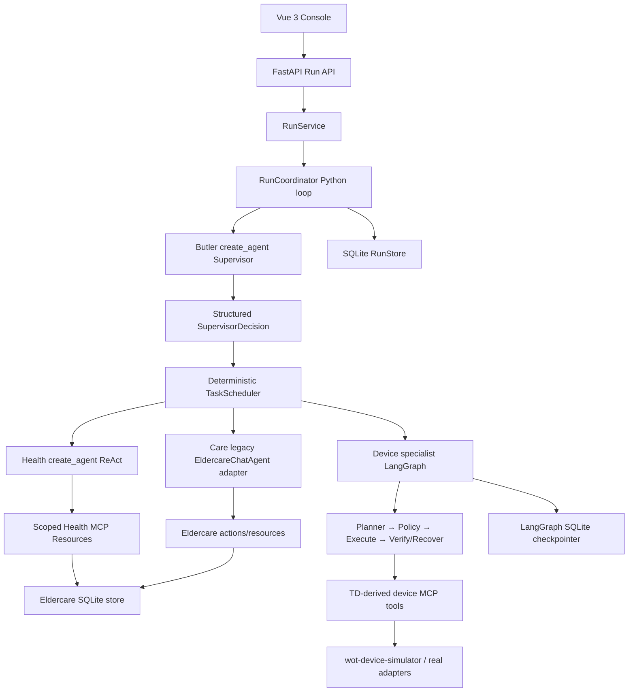

# WoTAgent 2.0 Project Handoff

Last updated: 2026-07-18
Current branch: `codex/run-task-dag`
Current implementation baseline: Domain Operations and Monitor Run refactor,
successor to `99afb3d feat: harden agent context and real model health flow`

## 中文快速交接摘要

当前项目已经从“每轮消息等于一个 Task”重构为：

```text
Conversation → Turn → Run → 多个 Task → AgentRun → Loop → ToolCall
```

当前真实实现不是一个完全统一的 LangGraph 多智能体主图：

- Butler Supervisor 使用 LangChain `create_agent`，负责生成结构化
  `SupervisorDecision`；
- 外层 Run、Task DAG、并行调度和二次决策由 Python `RunCoordinator`
  驱动；
- Health Agent 使用 `create_agent` ReAct；
- Environment、Security、Energy、Housekeeping、DeviceOps 使用设备
  LangGraph 子图；
- Care Agent 仍然通过旧 `EldercareChatAgent` 适配；
- Monitor 是独立的确定性监测服务，不由 LLM 驱动。

近期已完成：

1. Run、Task、AgentRun 分层数据模型；
2. Task DAG、依赖校验、资源冲突检测和有限并行；
3. Run 级 HTTP、WebSocket 事件流和 Vue 时间线；
4. LangGraph 原生 `interrupt()` 与 `Command(resume=...)`；
5. SQLite 持久化 Run、Task、AgentRun、事件和确认负载；
6. 服务重启后恢复同一个 Task checkpoint；
7. 后端 `178 passed, 2 skipped`，前端 `15 passed`，生产构建通过；
8. 模型 Finding Payload 与运行时 Finding Envelope 已拆分；
9. Task 已增加 Principal、Target、Capability、Effective Scope 和 Failure；
10. 张爷爷等居民名称在 Task 执行前解析为 canonical resident ID；
11. Health MCP 已执行居民 Scope 二次检查；
12. 相同不可恢复失败已由 Coordinator 阻止重复执行。
13. 前端已由养老专用看板改为平台级“领域运行中心”；
14. 已增加 DomainManifest、Subject、Resource、Telemetry、Monitor、Event 和
    Action 通用领域契约，养老作为首个领域适配器；
15. Monitor outbox 已通过应用层 DomainEventConsumer 创建正式 Run，并将
    `run_id` 回写风险事件。

但真实模型测试暴露了尚未解决的问题：

1. 历史真实运行曾出现 `Health Agent`/`health_agent` 身份漂移；现在模型不再
   生成可信身份，Coordinator 注入 Agent、Task 和 AgentRun 身份，真实
   DeepSeek Health 冒烟测试已通过。
2. 历史真实运行曾把“张爷爷”直接作为 MCP `resident_id`；现在已增加平台
   EntityResolver 接口和养老 ResidentEntityResolver，真实模型已验证
   `张爷爷 → elderly-001`、`李奶奶 → elderly-002`。
3. 后端已增加最小的 JH-1/JH-2 居民关系授权和 MCP Scope 校验，但登录身份仍由
   客户端提交，因此还不是生产级认证授权。
4. 失败分类、fingerprint 和重复终止已接入；更复杂的可重试、补偿和跨 Agent
   替代策略仍需继续完善。
5. 自动化测试仍主要使用 Fake/Scripted LLM，但 opt-in 真实模型 Health/Scope
   三案例已执行并记录；完整多 Agent + simulator 链路仍待单独测试。
6. 自动化测试未证明真实中文请求、真实模型、居民
   实体解析和 MCP 的完整链路。
7. 新 RunEvent 尚未完整投影模型 Token、TTFT、专业 Agent Loop 和 ToolCall，
   因此前端部分指标会显示为零。

安全状态：

- 项目没有真实登录鉴权，`user_id` 和 `role` 由客户端提交；
- 曾临时使用 Cloudflare Quick Tunnel 暴露 Vite，而 Vite 同时代理后端 API；
- 用户报告疑似账号安全问题后，隧道、前端、后端和仿真端均已关闭并确认端口停止；
- 在加入认证网关、后端鉴权、限流和密钥轮换前，禁止再次公网暴露。

建议下一步优先顺序：

```text
P0 真实链路正确性
→ 已完成本地契约与范围修复
→ 已完成 Health + Resident Scope 三案例真实模型冒烟测试
→ 已修复上下文预算、目标扩张和结构化 Finding 兼容问题

P1 居民级授权
→ Principal / Resident / CareAssignment / Permission
→ RBAC + Resource Scope + Relationship/Context Policy

P2 统一智能体架构
→ 评估把 RunCoordinator 改为 LangGraph 主图
→ Care Agent 迁移到统一 AgentSpec + create_agent/subgraph
→ Monitor 事件进入 Run 已完成，下一步统一专业 Agent 内部事件投影
```

## 1. Purpose Of This Document

This document is the current source of truth for discussing WoTAgent with
another AI or engineer. It distinguishes:

- what the repository actually implements;
- what has only been designed or partially migrated;
- what was covered by deterministic tests;
- what failed in a real LLM + MCP run;
- the most important architectural and security decisions still pending.

Do not assume that older design documents describe the current runtime exactly.
The project has undergone several major refactors.

## 2. Project Goal

WoTAgent 2.0 is an experimental multi-agent IoT platform built around:

- LangGraph and LangChain `create_agent`;
- LLM-driven task decomposition and specialist delegation;
- WoT Thing Description (TD) capability descriptions;
- TD-derived MCP tools and scoped MCP clients;
- deterministic RBAC, Policy, parameter validation and verification;
- persistent conversations, Runs, Tasks, events and checkpoints;
- smart-home and eldercare domains;
- an independent device simulator and Vue 3 operations console.

The intended responsibility boundary is:

| Component | Responsibility |
|---|---|
| LLM Supervisor | Understand the goal, create Tasks, choose specialists, evaluate findings and decide whether more work is needed |
| Specialist Agent | Run a bounded Observe-Reason-Act process within an explicit capability scope |
| Scheduler | Validate the Task DAG, enforce dependencies, resource conflicts and concurrency limits |
| RBAC/Policy | Decide whether the principal may perform an operation |
| AgentSpec/MCP scope | Limit which capabilities a specialist can see |
| TD | Define actual device properties, actions, events and parameter schemas |
| MCP execution | Invoke resources/tools and return structured results |
| Verification | Confirm post-action state instead of trusting HTTP/tool success alone |
| Monitor | Continuously consume device data and produce deterministic risk events |
| Audit/Trace | Record structured decisions and execution facts without exposing private chain-of-thought |

## 3. Current Repository Layout

```text
WoTAgent/
├── wotagent-prototype/                 Python backend and evaluation
│   ├── src/wotagent/
│   │   ├── agents/                     AgentSpec, contracts, create_agent factories
│   │   ├── agent_graph/                Device specialist LangGraph
│   │   ├── orchestration/              Run/Task models, coordinator, scheduler, stores
│   │   ├── application/                Run application service
│   │   ├── api/                        FastAPI assembly and routers
│   │   ├── runtime/                    Dependency construction and production adapters
│   │   ├── domains/eldercare/          Eldercare domain package
│   │   ├── auth/ and policy/           Coarse role and device policy checks
│   │   ├── gateway/ and tools/         MCP device access
│   │   ├── wot/                        TD models and tool compiler
│   │   ├── telemetry/                  Legacy detailed trace and pricing
│   │   └── evaluation/                 HomeBench/SimuHome-oriented evaluation
│   └── tests/
├── frontend/wotagent-v2-console/       Vue 3 Run/Task console
├── wot-device-simulator/               FastMCP device simulator on port 18080
├── doc/                                Design, API and evaluation documents
└── handoff.md                          This file
```

## 4. Current Runtime Model

The current interaction hierarchy is:

```text
Conversation
└── Turn
    └── Run
        ├── Task
        │   └── AgentRun
        │       ├── Loop
        │       └── ToolCall
        └── Task
            └── AgentRun
```

- One user message creates one `Turn` and one `Run`.
- A Supervisor decision can create multiple Tasks.
- Tasks can have dependencies and resource claims.
- A Task is executed by one specialist Agent.
- Multiple ready Tasks may run concurrently when the Scheduler considers them
  safe.
- Loop iterations and Tool Calls belong inside an AgentRun; they are not
  top-level Tasks.

### 4.1 Actual Production Call Chain



Important qualification:

- The Butler itself is built with LangChain `create_agent`.
- Device specialists are compiled LangGraph graphs.
- The outer Run/Supervisor/Scheduler lifecycle is currently an imperative
  Python `RunCoordinator`, not one unified LangGraph `StateGraph`.
- `health_agent` uses `create_agent`.
- `care_agent` still adapts the older `EldercareChatAgent`.
- Therefore the target architecture of "Supervisor main graph with all
  specialists as uniform ReAct subgraphs" is not yet fully realized.

## 5. Supervisor, Tasks And Parallelism

The Supervisor returns a validated `SupervisorDecision` with one of:

- `create_tasks`;
- `finish`;
- `clarify`.

When creating Tasks it supplies:

- `local_id`;
- `agent_id`;
- `objective`;
- `reason`;
- expected evidence;
- success criteria;
- dependencies;
- resource claims;
- priority;
- parallel candidate flag.

The deterministic `TaskScheduler` then:

- rejects unavailable Agent IDs;
- assigns real `task_id` values;
- maps local dependencies to real IDs;
- detects missing/cyclic dependencies through Pydantic validation;
- selects ready Tasks;
- limits parallelism;
- prevents conflicting writes to the same claimed resource.

Current limits default to:

```text
Supervisor iterations: 4
Device Agent iterations: 4
Health Agent iterations: 4
Maximum tool calls: 16
Maximum parallel Tasks: 4
Maximum Tasks per plan: 16
Total specialist timeout: 30 seconds
LLM timeout: 12 seconds
```

## 6. Current Agent Inventory

| Agent | Current implementation | LLM-driven | Current status |
|---|---|---:|---|
| Butler Supervisor | LangChain `create_agent`, structured `SupervisorDecision` | Yes | Active, but outer loop is Python |
| `health_agent` | `create_agent` with scoped health resource tools | Yes | Active but real production flow currently broken |
| `care_agent` | Adapter to legacy `EldercareChatAgent` | Partly | Not yet a uniform create_agent specialist |
| `environment_agent` | Device LangGraph with domain prompt/profile | Yes + deterministic execution | Active |
| `security_agent` | Device LangGraph with scoped AgentSpec | Yes + deterministic execution | Active |
| `energy_agent` | Device LangGraph with scoped AgentSpec | Yes + deterministic execution | Active |
| `housekeeping_agent` | Device LangGraph with scoped AgentSpec | Yes + deterministic execution | Active |
| `device_ops_agent` | Device LangGraph with scoped AgentSpec | Yes + deterministic execution | Active |
| Monitor | Deterministic long-running domain service | No | Active; outbox events are submitted as source-attested Runs |

The device graph contains:

```text
START
→ plan
→ policy
→ confirm or execute
→ verify/loop control
→ recover when bounded recovery is allowed
→ respond
→ END
```

High-risk confirmation uses native LangGraph `interrupt()` and resumes with
`Command(resume=...)`.

## 7. Persistence And Restart Recovery

Three separate persistence concerns currently exist:

| Store | Default file | Purpose |
|---|---|---|
| ConversationStore | `data/conversations.db` | Conversations and Turns |
| SQLiteRunStore | `data/agent_runs.db` | Runs, Tasks, AgentRuns, RunEvents and pending confirmation payloads |
| LangGraph checkpointer | `data/agent_checkpoints.db` | Device graph state and native interrupts |
| EldercareStore | `data/eldercare.db` | Residents, readings, risks and care actions |

Recently completed behavior:

- confirmation state no longer depends on an in-memory callback closure;
- `RunService` can rebuild a Coordinator after restart;
- it reloads the waiting Task and AgentRun from SQLite;
- the device graph resumes using the same `task_id` as LangGraph `thread_id`;
- the resumed Finding returns to the Supervisor for another decision.

Known persistence limitations:

- detailed legacy `TraceStore` remains in memory;
- RunEvent WebSocket wake-up uses a process-local `asyncio.Condition`;
- multi-process/multi-instance deployment needs Redis or PostgreSQL
  notifications;
- arbitrary recovery of a process crash during a non-interrupted running Task
  is not implemented.

## 8. API And Frontend

Current Run API:

```text
POST /api/v2/runs
GET  /api/v2/runs/{run_id}
GET  /api/v2/runs/{run_id}/tasks
GET  /api/v2/runs/{run_id}/events
GET  /api/v2/runs/{run_id}/tasks/{task_id}/agent-runs
POST /api/v2/runs/{run_id}/tasks/{task_id}/confirm
WS   /ws/v2
```

The old `/api/v2/tasks` runtime was removed.

The Vue console:

- displays conversations and Turns;
- displays the Run timeline inline with each chat turn;
- groups events by Run and Task;
- shows Task status and Agent execution;
- supports confirmation actions;
- provides a generic Domain Operations Center driven by DomainManifest;
- displays real Monitor heartbeat, domain resources, telemetry, events and
  linked Agent Runs;
- persists the selected demo account in local storage.

Current demo identities are hard-coded in the frontend:

```text
JH-1: 王护理员, role=operator, displayed resident=elderly-001 张爷爷
JH-2: 赵观察员, role=viewer, displayed resident=elderly-002 李奶奶
```

These are not authenticated accounts. `user_id` and `role` are client-provided
values.

Known observability gap:

- RunEvents currently expose Supervisor and Task lifecycle events;
- detailed model calls, token usage, TTFT, internal specialist loops and tool
  calls remain in the legacy TraceStore and are not fully projected into
  RunEvents;
- therefore the new frontend can show zero token/latency values even when real
  model calls occurred.

## 9. Device And WoT Chain

The intended device chain is:

```text
Device or simulator
→ device registry
→ WoT TD
→ TD parser/tool compiler
→ MCP tool schema
→ MCP server/client
→ AgentSpec-scoped specialist
→ Policy/RBAC
→ execution
→ state verification
```

The standalone simulator:

- runs FastMCP, REST and dashboard on port `18080`;
- stores simulated state in `wot-device-simulator/data/state.db`;
- includes smart-home and eldercare-related devices;
- is the preferred unified simulation entry instead of separate ad-hoc HTTP
  simulators.

Correct simulator executable:

```powershell
cd D:\Users\gyq16\Desktop\PRJ\WoTAgent\wot-device-simulator
.\.venv\Scripts\wot-sim-api.exe
```

The documented `python -m wot_device_simulator.service` command currently exits
without starting the server because `service.py` defines `main()` but does not
invoke it under `if __name__ == "__main__"`.

## 10. Eldercare Domain

The eldercare domain currently contains:

- residents and room/device associations;
- sensor readings;
- health summaries and trends;
- deterministic Monitor rules;
- risk events;
- care notifications and care tasks;
- environment adjustment actions;
- Health MCP Resources;
- eldercare SQLite storage;
- legacy goal graph and strategy modules retained during migration.

Current demo residents:

```text
elderly-001 → 张爷爷
elderly-002 → 李奶奶
```

The recommended conceptual distinction is:

- user/account/caregiver = authorization principal;
- resident = protected data subject and resource target;
- Agent = delegated software principal with a limited capability scope;
- device = protected IoT resource.

## 11. Confirmed Real-World Failure

On 2026-07-18, a real DeepSeek + Health ReAct + MCP request was executed:

```text
查看张爷爷今天的健康状态
```

Run:

```text
run_62a00f682d03
```

The Run created four Health Tasks and failed after the maximum Supervisor
iterations.

### 11.1 Agent Identity Contract Failure

The Task expected:

```json
{"agent_id": "health_agent"}
```

The model repeatedly returned:

```json
{"agent": "Health Agent"}
```

The runtime rejected it:

```text
specialist returned agent='Health Agent'; expected 'health_agent'
```

Root cause:

- the system prompt calls the specialist "Health Agent";
- the internal ID is `health_agent`;
- `AgentFinding.agent` is an unconstrained `str`;
- `create_agent(name="health_agent")` does not populate that output field;
- runtime performs strict string equality after generation.

Remediation implemented locally in `54e2528`:

1. specialist models now return an identity-free `AgentFindingPayload`;
2. the Coordinator injects Agent, Task and AgentRun identity into the persisted
   `AgentFinding`;
3. the prompt explicitly forbids model-generated runtime identity.

The deterministic tests pass, but the real DeepSeek scenario has not yet been
rerun.

### 11.2 Resident Entity Resolution Failure

The Health Task contained only natural language:

```text
查询张爷爷今天的健康状态
```

It did not carry:

```json
{"resident_id": "elderly-001"}
```

The model therefore called:

```text
elderly://张爷爷/profile
elderly://张爷爷/health/summary
```

The MCP Resource expects:

```text
elderly://elderly-001/profile
elderly://elderly-001/health/summary
```

This produced `resident not found` errors. In one iteration, repeated tool
failure also resulted in `structured_response=None`.

This was not merely a prompt problem. `AgentTask` now carries typed Principal,
Target, requested capability and effective scope. A domain Resolver resolves
the resident before execution, and the Health executor receives the canonical
ID.

### 11.3 Ineffective Retry

The Supervisor saw the infrastructure/contract failure and created essentially
the same Health Task four times.

The following controls are now implemented:

- repeated failure fingerprint detection;
- duplicate Task detection across Supervisor iterations;
- recoverable versus non-recoverable error classification;
- distinction between business evidence shortage and platform contract failure.

The Coordinator now refuses to execute the same non-recoverable subject twice.
More advanced compensation and alternative delegation remain future work.

## 12. Current Authorization Problem

The backend currently has coarse role-based permissions such as:

```text
viewer   → device.read
operator → device.read + device.control
admin    → wildcard
```

The new P0 authorization service now enforces the demo relationship:

```text
JH-1 may access elderly-001
JH-2 may access elderly-002
```

This is still not production authentication: the client can currently submit
its own `user_id` and role. The relationship check is therefore a functional
experiment boundary, not a secure identity boundary.

`Resident.caregiver` is a display string, not a principal ID. Existing
`resident_scope` fields constrain some domain delegations, but do not prove that
the current user is authorized for that resident.

The Health MCP client now independently checks the effective resident scope and
returns `RESOURCE_SCOPE_DENIED` for cross-resident access.

Recommended target model:

```text
RBAC + resource scope + relationship/context policy
```

Suggested entities:

```text
Principal
Resident
CareAssignment
Permission
AuthorizationContext
```

Suggested decision:

```text
role permits health.summary.read
AND principal is assigned to the resident
AND contextual constraints such as shift/purpose/emergency are satisfied
```

An eventual Task should carry typed fields similar to:

```json
{
  "objective": "查看今天的健康状态",
  "principal": {
    "user_id": "JH-1",
    "role": "operator"
  },
  "target": {
    "type": "resident",
    "resident_id": "elderly-001",
    "display_name": "张爷爷"
  },
  "requested_capability": "health.summary.read",
  "resource_scope": ["resident:elderly-001"]
}
```

The MCP client must independently reject a model-supplied resident outside the
authorized scope.

## 13. Monitor Status

The intended Monitor is not an LLM Agent. It should:

- continuously receive or poll device data;
- persist readings;
- execute deterministic threshold and temporal rules;
- deduplicate risk events;
- submit a structured event to the Butler;
- never send high-frequency raw telemetry directly to the LLM.

The eldercare package contains collector, monitor and monitor service behavior.
The application-layer `DomainEventConsumer` now claims the durable outbox and
creates a normal Run through `RunService`. Event Runs persist:

```text
source=monitor
domain_id=eldercare
source_event_id=<risk id>
source_context.target=<canonical resident target>
```

Each Monitor event uses an isolated Conversation to prevent unrelated sensor
events from accumulating shared LLM history. The event stores its linked
`run_id`, so the Domain Operations Center can open the same Run timeline.

## 14. Tests And Their Actual Meaning

Last verified automated results before this handoff:

```text
Backend: 178 passed, 2 skipped
Frontend: 15 passed
Frontend production build: passed
```

These tests cover:

- Run/Task/AgentRun models;
- Task DAG validation;
- dependency and resource-conflict scheduling;
- parallel batch execution;
- Run API and WebSocket replay;
- native LangGraph interrupt/resume;
- SQLite RunStore persistence;
- rebuilding Store and Coordinator before confirmation resume;
- scripted create_agent multi-step behavior;
- frontend Run/Task rendering and API calls.

What these results do not prove:

- correctness with the real DeepSeek model;
- Chinese name to canonical resident ID resolution;
- real Health Agent structured output stability;
- end-to-end resident authorization;
- a full real LLM → Supervisor → specialist → MCP → Finding smoke path;
- arbitrary crash recovery;
- production security.

The create_agent tests use a `ScriptedChatModel` that already emits:

```json
{"agent": "health_agent", "resident_id": "elderly-001"}
```

This hid the production contract and entity-resolution failures.

Required future test layers:

1. deterministic unit tests;
2. fake-model integration tests;
3. recorded/replay model contract tests;
4. opt-in real-model smoke tests with strict token budgets;
5. simulator-backed end-to-end scenarios;
6. negative authorization and scope tests.

Every release candidate should execute at least:

```text
查看张爷爷今天的健康状态
查询李奶奶最近生命体征
JH-2 尝试读取张爷爷健康数据
打开客厅灯并完成确认
并行查询健康和房间环境
相同不可恢复错误不得重复执行四次
```

## 15. Decision Modes: Important Caveat

Configuration exposes:

```text
AGENT_DECISION_MODE=rule|hybrid|agentic
```

However, after the Run/Task refactor this is not yet a complete top-level
strategy switch:

- the Run Supervisor path always calls the LLM `create_agent` Supervisor;
- decision mode still affects parts of device planning and older eldercare
  strategy code;
- a full rule-based Run/Supervisor baseline and shadow comparison are not
  uniformly wired into the new Coordinator.

Do not claim that all three modes currently provide equivalent end-to-end Run
implementations.

## 16. Security Status

The system is experimental and currently has no real authentication.

On 2026-07-18 a temporary Cloudflare Quick Tunnel was opened to the Vite
frontend. Because Vite proxied `/api` and `/ws/v2`, this also exposed the
unauthenticated backend through the same public origin.

After the user reported suspected account compromise:

- `cloudflared` was force-stopped;
- frontend, backend and simulator were stopped;
- ports `5174`, `8000`, `18080` and the Cloudflare metrics port were verified
  closed;
- the temporary public URL returned Cloudflare `530`.

Current service status at handoff:

```text
Frontend: local only on 127.0.0.1:5174
Backend: local only on 127.0.0.1:8000
Simulator: local only on 127.0.0.1:18080
Domain event consumer: disabled for token-safe UI QA
Independent Monitor: not running continuously
Cloudflare tunnel: stopped
```

Do not create another public tunnel until at least one of the following exists:

- authenticated reverse proxy/access gateway;
- backend authentication and server-derived roles;
- strict origin/network restrictions;
- rate limits;
- secret and API-key rotation;
- audit and incident review.

Never expose the current Vite proxy directly to the public Internet.

## 17. Current Git And Workspace State

Recent commits:

```text
f5cc0aa feat: persist run state across restarts
03ea444 fix: resume device graph native interrupts
63cd539 feat: resume run tasks after confirmation
7892383 refactor: replace task runner with run task dag
137426a feat: add run scoped task event stream
df01d9e feat: add run task DAG scheduler
40c5e18 refactor: establish agent platform and domain boundaries
```

At handoff, the repository also contains runtime-generated changes:

```text
wot-device-simulator/data/state.db-shm
wot-device-simulator/data/state.db-wal
.codex-remote-attachments/
```

These are not part of the intended source change. Do not revert or delete them
without checking with the user.

## 18. Recommended Next Work

### P0: Restore Correctness

1. Keep the real-model suite opt-in and preserve its explicit token budgets.
2. Project create_agent usage and repair-call usage into persistent RunEvents.
3. Add a separate simulator-backed multi-Agent smoke suite; do not mix it with
   the isolated Health/Scope contract test.
4. Preserve `source_request` as the immutable user-goal boundary while allowing
   the Supervisor to propose narrower specialist objectives.

### P1: Complete Authorization

1. Add backend-authenticated Principals instead of trusting client role values.
2. Add `CareAssignment` or equivalent principal-resident relationships.
3. Define eldercare permissions such as health summary, detailed vitals,
   notifications and environment control.
4. Add contextual checks for shift, purpose and emergency access.
5. Propagate authorization context through Run → Task → Agent → MCP.
6. Add negative tests for cross-resident access.

### P2: Finish The Agent Architecture

1. Decide whether the outer Coordinator should become a LangGraph Supervisor
   graph.
2. Convert Care into the same AgentSpec + create_agent/subgraph contract.
3. Normalize all specialist output and error contracts.
4. Project specialist loops, tool calls, model usage and TTFT into RunEvents.
5. Convert remaining legacy Care execution to the uniform AgentSpec/create_agent
   specialist contract.
6. Restore a real rule baseline and shadow-mode comparison for the Run runtime.

### P3: Operational Hardening

1. Add cancellation and independent Task retry APIs.
2. Recover or mark abandoned running Tasks after process restart.
3. Replace process-local WebSocket notifications for multi-instance use.
4. Add rate limiting, secret management and authenticated deployment.
5. Fix simulator module startup documentation or add a `__main__` guard.

## 19. Files To Read First

For architecture:

```text
src/wotagent/orchestration/run_models.py
src/wotagent/orchestration/run_coordinator.py
src/wotagent/orchestration/scheduler.py
src/wotagent/runtime/run_runtime.py
src/wotagent/runtime/container.py
```

For Agents:

```text
src/wotagent/agents/contracts.py
src/wotagent/agents/specs.py
src/wotagent/agents/factory.py
src/wotagent/agents/health.py
src/wotagent/agent_graph/graph.py
```

For eldercare:

```text
src/wotagent/domains/eldercare/models.py
src/wotagent/domains/eldercare/store.py
src/wotagent/domains/eldercare/health_gateway.py
src/wotagent/domains/eldercare/monitor.py
src/wotagent/domains/eldercare/runtime.py
```

For API/persistence:

```text
src/wotagent/application/run_service.py
src/wotagent/api/app.py
src/wotagent/api/routers/runs.py
src/wotagent/orchestration/run_store.py
src/wotagent/runtime/lifecycle.py
```

For authorization:

```text
src/wotagent/auth/rbac.py
src/wotagent/policy/engine.py
```

For frontend:

```text
frontend/wotagent-v2-console/src/App.vue
frontend/wotagent-v2-console/src/composables/useAgentRuntime.ts
frontend/wotagent-v2-console/src/components/TaskWorkspace.vue
frontend/wotagent-v2-console/src/types/agent.ts
```

## 20. Questions For The Next AI

1. Should domain entity resolution be a platform `EntityResolver`, a
   Supervisor responsibility or a domain adapter? Explain the trust boundary.
2. What is the cleanest typed representation of principal, target, capability
   and resource scope without making the platform eldercare-specific?
3. Should eldercare authorization use RBAC + ABAC, RBAC + ReBAC, or a combined
   policy model?
4. Should the specialist `agent` field remain model-generated under `Literal`
   constraints, or be platform-attested after generation?
5. How should repeated failure fingerprints be represented so the Supervisor
   cannot waste iterations on a non-recoverable contract error?
6. Should the outer RunCoordinator be replaced by a LangGraph StateGraph, and
   what state/persistence boundaries would that improve?
7. How can real-model smoke tests remain affordable while still detecting the
   failures that scripted models missed?

## 21. Non-Negotiable Design Constraints

- Do not let an LLM bypass RBAC, Policy, MCP scope or TD validation.
- Do not let an LLM directly invoke arbitrary tool names.
- Do not treat a tool returning HTTP 200 as verified goal completion.
- Do not expose private chain-of-thought.
- Do not send high-frequency raw sensor data directly to the LLM.
- Do not allow unlimited Agent loops or retries.
- Do not diagnose illness or adjust medication.
- Do not expose the unauthenticated development stack through a public tunnel.
- Do not claim a capability is complete based only on fake-model tests.
