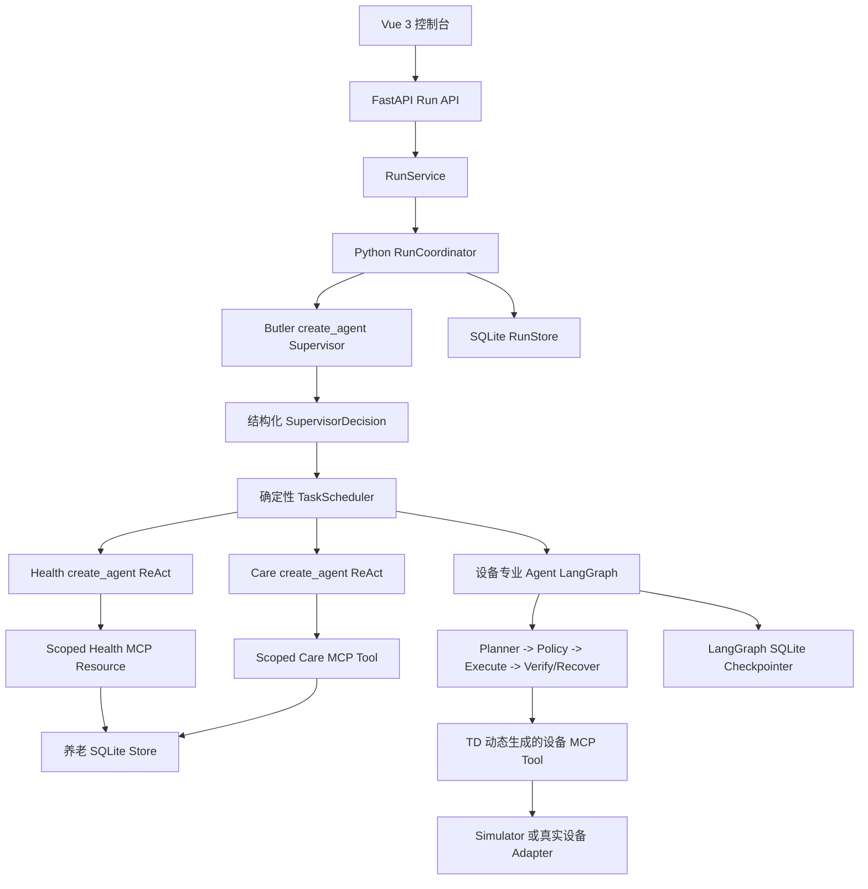

# WoTAgent 项目交接文档

最后更新：2026-07-23

当前分支：`trae/run-task-dag`

当前发布基线：`v2.8.0`

当前实现目标：`v3.0.0` 场景隔离与 P1 授权

本次文档同步前源码基线：
`4b8f954 docs: add agent abstraction interview guide`

> 本文是当前交接基线。代码与自动化测试优先于旧设计文档；本文后面的历史问题
> 只用于解释演进，不表示故障仍然存在。

## 1. 项目目标

WoTAgent 是一个面向实验验证的多 Agent 物联网平台，主要技术包括：

- LangChain `create_agent` 和 LangGraph；
- LLM 驱动的任务拆解、专业 Agent 委派和二次决策；
- WoT Thing Description（TD）能力描述；
- TD 动态编译的 MCP Tool；
- Principal、RBAC、关系策略和 Effective Scope；
- 确定性 Policy、参数校验、执行后状态验证和审计；
- 持久化 Conversation、Run、Task、事件和 Checkpoint；
- 养老与别墅/智能家居领域；
- 独立 Device Simulator 和 Vue 3 控制台。

系统职责边界：

| 组件 | 职责 |
|---|---|
| LLM Supervisor | 理解目标、创建 Task、选择专业 Agent、评价 Finding、决定是否继续 |
| 专业 Agent | 在明确 Capability Scope 内执行有限 Observe-Reason-Act |
| TaskScheduler | 校验 DAG、依赖、资源冲突和并发上限 |
| Principal/RBAC/Policy | 判断当前主体是否允许操作目标资源 |
| AgentSpec/MCP Scope | 限制专业 Agent 可见和可调用的能力 |
| TD | 定义设备 Property、Action、Event 和参数 Schema |
| MCP 执行层 | 调用 Resource/Tool 并返回结构化结果 |
| Verification | 读取动作后状态，不把 HTTP 200 当作目标完成 |
| Monitor | 持续接收数据并以确定性规则生成风险事件 |
| Audit/Trace | 记录决策、调用、结果、失败和最终结论，不暴露私有思维链 |

## 2. 当前运行模型

```text
Conversation
└── Turn
    └── Run
        ├── Task
        │   └── AgentRun
        │       ├── Loop
        │       └── ToolCall
        └── Task
            └── AgentRun
```

- 一条用户消息创建一个 Turn 和一个 Run。
- Supervisor 一轮可以创建多个 Task。
- Task 可以声明依赖和 Resource Claim。
- Scheduler 在依赖满足且资源不冲突时有限并行。
- 一个 Task 由一个专业 Agent 执行。
- Loop 和 ToolCall 属于 AgentRun，不是顶层 Task。
- 同一个 AgentSpec 可以在同一 Run 中被调用多次；每次 Task 都有独立
  AgentRun。

### 2.1 真实调用链



必须明确：

- Butler 使用 LangChain `create_agent`。
- Health 和 Care 使用有限 `create_agent` ReAct。
- 设备专业 Agent 是 LangGraph 子图。
- 外层 Run、Task DAG、并行调度和 Supervisor 二次决策仍由 Python
  `RunCoordinator` 驱动，不是统一 LangGraph 主图。
- Monitor 是独立确定性服务，不是 LLM Agent。

## 3. 当前 Agent

| Agent | 实现 | LLM 驱动 | 当前状态 |
|---|---|---:|---|
| Butler Supervisor | `create_agent` + `SupervisorDecision` | 是 | 当前主入口 |
| `health_agent` | Scoped Health MCP + bounded ReAct | 是 | 已接入 |
| `care_agent` | Scoped Care MCP + bounded ReAct | 是 | 已接入 |
| `environment_agent` | 设备 LangGraph | 是 + 确定性执行 | 已接入 |
| `security_agent` | 设备 LangGraph | 是 + 确定性执行 | 已接入 |
| `energy_agent` | 设备 LangGraph | 是 + 确定性执行 | 已接入 |
| `housekeeping_agent` | 设备 LangGraph | 是 + 确定性执行 | 已接入 |
| `device_ops_agent` | 设备 LangGraph | 是 + 确定性执行 | 已接入 |
| Monitor | 长期运行的确定性服务 | 否 | 已接入 Domain Event Run |

并不是每个专业 Agent 在每个 Profile 中都有完整工作流。别墅主要使用环境、安防、
能耗、家务和设备运维；养老主要使用健康、护理和环境，其余是扩展槽位。

### 3.1 Agent Registry 与 Profile

当前所有专业 Agent 由 `AgentRegistry` 统一注册。Registry 保存稳定 Agent ID、
运行时类型、委派能力和 MCP 范围；Deployment Profile 只选择当前场景允许启用的
`enabled_agents`。启动时会拒绝未知 Agent ID，Supervisor Catalog、Scheduler 和
设备子图发现都从同一个 Registry 派生，不再分别维护 Agent 清单。

```text
AgentRegistry：平台有哪些软件能力
Deployment Profile：当前场景启用哪些软件能力和设备
Principal / Authorization：当前用户能对哪些资源做什么
```

### 3.2 设备专业 Agent 子图

```text
START
-> plan
-> policy
-> confirm 或 execute
-> verify / loop_control
-> recover（仅允许的有限恢复）
-> respond
-> END
```

高风险确认使用 LangGraph 原生 `interrupt()`，恢复使用
`Command(resume=...)`。

## 4. Supervisor、Task 与并行

Supervisor 返回：

- `create_tasks`
- `finish`
- `clarify`

创建 Task 时包含：

- `local_id`
- `agent_id`
- `objective`
- `reason`
- `expected_evidence`
- `success_criteria`
- `depends_on`
- `resource_claims`
- `parallel_candidate`
- `priority`
- `target_type` / `target_mention`
- `requested_capability`

Scheduler 负责：

- 拒绝不存在的 Agent ID；
- 分配真实 `task_id`；
- 把局部依赖转换成真实 ID；
- 校验缺失依赖和循环依赖；
- 选择 Ready Task；
- 限制并行数量；
- 阻止同一资源的冲突写；
- 执行授权与 Effective Scope 约束。

原则：

> Supervisor 有任务拆解和并行建议权；Scheduler 有最终执行裁决权。

同一个 Agent 的两个无依赖只读 Task 可以并行；同资源写操作必须串行。

默认限制：

```text
Supervisor 最大轮次：4
设备 Agent 最大循环：4
Health Agent 最大循环：4
最大 Tool 调用：16
最大并行 Task：4
单次计划最大 Task：16
专业 Agent 总超时：30 秒
LLM 超时：12 秒
```

## 5. Principal 与授权

必须区分：

- Human Principal：JH-1、JH-2、注册用户；
- Human Role：护理员、家属、别墅业主、安保人员；
- Software Agent：Health、Care、Environment 等；
- Resource：Resident、Site、Room、Device；
- Capability：`health.summary.read`、`device.control` 等。

Task 中携带：

```text
Principal
Target
Requested Capability
Effective Scope
```

其中 Requested Capability 可以由 Supervisor 提出，Effective Scope 只能由后端
授权模块签发。

当前执行范围：

```text
Principal 能力与关系范围
INTERSECT Deployment Profile 设备
INTERSECT AgentSpec/MCP Scope
INTERSECT TD/Policy
```

养老已经具备：

- `JH-1 -> caregiver_of elderly-001`
- `JH-2 -> family_of elderly-002`
- Resident 名称解析为规范 ID；
- Task 创建前授权；
- Health MCP 居民范围二次校验；
- 跨 Resident 访问负向测试。

别墅第一阶段使用 Site 级关系：

- JH-1：业主，可读写；
- JH-2：安保/观察主体，当前以只读为主。

身份系统支持：

- 后端维护的 Role Template；
- 资源目标绑定；
- 持久化 Principal；
- PIN 哈希；
- Bearer Session；
- 种子演示账号一键进入。

这仍是实验级身份系统，不是生产级统一认证。

## 6. Deployment Profile 与 Domain

当前 Profile：

| Profile | Domain | 空间 | 配置设备 | TD 覆盖 |
|---|---|---:|---:|---:|
| `eldercare` | `eldercare` | 2 | 16 | 15 |
| `villa` | `smart_home` | 12 | 23 | 23 |

当前缺口：`purifier-102` 已写入养老 Profile，但缺少 TD。

Profile 决定当前站点、空间、设备、启用 Agent 和领域提示词；Domain Operations
决定如何把主体、资源、Telemetry、Monitor、Event 和 Action 投影到前端领域运行
中心。Profile 不是 Role，Domain 也不是 Agent。

## 7. TD、MCP 与设备链

```text
设备或 Simulator
-> 设备注册
-> WoT TD
-> TD Parser / Tool Compiler
-> MCP Tool Schema
-> MCP Server / Client
-> AgentSpec-scoped Specialist
-> Principal/Policy
-> 执行
-> 状态验证
```

当前 TD 目录有 38 份设备 TD。工具名由设备和 Affordance 动态生成，例如：

```text
light_001__read_state
light_001__action__turn_on
light_001__action__set_brightness
```

LLM 不直接拼任意工具名，也不能绕过 MCP Client。

Simulator 统一承载智能家居和养老设备仿真，端口为 `18080`，同时提供：

- FastMCP；
- REST；
- Dashboard；
- SQLite 状态。

## 8. 养老领域与 Monitor

养老领域包含：

- Resident 与房间/设备关联；
- Sensor Reading；
- 健康摘要与趋势；
- 确定性 Monitor 规则；
- Risk Event；
- 护理通知和护理 Task；
- 低风险环境调节；
- Health MCP Resource；
- 养老 SQLite Store。

Monitor 不使用 LLM 做阈值判断。它：

1. 接收或轮询设备数据；
2. 持久化 Reading；
3. 执行确定性阈值和时间窗口规则；
4. 去重风险事件；
5. 通过 Outbox 创建 `source=monitor` 的正式 Run；
6. 将 `run_id` 回写事件。

风险等级支持 `medium`、`high`、`critical` 等确定性分类；处置状态机为：

```text
open -> acknowledged -> in_progress -> resolved | false_positive
```

当前已经覆盖心率、血压、血氧、温湿度等指标的记录与趋势，其中血压和湿度也已
进入确定性风险分类。阈值仅用于实验性风险协同，不构成医疗诊断。

### 8.1 跨领域事件链

平台现在提供统一的 `DomainEventEnvelope`、`DomainEventSource` 和持久化
`SQLiteDomainEventStore`。养老通过 `EldercareDomainEventSource` 适配既有
RiskEvent；Villa 的烟雾和能耗事件直接写入通用事件库。两者由同一个
`DomainEventConsumer` 转换为正式 Run：

```text
领域 Monitor / 确定性规则
→ 持久化 Domain Event + Outbox
→ 通用 DomainEventConsumer
→ RunService
→ RunCoordinator
→ Supervisor / Task DAG / 专业 Agent
```

消费者不知道居民、别墅或具体风险语义。后续实验室、园区等领域只需实现
`DomainEventSource`，不需要复制 Run 创建和重试逻辑。

## 9. 持久化与恢复

| Store | 默认文件 | 用途 |
|---|---|---|
| ConversationStore | `data/conversations.db` | Conversation 与 Turn |
| SQLiteRunStore | `data/agent_runs.db` | Run、Task、AgentRun、RunEvent、TraceArtifact 和确认负载 |
| LangGraph Checkpointer | `data/agent_checkpoints.db` | 设备图状态与原生 interrupt |
| EldercareStore | `data/eldercare.db` | Resident、Reading、Risk、Care Action |
| DomainEventStore | `data/domain_events.db` | 跨领域事件、Outbox、租约、重试和 Run 绑定 |

已实现：

- 待确认状态不依赖内存闭包；
- 重启后可重建 Coordinator；
- 使用同一个 `task_id` 恢复 LangGraph Checkpoint；
- 恢复后的 Finding 会回到 Supervisor 二次决策；
- RunEvent 和 TraceArtifact 可在页面刷新后回放。

未实现：

- 普通 Running Task 在任意进程崩溃点自动续跑；
- 多实例 WebSocket 通知；
- 完整取消和单 Task 独立重试。

## 10. API 与前端

主要 Run API：

```text
POST /api/v2/runs
GET  /api/v2/runs/{run_id}
GET  /api/v2/runs/{run_id}/tasks
GET  /api/v2/runs/{run_id}/events
GET  /api/v2/runs/{run_id}/tasks/{task_id}/agent-runs
GET  /api/v2/runs/{run_id}/trace-artifacts/{artifact_id}
POST /api/v2/runs/{run_id}/tasks/{task_id}/confirm
WS   /ws/v2
```

旧 `/api/v2/tasks` 已删除。

Vue 控制台当前支持：

- Principal 登录与注册；
- Profile 切换；
- 新会话角色化操作提示；
- Conversation/Turn；
- Run/Task/AgentRun 分层时间线；
- 调度波次、依赖、并行和等待关系；
- 工具输入、输出和验证详情；
- Markdown 最终回复；
- 语音输入；
- 领域运行中心；
- 风险事件等级、状态和处置动作；
- 页面刷新后的事件恢复。

## 11. Trace 与指标

RunEvent 用于精简实时流，TraceArtifact 保存大载荷。当前记录：

- 输入来源；
- Supervisor 决策轮次；
- Task 创建和调度波次；
- Agent Objective；
- 模型请求、响应摘要和 Token；
- Tool 输入、输出与状态验证；
- Policy/RBAC 判断；
- Finding、Failure 和最终 Run 状态；
- 总耗时、循环次数和 Tool 次数。

`ainvoke` 没有真实首 Token 流，因此 TTFT 不可用时必须显示“不可用”，不能显示
为零。最终响应总耗时使用 Run 从创建到完成的 End-to-End Duration。

## 12. 决策模式注意事项

配置提供：

```text
AGENT_DECISION_MODE=rule|hybrid|agentic
```

但当前它不是三个完整且等价的顶层 Run 实现：

- Run Supervisor 仍使用 LLM `create_agent`；
- Decision Mode 主要影响部分设备和旧养老策略；
- 完整 Rule Baseline 与 Shadow 对比尚未统一接入 Coordinator。

不能声称三种模式已经实现等价端到端运行。

## 13. 已解决的真实故障

### 13.1 Agent 身份漂移

历史上模型曾输出展示名 `Health Agent`，运行时要求 `health_agent`。当前模型只
生成业务 Finding Payload，Agent、Task 和 AgentRun ID 由运行时注入。

### 13.2 Resident 名称误作 ID

历史上模型曾调用 `elderly://张爷爷/...`。当前 Supervisor 提供 Mention，
ResidentEntityResolver 解析为 `elderly-001`，授权模块过滤后才创建 Task。

### 13.3 相同失败重复调度

历史上同一个不可恢复 Health 错误被调度四次。当前 `TaskFailure` 包含 Category、
Code、Retryable 和 Fingerprint，Coordinator 会阻止等价不可恢复 Task。

### 13.4 正确回答却被标记失败

当前区分：

- 业务目标完成；
- 部分成功；
- 证据不足并需要外部输入；
- 基础设施失败。

健康数据过期时返回 `needs_more_information`，保留有用证据，不再伪装成系统
异常。

### 13.5 条件委派提前执行

历史上 Supervisor 同时创建 Health 和依赖它的 Care Task，但 `depends_on` 只
保证顺序，不表示条件成立。当前建议先调查，下一轮根据 Finding 决定是否创建
Care Task。通用 Guard/Skip Task 仍未实现。

## 14. 当前测试结果

最新自动化结果：

```text
后端：273 passed, 3 skipped
Simulator：64 passed
前端：45 passed
前端 typecheck/build：通过
```

覆盖：

- Run/Task/AgentRun 模型；
- DAG、依赖、资源冲突和有限并行；
- 同一 Agent 多 Task；
- LangGraph interrupt/resume；
- SQLite 持久化和确认恢复；
- Principal、Role Template、关系与 Session；
- Resident 实体解析和 MCP Scope；
- Health/Care ReAct；
- TD/Policy/Verification；
- Monitor Run 与事件幂等；
- 风险分类和处置状态机；
- 前端事件回放和分层 Trace。

这些测试不能证明：

- 大样本真实模型中文稳定性；
- 所有 Agent/Profile/Principal/Device 组合；
- 生产级身份与安全；
- 任意崩溃点恢复；
- 长期真实设备运行。

真实模型测试必须保持 opt-in、小预算、固定模型和严格循环上限。

## 15. 安全状态

当前身份系统是实验级，不是生产级。历史上曾用 Cloudflare Quick Tunnel 暴露
Vite，而 Vite 同时代理 API 和 WebSocket。

公网暴露前至少应具备：

- 认证反向代理或 Access Gateway；
- 生产级后端鉴权；
- 限流；
- Secret/API Key 轮换；
- Origin 与网络限制；
- 审计和事故处置。

短时测试结束后必须执行 `stop-wotagent.bat`。本文不记录“当前服务是否正在
运行”，因为进程状态会变化，应使用 `status-wotagent.bat` 实时确认。

## 16. 当前已知缺口

1. 养老 Profile 的 `purifier-102` 缺少 TD。
2. 通用条件 Task Guard/Skip 未实现。
3. 外层仍是 Python RunCoordinator，不是统一 LangGraph 主图。
4. 顶层 Rule/Hybrid Shadow 对比未完整实现。
5. Care 的确认回执、任务状态更新和升级机制仍可增强。
6. 养老场景中部分 Agent 只有能力槽位，没有完整专用流程。
7. 多实例通知、任意崩溃恢复、取消和独立 Task 重试未完成。
8. 真实模型评测样本仍小。
9. SimuHome qt1/qt2/qt4 和 600 集动态运行未完成。

## 17. 下一步建议

### 17.0 当前主线：Villa 优先

2026-07-24 起，后续演示与架构开发优先面向 Villa Domain，养老领域保留为第二领域
适配证明。Villa 领域中心已把场景分为两类：

- Agent 编排：安防巡检、离家模式、回家模式、全屋运行体检、节能评估；
- 直接仿真：烟雾告警、能耗峰值。

Agent 编排场景不再由领域插件直接调用设备，而是提交标准 Run：

```text
领域中心
→ DomainScenarioRunRequest
→ RunService
→ Butler Supervisor
→ Task DAG / Scheduler
→ 专业 Agent
→ TD / MCP / 验证
```

领域只给出目标、来源和建议关注的专业主体，不预先写死 Task DAG；最终拆解仍由
Supervisor 决定。直接仿真仅负责向设备入口注入可重复数据。

当前优先级为流程、架构和演示闭环。生产认证网关、限流和完整安全加固暂缓，但已有
RBAC、AgentSpec Scope、TD 校验与确认机制不删除。

### P0：补齐当前契约

1. 为 Profile 增加“所有 Device ID 必须存在 TD”的自动化校验。
2. 添加 `purifier-102` TD，或从 Profile 移除该设备。
3. 保持真实模型冒烟测试小预算运行。
4. 继续检测最短 Task 路径、无效保守澄清和历史上下文污染。

### P1：深化授权

1. 增加岗位、班次、目的和紧急上下文。
2. 为通用领域事件 Outbox 增加管理端重放、死信查看和跨进程通知能力。
3. 增加 Session 生命周期、限流和生产认证网关。

### P2：完善智能体协作

1. 决定是否将外层 Coordinator 改造成 LangGraph 主图。
2. 增加条件 Task Guard/Skip，或继续坚持分轮条件委派。
3. 扩展 Care 的确认、状态更新和有限升级 Tool。
4. 统一所有 Specialist Finding 和 Failure 契约。
5. 完成顶层 Rule Baseline 与 Shadow Mode。

### P3：运行强化

1. 增加取消和独立 Task 重试 API。
2. 处理服务重启时遗留的 Running Task。
3. 使用 Redis/PostgreSQL 通知支持多实例。
4. 增加 Secret 管理和安全部署。

## 18. 建议优先阅读

架构：

```text
doc/README.md
doc/TECHNICAL_GUIDE.md
wotagent-prototype/src/wotagent/orchestration/run_models.py
wotagent-prototype/src/wotagent/orchestration/run_coordinator.py
wotagent-prototype/src/wotagent/orchestration/scheduler.py
wotagent-prototype/src/wotagent/runtime/run_runtime.py
```

Agent：

```text
wotagent-prototype/src/wotagent/agents/contracts.py
wotagent-prototype/src/wotagent/agents/specs.py
wotagent-prototype/src/wotagent/agents/supervisor_agent.py
wotagent-prototype/src/wotagent/agents/health.py
wotagent-prototype/src/wotagent/agents/care.py
wotagent-prototype/src/wotagent/agent_graph/graph.py
```

领域与授权：

```text
wotagent-prototype/src/wotagent/domain/operations.py
wotagent-prototype/src/wotagent/domains/eldercare/
wotagent-prototype/src/wotagent/domains/smart_home/
wotagent-prototype/src/wotagent/identity/
wotagent-prototype/src/wotagent/auth/
wotagent-prototype/src/wotagent/policy/
```

前端：

```text
frontend/wotagent-v2-console/src/App.vue
frontend/wotagent-v2-console/src/composables/useAgentRuntime.ts
frontend/wotagent-v2-console/src/components/TaskWorkspace.vue
frontend/wotagent-v2-console/src/components/InlineTraceTimeline.vue
```

## 19. 不可违反的设计约束

- LLM 不得绕过 Principal、RBAC、Policy、MCP Scope 或 TD。
- LLM 不得直接调用任意工具名或硬件。
- HTTP 200 不得直接等同于目标完成。
- 不得暴露私有 Chain-of-Thought。
- 不得把高频原始传感器数据直接塞给 LLM。
- 不得允许无限 Agent Loop 或无限重试。
- 养老场景不得诊断疾病或调整药物。
- 不得仅凭 Fake LLM 测试声称真实模型能力完成。
- 未完成生产安全措施前，不得把开发栈作为公网服务长期暴露。
